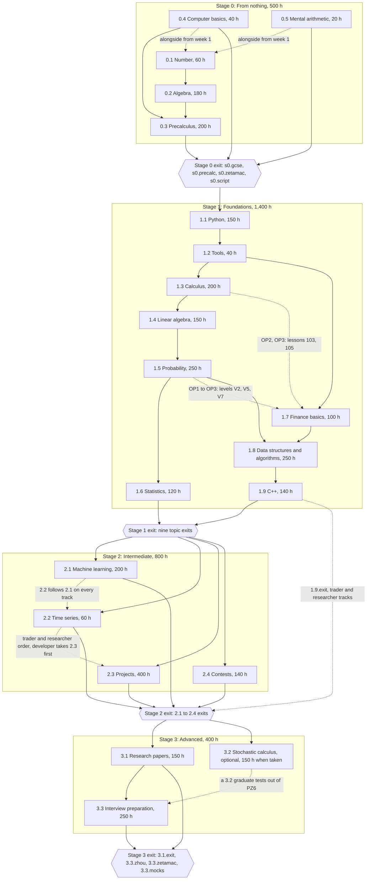

# Zero to Quant: curriculum index

Blueprint, Stage 2 Phase 1. Draft 1, 6 October 2026.

**What this is.** The one index of the curriculum as the eleven item files in `docs/curriculum/` define it: every stage, item, course and level with its lesson count (section 1); every item's hours against `docs/curriculum.md` (section 2); the prerequisite graph (section 3); where every quiz, homework set, topic paper and exit test sits (section 4); the resource canon in summary (section 5); and, kept apart and not merged, the additions `docs/blueprint/work/canon-gap.md` proposes for the owner (section 6). Sections 7 and 8 list what other papers must still settle and the small fixes this pass made to the item files.

**Sources of truth.** `docs/curriculum.md`, the owner's, for stages, items, hours and exit lines. The item files for courses, levels, lessons, homework, papers and reading. `canon-gap.md` revision 2 for the canon and the proposals. Where two of them disagree, this index says so and names the one it follows.

**How the numbers were produced.** A script parsed every course heading, level heading and lesson row in section 2 of each item file (2,148 lesson rows), compared them with the counts each file declares, checked every id against `CONTENT-FORMAT.md` 4.1, resolved each cross-file lesson reference written as "item lesson N" (about 470 of them) against the title of the lesson it points to, and summed every hours table. It is a scratch check; the build's CI (`CONTENT-FORMAT.md` 6.7) replaces it, and section 7 asks CI to regenerate this index's tables from the lesson files. Results of that run are tagged [measured]; every other figure is quoted from the file named beside it.

**Writing conventions.** Lesson time is 15 minutes including the quiz in every item file, so lesson hours are lessons $\times 0.25$. Course and level codes (W, P, W1, KC3) are document shorthand scoped to one item; the same letter recurs across items (Y, B and A in 0.4, 0.5 and 1.1; N, H, V and Z in 1.4 and 1.5; CP in 1.9 and 2.1). The app computes display numbers from position and content refers to courses only by id (`CONTENT-FORMAT.md` 4.1).

---

## 0. Summary

### 0.1 Totals [measured]

| | Stage 0 | Stage 1 | Stage 2 | Stage 3 | Path | 3.2 (optional) | Path with 3.2 |
|---|---|---|---|---|---|---|---|
| Hours (`curriculum.md`) | 500 | 1,400 | 800 | 400 | **3,100** | not counted; 150 when taken | 3,250 |
| Items | 5 | 9 | 4 | 2 | **20** | 1 | 21 |
| Courses | 15 | 38 | 17 | 10 | **80** | 5 | 85 |
| Levels | 67 | 167 | 93 | 50 | **377** | 20 | 397 |
| Lessons | 346 | 928 | 508 | 262 | **2,044** | 104 | 2,148 |
| Lesson hours | 86.5 | 232.0 | 127.0 | 65.5 | **511.0** | 26.0 | 537.0 |
| Homework sets | 67 | 167 | 89 and 4 milestone packs | 50 | **373 and 4 packs** | 20 | 393 and 4 packs |
| In-app topic papers agreed by `ASSESSMENT.md` 2.8 | 3 | 9 | 2 | 0 | **14** | 1 | 15 |
| Topic papers proposed by item files | 0 | 0 | 1, and 3 Arena rounds | 2 | **3 and 3 rounds** | 0 | |
| Exit parts | 4 stage parts, 3 topic parts | 9 | 3, and 1 proposed | 4, and 1 proposed | **23, and 2 proposed** | 1 proposed | |

Every lesson ends in a quiz and every level in a level review, so the path holds 2,044 lesson quizzes and 377 level reviews. Lessons take 16.5% of the path's hours; the rest is homework (23.2%), projects and drills (22.8%), reading and lectures (21.4%), practice and redo (12.1%) and papers (4.0%) [measured, section 2].

### 0.2 What this pass found

- **The files agree with themselves.** Every count a course heading, level heading or summary table declares equals its rows; lesson numbers run without gaps from 1 in every item; every level has 4 to 7 lessons, as `Level.lessons` requires; all 2,148 lesson ids are unique and match the `Id()` pattern; every hours table sums to its item's curriculum hours exactly; lesson hours equal lessons $\times 0.25$ everywhere [measured].
- **The files agree with each other, with seven kinds of exception, all fixed in eight changes** (section 8): a library namespace two topics shared (`alg`, used by 0.2 Algebra and 1.8 Algorithms); 93 lesson ids written in a short form outside their course namespace; 16 source ids that duplicated canon ids; one out-of-range lesson reference; two exit-table rows in the Stage 3 file that predated the 2.1 and 3.1 file; a missing topic exit part for 0.3; and stale revision 1 hours for three canon-gap proposals in two files.
- **Hours reconcile for all 20 counted items.** 3.2 is the one flag: the owner's "optional, hours not counted" against its file's 150 hours for a learner who opts in, which the schema cannot yet express (section 2.2).
- **Ten items do not yet map their hours to estimate units**, which CI's 10% rule needs (section 2.2). Section 7 lists what `CONTENT-FORMAT.md`, `ASSESSMENT.md`, the compiler and `canon-gap.md` must still settle.
- **The canon** is 267 works in `canon-gap.md` section 6 plus 131 new ids the item files cite, about 398 works for `content/sources.yaml` (section 5.3).

### 0.3 Decisions made here

The item files left a few ids and one counting rule open. The build needs them fixed before the first `curriculum.yaml` is written.

| # | Decision | Chosen | Rejected | Reason |
|---|---|---|---|---|
| 1 | Topic ids for the 14 topics no file named | **Full words**: `top.precalculus`, `top.computing`, `top.mental-arithmetic`, `top.calculus`, `top.linear-algebra`, `top.probability`, `top.statistics`, `top.finance`, `top.machine-learning`, `top.time-series`, `top.projects`, `top.research-papers`, `top.stochastic-calculus`, `top.interview` | The library namespaces as topic ids (`top.pre`, `top.ts`) | The seven ids the files already wrote are full words (`top.number`, `top.algebra`, `top.python`, `top.tools`, `top.algorithms`, `top.cpp`, `top.contests`); topic ids appear in the owner's diffs and in the app's routes, where words read better than abbreviations |
| 2 | Stage ids | **`stg.s0` to `stg.s3`** | `stg.0` to `stg.3`; `stg.stage-0` | Matches the `s0.` prefix the Stage 0 exit parts already use (`s0.gcse`) |
| 3 | Track ids | **`trk.trader`, `trk.researcher`, `trk.developer`**; `trk.derivatives` for the 3.2 add-on, which `3.2.done` already names in its `track` field; `trk.ml-research` reserved for canon-gap P14 if accepted | Ids per proposal | The curriculum's three tracks plus the two the files and proposals already use; the `TrackName` pattern takes them as written |
| 4 | 1.8's library namespace | **`dsa`** (section 8, fix 1) | Renaming 0.2's `alg` instead | 0.2 is built first in depth-first order and `stage1-python-tools.md` cites its `prj.alg.root-finder`; no paper outside `stage1-dsa-cpp.md` cites a 1.8 library id, so the rename touches one file |
| 5 | How 3.2 is counted here | **Outside the path**: the owner's 3,100 hours stand and 3.2's 150 hours appear as "when taken" | Adding 150 to Stage 3 | The curriculum says "hours not counted"; counting them is canon-gap decision 4 and P16, the owner's call (section 6) |
| 6 | What this index lists | **Stages, items, courses and levels**; lessons stay in the item files | Copying all 2,148 lesson rows here | One place per fact. A second copy of the lesson tables would drift; CI can regenerate this index's counts from the lesson files (section 7, request 5) |

---

## 1. Hierarchy

**Items at a glance** [measured]. "Library" is the topic namespace for skills, misconceptions, generators, drills and glossary terms (`skl.<ns>.*` and so on); lessons use their course as namespace.

| Item | Topic id | Library | Hours | Courses | Levels | Lessons | Lesson hours | Item file |
|---|---|---|---|---|---|---|---|---|
| 0.1 Number | `top.number` | `num` | 60 | 2 | 8 | 42 | 10.5 | `stage0-number-algebra.md` |
| 0.2 Algebra | `top.algebra` | `alg` | 180 | 4 | 19 | 111 | 27.75 | `stage0-number-algebra.md` |
| 0.3 Precalculus | `top.precalculus` | `pre` | 200 | 5 | 29 | 146 | 36.5 | `stage0-precalc-computing.md` |
| 0.4 Computer basics | `top.computing` | `comp` | 40 | 3 | 7 | 31 | 7.75 | `stage0-precalc-computing.md` |
| 0.5 Mental arithmetic | `top.mental-arithmetic` | `ment` | 20 | 1 | 4 | 16 | 4.0 | `stage0-precalc-computing.md` |
| 1.1 Python | `top.python` | `py` | 150 | 4 | 19 | 107 | 26.75 | `stage1-python-tools.md` |
| 1.2 Tools | `top.tools` | `tools` | 40 | 1 | 7 | 32 | 8.0 | `stage1-python-tools.md` |
| 1.3 Calculus | `top.calculus` | `calc` | 200 | 5 | 25 | 137 | 34.25 | `stage1-calculus.md` |
| 1.4 Linear algebra | `top.linear-algebra` | `linalg` | 150 | 5 | 18 | 98 | 24.5 | `stage1-linear-algebra.md` |
| 1.5 Probability | `top.probability` | `prob` | 250 | 5 | 27 | 156 | 39.0 | `stage1-probability.md` |
| 1.6 Statistics | `top.statistics` | `stats` | 120 | 4 | 15 | 80 | 20.0 | `stage1-statistics-ts.md` |
| 1.7 Finance basics | `top.finance` | `fin` | 100 | 5 | 14 | 80 | 20.0 | `stage1-finance-projects.md` |
| 1.8 Data structures and algorithms | `top.algorithms` | `dsa` | 250 | 5 | 26 | 150 | 37.5 | `stage1-dsa-cpp.md` |
| 1.9 C++ | `top.cpp` | `cpp` | 140 | 4 | 16 | 88 | 22.0 | `stage1-dsa-cpp.md` |
| 2.1 Machine learning | `top.machine-learning` | `ml` | 200 | 5 | 29 | 152 | 38.0 | `stage2-ml-papers.md` |
| 2.2 Time series | `top.time-series` | `ts` | 60 | 3 | 8 | 43 | 10.75 | `stage1-statistics-ts.md` |
| 2.3 Projects | `top.projects` | `proj` | 400 | 5 | 41 | 229 | 57.25 | `stage1-finance-projects.md` |
| 2.4 Contests | `top.contests` | `cp` | 140 | 4 | 15 | 84 | 21.0 | `stage1-dsa-cpp.md` |
| 3.1 Research papers | `top.research-papers` | `papers` | 150 | 5 | 22 | 108 | 27.0 | `stage2-ml-papers.md` |
| 3.2 Stochastic calculus | `top.stochastic-calculus` | `stoch` | optional (150 when taken) | 5 | 20 | 104 | 26.0 | `stage3-stochastic-interview.md` |
| 3.3 Interview preparation | `top.interview` | `iv` | 250 | 5 | 28 | 154 | 38.5 | `stage3-stochastic-interview.md` |

**Shape** [measured]. Eleven topics have 5 courses, five have 4, two have 3, one has 2 and two have 1. Levels hold 4 to 7 lessons everywhere. Courses run from 8 lessons (`crs.keys`) to 50 (`crs.systems`); 22 of the 85 courses fall outside design research 8.2's guide of 20 to 45 lessons (all of 0.4, 0.5 and 1.7's courses, three of 1.4's, three of 2.2 and 1.6 together, two of 2.4's, two of 3.2's, `crs.pairs`, and 2.3's `crs.method` and `crs.systems`). The guide is not a schema rule; the files that set short courses say why (for example, 1.7 runs alongside 1.3 to 1.6 and unlocks course by course).

Course tables follow, in path order. Levels are listed as code, name and lesson count; "Numbers" is the course's lesson numbers within its item.

### Stage 0: From nothing (500 h)

#### 0.1 Number (60 h)

`top.number`, libraries `num`. 2 courses, 8 levels, 42 lessons (10.5 lesson hours). Source: `docs/curriculum/stage0-number-algebra.md`. Sample lesson written in full: `lsn.numwork.digit-worth`.

| Code | Course | Id | Levels (lessons) | Lessons | Numbers |
|---|---|---|---|---|---|
| W | How Numbers Work | `crs.numwork` | W1 Place value and calculation (5); W2 Negative numbers and the laws of arithmetic (5); W3 Factors, primes and counting (6); W4 Fractions (5) | 21 | 1 to 21 |
| P | Proportion, Powers and Precision | `crs.propprec` | P1 Decimals and percentages (5); P2 Ratio, rates and proportion (5); P3 Powers and roots (5); P4 Precision, estimation and the real numbers (6) | 21 | 22 to 42 |

#### 0.2 Algebra (180 h)

`top.algebra`, libraries `alg`. 4 courses, 19 levels, 111 lessons (27.75 lesson hours). Source: `docs/curriculum/stage0-number-algebra.md`.

| Code | Course | Id | Levels (lessons) | Lessons | Numbers |
|---|---|---|---|---|---|
| E | Expressions and Equations | `crs.expreq` | E1 Letters for numbers (6); E2 Brackets and factorising (5); E3 Algebraic fractions, indices, sums and proof (6); E4 Linear equations (6); E5 Formulae and changing the subject (5); E6 Inequalities (6) | 34 | 1 to 34 |
| L | Lines and Linear Systems | `crs.lines` | L1 Coordinates and straight lines (7); L2 Linear graphs in the world (6); L3 Simultaneous linear equations (7) | 20 | 35 to 54 |
| Q | Quadratics and Polynomials | `crs.quadpoly` | Q1 Factorising quadratics (6); Q2 Completing the square and the formula (6); Q3 Quadratic graphs, circles and systems (6); Q4 Optimising with quadratics (5); Q5 Polynomials (6); Q6 Complex numbers (4) | 33 | 55 to 87 |
| F | Functions and Graphs | `crs.funcs` | F1 Functions (6); F2 A gallery of graphs (7); F3 Transformations and symmetry (5); F4 Solving equations with graphs, iteration and rates (6) | 24 | 88 to 111 |

#### 0.3 Precalculus (200 h)

`top.precalculus`, libraries `pre`. 5 courses, 29 levels, 146 lessons (36.5 lesson hours). Source: `docs/curriculum/stage0-precalc-computing.md`. Sample lesson written in full: `lsn.growth.log-as-count`.

| Code | Course | Id | Levels (lessons) | Lessons | Numbers |
|---|---|---|---|---|---|
| S | Shape and Space | `crs.shape` | S1 Angles and polygons (4); S2 Area and volume (5); S3 Pythagoras, congruence and similarity (5); S4 Transformations and constructions (4); S5 Circle theorems (5); S6 Right-angled trigonometry (5); S7 Any triangle (4); S8 Vectors (6) | 38 | 1 to 38 |
| G | Growth: Sequences, Series, Exponentials and Logarithms | `crs.growth` | G1 Sequences and recurrences (5); G2 Exponential functions (5); G3 Logarithms (6); G4 Modelling with exponentials and logarithms (5); G5 Series (6) | 27 | 39 to 65 |
| T | Circles, Waves and Rotations | `crs.waves` | T1 Radians and the unit circle (5); T2 Waves (5); T3 Identities and equations (6); T4 Compound angles (5); T5 Matrices (6); T6 Complex numbers in polar form (5) | 32 | 66 to 97 |
| C | Counting, Chance and Data | `crs.chance` | C1 Counting arrangements (5); C2 Counting principles (4); C3 The binomial theorem (5); C4 Probability (6); C5 Data and statistics (6) | 26 | 98 to 123 |
| R | Proof, Limits and Curves | `crs.rigour` | R1 Logic and proof (5); R2 Proof by induction (4); R3 Rational functions and partial fractions (4); R4 Conics and parametric curves (5); R5 Limits and continuity (5) | 23 | 124 to 146 |

#### 0.4 Computer basics (40 h)

`top.computing`, libraries `comp`. 3 courses, 7 levels, 31 lessons (7.75 lesson hours). Source: `docs/curriculum/stage0-precalc-computing.md`.

| Code | Course | Id | Levels (lessons) | Lessons | Numbers |
|---|---|---|---|---|---|
| K | Keyboard Fluency | `crs.keys` | K1 The home row and technique (4); K2 Every key, and the shortcuts (4) | 8 | 1 to 8 |
| B | Workbench: Files, Terminal and Editor | `crs.bench` | B1 Files and folders (4); B2 The terminal (5); B3 Installing tools and the editor (4) | 13 | 9 to 21 |
| Y | First Programs in Python | `crs.firstpy` | Y1 Values, variables and decisions (5); Y2 Loops, functions and errors (5) | 10 | 22 to 31 |

#### 0.5 Mental arithmetic (20 h)

`top.mental-arithmetic`, libraries `ment`. 1 course, 4 levels, 16 lessons (4 lesson hours). Source: `docs/curriculum/stage0-precalc-computing.md`.

| Code | Course | Id | Levels (lessons) | Lessons | Numbers |
|---|---|---|---|---|---|
| A | Arithmetic at Speed | `crs.speed` | A1 Tables and the Zetamac format (4); A2 Adding and subtracting fast (4); A3 Multiplying beyond the tables (4); A4 Fractions, decimals, percentages and estimates (4) | 16 | 1 to 16 |

### Stage 1: Foundations (1,400 h)

#### 1.1 Python (150 h)

`top.python`, libraries `py`. 4 courses, 19 levels, 107 lessons (26.75 lesson hours). Source: `docs/curriculum/stage1-python-tools.md`. Sample lesson written in full: `lsn.pythink.names-objects`.

| Code | Course | Id | Levels (lessons) | Lessons | Numbers |
|---|---|---|---|---|---|
| Y | Thinking in Python | `crs.pythink` | Y1 Objects, names and numbers (6); Y2 Text (4); Y3 Control flow (5); Y4 Functions (6); Y5 Collections (7) | 28 | 1 to 28 |
| B | Building Real Programs | `crs.pybuild` | B1 Iteration and functional tools (5); B2 Errors and debugging (5); B3 Files and the outside world (6); B4 Modules, environments and readable code (4); B5 Objects and types (7) | 27 | 29 to 55 |
| A | Arrays and Simulation | `crs.arrays` | A1 Arrays (6); A2 Computing with arrays (7); A3 Randomness and simulation (7) | 20 | 56 to 75 |
| D | Data, Time Series and Charts | `crs.dataframes` | D1 Series and DataFrames (6); D2 Loading and cleaning (4); D3 Combining and reshaping (6); D4 Time series (7); D5 Plotting and communicating (5); D6 Workflow and the exit (4) | 32 | 76 to 107 |

#### 1.2 Tools (40 h)

`top.tools`, libraries `tools`. 1 course, 7 levels, 32 lessons (8 lesson hours). Source: `docs/curriculum/stage1-python-tools.md`.

| Code | Course | Id | Levels (lessons) | Lessons | Numbers |
|---|---|---|---|---|---|
| T | Tools of the Trade | `crs.toolkit` | T1 The shell (4); T2 Working in the shell (4); T3 Git foundations (5); T4 Git collaboration (5); T5 Testing with pytest (6); T6 SQL queries (4); T7 SQL for analysis and change (4) | 32 | 1 to 32 |

#### 1.3 Calculus (200 h)

`top.calculus`, libraries `calc`. 5 courses, 25 levels, 137 lessons (34.25 lesson hours). Source: `docs/curriculum/stage1-calculus.md`. Sample lesson written in full: `lsn.deriv.instant-speed`.

| Code | Course | Id | Levels (lessons) | Lessons | Numbers |
|---|---|---|---|---|---|
| D | Limits and the Derivative | `crs.deriv` | D1 Rates and limits (7); D2 The derivative (6); D3 Rules of differentiation (7); D4 Inverses, implicit curves and related rates (5); D5 Derivatives computed and proved (4) | 29 | 1 to 29 |
| U | Using the Derivative: Approximation, Shape and Optimisation | `crs.deriv-apps` | U1 Approximation (5); U2 Extremes and the mean value theorem (4); U3 The shape of a graph (5); U4 Optimisation (6); U5 Convexity (4) | 24 | 30 to 53 |
| I | The Integral: Accumulation, Area and Probability | `crs.integral` | I1 Area and the definite integral (4); I2 The fundamental theorem (5); I3 Techniques of integration (7); I4 Improper integrals, densities and numerical integration (6); I5 Geometry and physics of integrals (6); I6 Differential equations (4) | 32 | 54 to 85 |
| X | Series and Expansions | `crs.series` | X1 Convergence (7); X2 Power series and asymptotics (6); X3 Taylor series (7) | 20 | 86 to 105 |
| M | Many Variables: Gradients, Constraints and Multiple Integrals | `crs.multivar` | M1 Functions of several variables (6); M2 The chain rule and the gradient (6); M3 Optimisation in several variables (6); M4 Lagrange multipliers (5); M5 Double integrals (5); M6 Change of variables and probability (4) | 32 | 106 to 137 |

#### 1.4 Linear algebra (150 h)

`top.linear-algebra`, libraries `linalg`. 5 courses, 18 levels, 98 lessons (24.5 lesson hours). Source: `docs/curriculum/stage1-linear-algebra.md`. Sample lesson written in full: `lsn.elimination.matrix-times-vector`.

| Code | Course | Id | Levels (lessons) | Lessons | Numbers |
|---|---|---|---|---|---|
| V | Vectors, Matrices and Elimination | `crs.elimination` | V1 Combinations and the column picture (5); V2 Elimination (7); V3 Structure, cost and meaning (6) | 18 | 1 to 18 |
| N | Spaces, Rank and the Four Subspaces | `crs.subspaces` | N1 Vector spaces and the nullspace (5); N2 Rank, independence and dimension (5); N3 The four fundamental subspaces (4); N4 Bases, coordinates and linear transformations (5) | 19 | 19 to 37 |
| O | Orthogonality and Least Squares | `crs.orthogonality` | O1 Orthogonality and projections (5); O2 Least squares in practice (6); O3 Orthonormal bases and QR (5) | 16 | 38 to 53 |
| H | Hidden Directions: Determinants and Eigenvalues | `crs.eigen` | H1 Determinants (6); H2 Eigenvalues and eigenvectors (6); H3 Dynamics (6); H4 Symmetric and complex matrices (5) | 23 | 54 to 76 |
| Z | Data Matrices: Positive Definiteness, the SVD and PCA | `crs.svd` | Z1 Positive definite matrices (6); Z2 The singular value decomposition (6); Z3 Principal component analysis (6); Z4 Matrices in learning and risk (4) | 22 | 77 to 98 |

#### 1.5 Probability (250 h)

`top.probability`, libraries `prob`. 5 courses, 27 levels, 156 lessons (39 lesson hours). Source: `docs/curriculum/stage1-probability.md`. Sample lesson written in full: `lsn.count.equally-likely-outcomes`.

| Code | Course | Id | Levels (lessons) | Lessons | Numbers |
|---|---|---|---|---|---|
| N | Counting and Chance | `crs.count` | N1 Outcomes and the naive definition (6); N2 Stories and symmetry (5); N3 The axioms of probability (6); N4 First interview patterns (5) | 22 | 1 to 22 |
| H | Conditional Probability and Bayes | `crs.cond` | H1 Updating on evidence (5); H2 Bayes' rule (6); H3 Independence (5); H4 Puzzles that fool experts (6) | 22 | 23 to 44 |
| V | Random Variables and Their Distributions | `crs.rv` | V1 Random variables and distributions (6); V2 Expectation (6); V3 Waiting times and rare events (6); V4 Expectation puzzles (6); V5 Continuous random variables (7); V6 Moments and generating functions (6); V7 Gamma, Beta and their relatives (6) | 43 | 45 to 87 |
| J | Joint Distributions, Conditional Expectation and Limit Theorems | `crs.joint` | J1 Joint, marginal and conditional (6); J2 Covariance and correlation (5); J3 Transformations and the multivariate normal (7); J4 Conditional expectation (6); J5 Inequalities (4); J6 Laws of large numbers and the central limit theorem (7) | 35 | 88 to 122 |
| Z | Markov Chains, Random Walks and Interview Problems | `crs.markov` | Z1 Markov chains (6); Z2 Markov chains at work (6); Z3 Random walks (6); Z4 Fair games and stopping times (5); Z5 Geometric probability (5); Z6 Games, stopping and betting (6) | 34 | 123 to 156 |

#### 1.6 Statistics (120 h)

`top.statistics`, libraries `stats`. 4 courses, 15 levels, 80 lessons (20 lesson hours). Source: `docs/curriculum/stage1-statistics-ts.md`. Sample lesson written in full: `lsn.estimators.standard-error`.

| Code | Course | Id | Levels (lessons) | Lessons | Numbers |
|---|---|---|---|---|---|
| ES | Estimators and Their Errors | `crs.estimators` | ES1 Sampling distributions (5); ES2 Judging estimators (5); ES3 Maximum likelihood (5); ES4 Large-sample theory (5) | 20 | 1 to 20 |
| IT | Intervals and Tests | `crs.testing` | IT1 Confidence intervals (5); IT2 Hypothesis tests (6); IT3 The testing toolkit (6); IT4 Many tests at once (5) | 22 | 21 to 42 |
| RG | Linear Regression | `crs.linreg` | RG1 The model (5); RG2 Inference for coefficients (6); RG3 When the assumptions fail (6); RG4 Multiple regression in practice (6); RG5 The summary table and the exit (4) | 27 | 43 to 69 |
| BY | Bayesian Inference | `crs.bayesian` | BY1 Updating (5); BY2 Priors, shrinkage and computation (6) | 11 | 70 to 80 |

#### 1.7 Finance basics (100 h)

`top.finance`, libraries `fin`. 5 courses, 14 levels, 80 lessons (20 lesson hours). Source: `docs/curriculum/stage1-finance-projects.md`. Sample lesson written in full: `lsn.rates.present-value`.

| Code | Course | Id | Levels (lessons) | Lessons | Numbers |
|---|---|---|---|---|---|
| RB | Rates and Bonds | `crs.rates` | RB1 Interest and present value (6); RB2 Bonds and yields (6); RB3 Interest-rate risk and swaps (4) | 16 | 1 to 16 |
| EQ | Shares and Portfolios | `crs.equity` | EQ1 Shares and how they pay (6); EQ2 Risk, return and the market (6) | 12 | 17 to 28 |
| MK | Exchanges and the Order Book | `crs.markets` | MK1 The limit order book (6); MK2 Auctions, venues and the trade cycle (4); MK3 Why spreads exist, and what trading costs (7) | 17 | 29 to 45 |
| DV | Forwards, Futures and Options | `crs.derivatives` | DV1 Forwards and futures (7); DV2 Option payoffs and strategies (5); DV3 No-arbitrage bounds and put-call parity (6) | 18 | 46 to 63 |
| OP | Pricing Options | `crs.pricing` | OP1 Binomial trees (7); OP2 Black-Scholes (4); OP3 Greeks, hedging and implied volatility (6) | 17 | 64 to 80 |

#### 1.8 Data structures and algorithms (250 h)

`top.algorithms`, libraries `dsa`. 5 courses, 26 levels, 150 lessons (37.5 lesson hours). Source: `docs/curriculum/stage1-dsa-cpp.md`. Sample lesson written in full: `lsn.algcost.doubling`.

| Code | Course | Id | Levels (lessons) | Lessons | Numbers |
|---|---|---|---|---|---|
| AC | Algorithmic Cost | `crs.algcost` | AC1 How Cost Grows (7); AC2 Recursion and Proof (6); AC3 Sorting (6); AC4 Selection and Order in Practice (4) | 23 | 1 to 23 |
| AH | Arrays, Hashing and Pointers | `crs.arrayhash` | AH1 Arrays and Hash Tables (6); AH2 Two Pointers (5); AH3 Sliding Windows (6); AH4 Prefix Sums (5); AH5 Binary Search (6); AH6 Intervals (5) | 33 | 24 to 56 |
| SQ | Stacks, Lists and Heaps | `crs.linear` | SQ1 Stacks (5); SQ2 Queues and Linked Lists (7); SQ3 Heaps (6); SQ4 Randomised Structures and Streams (4) | 22 | 57 to 78 |
| TG | Trees and Graphs | `crs.treesgraphs` | TG1 Binary Trees (6); TG2 Search Trees and Tries (6); TG3 Graphs and Traversal (7); TG4 Weighted Graphs (6); TG5 Graph Techniques (6) | 31 | 79 to 109 |
| DP | Recursion, Dynamic Programming and Greedy | `crs.dynprog` | DP1 Backtracking (6); DP2 From Recursion to Dynamic Programming (6); DP3 Two-Dimensional DP (6); DP4 Designing Dynamic Programmes (5); DP5 Greedy Algorithms (5); DP6 Bits and Integer Maths (6); DP7 Hard Problems and the Method (7) | 41 | 110 to 150 |

#### 1.9 C++ (140 h)

`top.cpp`, libraries `cpp`. 4 courses, 16 levels, 88 lessons (22 lesson hours). Source: `docs/curriculum/stage1-dsa-cpp.md`.

| Code | Course | Id | Levels (lessons) | Lessons | Numbers |
|---|---|---|---|---|---|
| CB | C++ Foundations | `crs.cppcore` | CB1 From Source to Program (5); CB2 Types and Arithmetic (6); CB3 Functions and Files (6); CB4 First Containers, Algorithms and Tests (5) | 22 | 1 to 22 |
| CM | Memory and Ownership | `crs.cppmemory` | CM1 The Memory Model (6); CM2 Classes and Invariants (6); CM3 Copying and Moving (6); CM4 Polymorphism and Design (6) | 24 | 23 to 46 |
| CL | Generic Code and the Standard Library | `crs.cppstl` | CL1 Templates (5); CL2 Containers (6); CL3 Algorithms (5); CL4 Randomness and Numerics (5) | 21 | 47 to 67 |
| CP | Performance and the Pricer | `crs.cpppricing` | CP1 Tools of a C++ Engineer (5); CP2 Performance (6); CP3 The Binomial Pricer in C++ (6); CP4 First Contact with Concurrency (4) | 21 | 68 to 88 |

### Stage 2: Intermediate (800 h)

#### 2.1 Machine learning (200 h)

`top.machine-learning`, libraries `ml`. 5 courses, 29 levels, 152 lessons (38 lesson hours). Source: `docs/curriculum/stage2-ml-papers.md`. Sample lesson written in full: `lsn.learning.unseen-data`.

| Code | Course | Id | Levels (lessons) | Lessons | Numbers |
|---|---|---|---|---|---|
| LD | Learning from Data | `crs.learning` | LD1 The learning problem (5); LD2 Bias and variance (5); LD3 Loss, likelihood and information (6); LD4 Fitting by optimisation (6); LD5 Validation and cross-validation (6); LD6 Model selection and the bootstrap (5) | 33 | 1 to 33 |
| LS | Linear Models and Shrinkage | `crs.shrinkage` | LS1 Linear regression as a predictor (6); LS2 Beyond linearity (5); LS3 Ridge (5); LS4 The lasso and the elastic net (6); LS5 High dimensions (4) | 26 | 34 to 59 |
| CP | Classification and Probabilities | `crs.classify` | CP1 Logistic regression (6); CP2 Generative classifiers (5); CP3 Evaluating classifiers (6); CP4 Probabilities you can bet on (5); CP5 Margins and kernels (4) | 26 | 60 to 85 |
| TN | Trees, Ensembles and Networks | `crs.ensembles` | TN1 Decision trees (6); TN2 Bagging and random forests (4); TN3 Boosting (6); TN4 Interpreting models (5); TN5 Neural networks: representation (4); TN6 Neural networks: training (6) | 31 | 86 to 116 |
| FD | Machine Learning on Financial Data | `crs.finml` | FD1 Validation through time (6); FD2 Leakage (6); FD3 Labels and sample weights (5); FD4 Features from market data (5); FD5 Unsupervised learning: structure in returns (5); FD6 Overfitting by search (4); FD7 Capstone and exit (5) | 36 | 117 to 152 |

#### 2.2 Time series (60 h)

`top.time-series`, libraries `ts`. 3 courses, 8 levels, 43 lessons (10.75 lesson hours). Source: `docs/curriculum/stage1-statistics-ts.md`.

| Code | Course | Id | Levels (lessons) | Lessons | Numbers |
|---|---|---|---|---|---|
| SM | Stationary Models | `crs.arma` | SM1 Prices, returns and stationarity (5); SM2 Autocorrelation (5); SM3 ARMA models (6); SM4 Forecasting and evaluation (5) | 21 | 1 to 21 |
| VL | Volatility | `crs.volatility` | VL1 Volatility clustering and its models (5); VL2 Fitting, forecasting and risk (5) | 10 | 22 to 31 |
| CO | Unit Roots and Cointegration | `crs.cointegration` | CO1 Unit roots and spurious regression (5); CO2 Cointegration and pairs (7) | 12 | 32 to 43 |

#### 2.3 Projects (400 h)

`top.projects`, libraries `proj`. 5 courses, 41 levels, 229 lessons (57.25 lesson hours). Source: `docs/curriculum/stage1-finance-projects.md`.

| Code | Course | Id | Levels (lessons) | Lessons | Numbers |
|---|---|---|---|---|---|
| RM | Research Method | `crs.method` | RM1 Questions and data (6); RM2 Measuring performance (6); RM3 Is it real? Inference for one strategy (6); RM4 Many trials, one winner (6); RM5 Validation through time (6); RM6 Reproducible research engineering (6); RM7 Writing and defending results (5); RM8 The empirical finance toolkit (6) | 47 | 1 to 47 |
| BT | The Backtesting Engine | `crs.backtest` | BT1 What a backtest is (6); BT2 Portfolio accounting (6); BT3 Fills, costs and constraints (6); BT4 Biases you can switch on (6); BT5 Sizing and risk control (6); BT6 Strategies to test the engine on (5); BT7 Architecture, tests and speed (5); BT8 Project 1, the backtesting engine (4) | 44 | 48 to 91 |
| AR | Alpha Research and Portfolio Construction | `crs.alpha` | AR1 Universes and signals (6); AR2 Cleaning and neutralising signals (6); AR3 Measuring predictive power (7); AR4 Factor models and risk models (6); AR5 From signal to portfolio (6); AR6 Honest alpha research (5); AR7 Signals beyond price, and machine learning (5); AR8 Project 2, alpha signal research (4) | 45 | 92 to 136 |
| OA | Options Analytics | `crs.options-analytics` | OA1 Option data (5); OA2 Implied volatility numerics (5); OA3 Smiles and surfaces (6); OA4 No arbitrage on the surface, and fitting (6); OA5 Three pricers compared, and a fourth (7); OA6 Greeks and risk in practice (5); OA7 Volatility as a traded quantity (5); OA8 Project 3, the options analytics dashboard (4) | 43 | 137 to 179 |
| MS | Market Data and Trading Systems | `crs.systems` | MS1 Feeds and messages (6); MS2 Rebuilding the book (6); MS3 Time and candles (6); MS4 Latency and throughput (6); MS5 Storage and replay (6); MS6 Performance engineering (5); MS7 Orders and the trading system (6); MS8 Running a system safely (5); MS9 Projects 4 and 5 (4) | 50 | 180 to 229 |

#### 2.4 Contests (140 h)

`top.contests`, libraries `cp`. 4 courses, 15 levels, 84 lessons (21 lesson hours). Source: `docs/curriculum/stage1-dsa-cpp.md`.

| Code | Course | Id | Levels (lessons) | Lessons | Numbers |
|---|---|---|---|---|---|
| KC | Contest Craft | `crs.contestcraft` | KC1 How Contests Work (5); KC2 Ad Hoc Thinking (6); KC3 Searching under Contest Limits (4); KC4 Practice Discipline and Other Competitions (6) | 21 | 1 to 21 |
| KM | Contest Mathematics | `crs.contestmath` | KM1 Primes and Divisibility (6); KM2 Modular Arithmetic (5); KM3 Counting (5); KM4 Probability and Games (6); KM5 Integer Geometry (4) | 26 | 22 to 47 |
| KS | Contest Data Structures and Graphs | `crs.contestds` | KS1 Range Queries (6); KS2 Trees at Scale (6); KS3 Graphs at Scale (7) | 19 | 48 to 66 |
| KD | Contest Techniques: DP and Strings | `crs.contestdp` | KD1 DP Techniques (6); KD2 Strings (6); KD3 Techniques for Hard Constraints (6) | 18 | 67 to 84 |

### Stage 3: Advanced (400 h)

#### 3.1 Research papers (150 h)

`top.research-papers`, libraries `papers`. 5 courses, 22 levels, 108 lessons (27 lesson hours). Source: `docs/curriculum/stage2-ml-papers.md`.

| Code | Course | Id | Levels (lessons) | Lessons | Numbers |
|---|---|---|---|---|---|
| MP | Reading Papers and Replicating Momentum | `crs.momentum` | MP1 How to read an empirical paper (5); MP2 The replication method (5); MP3 Momentum: the strategy (6); MP4 What explains momentum (5); MP5 Replicating Jegadeesh and Titman (4) | 25 | 1 to 25 |
| FF | Factor Models: Fama and French | `crs.factors` | FF1 The CAPM and its failure (5); FF2 Building the factors (5); FF3 Time-series regressions and the GRS test (5); FF4 Beyond three factors (5); FF5 Replicating Fama and French (4) | 24 | 26 to 49 |
| PS | Pairs Trading and Statistical Arbitrage | `crs.pairs` | PS1 The distance method (6); PS2 What the paper found, and why (5); PS3 Statistical arbitrage models (4); PS4 Replicating Gatev, Goetzmann and Rouwenhorst (4) | 19 | 50 to 68 |
| MM | Market Making: Avellaneda and Stoikov | `crs.making` | MM1 The market maker's problem (5); MM2 The Avellaneda-Stoikov solution (6); MM3 Simulating the paper (5); MM4 Beyond the paper (4) | 20 | 69 to 88 |
| WS | What Survives: Multiple Testing and Replication | `crs.survival` | WS1 The factor zoo (6); WS2 The replication evidence (5); WS3 Machine learning meets the cross-section (4); WS4 The exit: your replication (5) | 20 | 89 to 108 |

#### 3.2 Stochastic calculus (optional: hours not counted in the 3,100; 150 h when taken)

`top.stochastic-calculus`, libraries `stoch`. 5 courses, 20 levels, 104 lessons (26 lesson hours). Source: `docs/curriculum/stage3-stochastic-interview.md`. Sample lesson written in full: `lsn.brownian.quadratic-variation`.

| Code | Course | Id | Levels (lessons) | Lessons | Numbers |
|---|---|---|---|---|---|
| AT | Arbitrage on a Tree | `crs.tree-pricing` | AT1 Replication on many periods (4); AT2 Probability on coin-toss space (5); AT3 State prices and changing measure (4); AT4 American claims and stopping times (5); AT5 Random walks and random interest rates (6) | 24 | 1 to 24 |
| BR | Measure, Information and Brownian Motion | `crs.brownian` | BR1 Probability on infinite spaces (6); BR2 Information and conditioning (5); BR3 Building Brownian motion (5); BR4 Roughness: variation and martingales (5); BR5 Hitting times and the maximum (6) | 27 | 25 to 51 |
| IC | Itô Calculus | `crs.ito` | IC1 The Itô integral (5); IC2 Itô's formula (6); IC3 Black-Scholes-Merton by replication (5); IC4 Many dimensions and simulation (4) | 20 | 52 to 71 |
| RN | Risk-Neutral Pricing and the PDE | `crs.risk-neutral` | RN1 Girsanov and the risk-neutral measure (6); RN2 Completeness, the fundamental theorems and replication (6); RN3 SDEs, Feynman-Kac and numerical pricing (6) | 18 | 72 to 89 |
| EX | Exotics, Rates and Volatility Models | `crs.exotics-rates` | EX1 Exotic and American options (5); EX2 Numéraires and interest-rate models (5); EX3 Beyond constant volatility (5) | 15 | 90 to 104 |

#### 3.3 Interview preparation (250 h)

`top.interview`, libraries `iv`. 5 courses, 28 levels, 154 lessons (38.5 lesson hours). Source: `docs/curriculum/stage3-stochastic-interview.md`.

| Code | Course | Id | Levels (lessons) | Lessons | Numbers |
|---|---|---|---|---|---|
| PZ | Probability Under the Clock | `crs.puzzles` | PZ1 Method under the clock (6); PZ2 Expectation at speed (6); PZ3 Conditional probability under pressure (6); PZ4 States, chains and games (6); PZ5 Continuous and geometric problems (6); PZ6 Stochastic processes at interview depth (6); PZ7 Solving cold (5) | 41 | 1 to 41 |
| QM | Mental Maths and Brainteasers Under Pressure | `crs.mental-pressure` | QM1 Speed formats (5); QM2 Estimation and quick quant numbers (5); QM3 Test strategy (4); QM4 Logic, invariants and constructions (6); QM5 Number puzzles (5); QM6 Calculus and linear algebra at interview speed (6) | 31 | 42 to 72 |
| MG | Bets, Markets and Market-Making Games | `crs.mm-games` | MG1 Pricing a bet (6); MG2 Sizing (5); MG3 Making markets (6); MG4 Trading games (5); MG5 Options at interview speed (6) | 28 | 73 to 100 |
| TR | Technical Rounds: Statistics, Machine Learning and Code | `crs.technical` | TR1 Statistics questions (6); TR2 Machine-learning questions (6); TR3 ML-lab depth (5); TR4 Coding rounds (6); TR5 C++ and systems questions (5); TR6 The data take-home (5) | 33 | 101 to 133 |
| IV | The Interview Itself | `crs.interview` | IV1 How interviews are marked (5); IV2 You and your work (5); IV3 The process (5); IV4 Mock interviews (6) | 21 | 134 to 154 |

---

## 2. Hours reconciliation

### 2.1 Every item against `curriculum.md` [measured]

Blocks are the item files' own hours tables. "Estimates" is what the file says the content schema carries as estimates (lesson minutes, set and paper estimates, companion hours, exit `estHours`, project milestones); CI fails a topic whose estimates miss its curriculum hours by more than 10% (`CONTENT-FORMAT.md` 6.7). "Solving" is the file's stated share of time spent solving rather than reading, against the curriculum's 60% floor (rule 2).

| Item | `curriculum.md` | File | Match | Lessons | Practice and redo | Homework | Papers and exits | Reading and lectures | Projects and drills | Estimates declared | Solving |
|---|---|---|---|---|---|---|---|---|---|---|---|
| 0.1 | 60 | 60.0 | yes | 10.5 | 12.0 | 16.0 | 3.0 | 15.0 | 3.5 | 56.75 (94.6%) | 92% |
| 0.2 | 180 | 180.0 | yes | 27.75 | 36.0 | 47.5 | 6.0 | 46.75 | 16.0 | 169.5 (94.2%) | 91% |
| 0.3 | 200 | 200.0 | yes | 36.5 | 39.75 | 50.75 | 11.5 | 47.5 | 14.0 | **not stated** | 91% |
| 0.4 | 40 | 40.0 | yes | 7.75 | 13.75 | 5.25 | 1.25 | 6.5 | 5.5 | **not stated** | 84% |
| 0.5 | 20 | 20.0 | yes | 4.0 | 11.0 | 2.0 | 0.5 | 1.5 | 1.0 | **not stated** | 92.5% (computed here: all but the reading row) |
| **Stage 0** | **500** | **500.0** | **yes** | 86.5 | 112.5 | 121.5 | 22.25 | 117.25 | 40.0 | | |
| 1.1 | 150 | 150.0 | yes | 26.75 | 24.25 | 38.0 | 4.0 | 30.0 | 27.0 | 142.25 (94.8%) | 89% |
| 1.2 | 40 | 40.0 | yes | 8.0 | 6.25 | 10.5 | 2.5 | 8.25 | 4.5 | 37.5 (93.75%) | 88% |
| 1.3 | 200 | 200.0 | yes | 34.25 | 20.25 | 50.25 | 15.0 | 61.5 | 18.75 | 186.0 (93%) | 84% |
| 1.4 | 150 | 150.0 | yes | 24.5 | 22.0 | 36.0 | 12.0 | 35.5 | 20.0 | 140.5 (93.7%) | 83.5% |
| 1.5 | 250 | 250.0 | yes | 39.0 | 33.75 | 63.5 | 20.0 | 74.25 | 19.5 | **not stated** | 81% |
| 1.6 | 120 | 120.0 | yes | 20.0 | 18.0 | 30.0 | 4.0 | 28.0 | 20.0 | **not stated** | 83% |
| 1.7 | 100 | 100.0 | yes | 20.0 | 12.0 | 26.0 | 4.0 | 26.0 | 12.0 | 94.0 (94.0%) | 72% |
| 1.8 | 250 | 250.0 | yes | 37.5 | 24.5 | 65.0 | 4.0 | 36.0 | 83.0 | 242.5 (97.0%) | 91% |
| 1.9 | 140 | 140.0 | yes | 22.0 | 15.0 | 40.0 | 4.0 | 23.0 | 36.0 | 134.5 (96.1%) | 84% |
| **Stage 1** | **1,400** | **1,400.0** | **yes** | 232.0 | 176.0 | 359.25 | 69.5 | 322.5 | 240.75 | | |
| 2.1 | 200 | 200.0 | yes | 38.0 | 14.0 | 58.0 | 4.0 | 46.0 | 40.0 | **not stated** | 84% |
| 2.2 | 60 | 60.0 | yes | 10.75 | 7.75 | 16.0 | 3.5 | 11.0 | 11.0 | **not stated** | 87% |
| 2.3 | 400 | 400.0 | yes | 57.25 | 24.75 | 55.5 | 5.0 | 47.5 | 210.0 | 389.5 (97.4%) | 84% |
| 2.4 | 140 | 140.0 | yes | 21.0 | 6.25 | 22.5 | 7.5 | 7.75 | 75.0 | 137.5 (98.2%) | 94.5% (computed here) |
| **Stage 2** | **800** | **800.0** | **yes** | 127.0 | 52.75 | 152.0 | 20.0 | 112.25 | 336.0 | | |
| 3.1 | 150 | 150.0 | yes | 27.0 | 10.0 | 38.5 | 4.0 | 22.0 | 48.5 | **not stated** | 85% |
| 3.3 | 250 | 250.0 | yes | 38.5 | 23.5 | 49.5 | 7.5 | 89.5 | 41.5 | **not stated** | 96% |
| **Stage 3** | **400** | **400.0** | **yes** | 65.5 | 33.5 | 88.0 | 11.5 | 111.5 | 90.0 | | |
| **Path** | **3,100** | **3,100.0** | **yes** | 511.0 (16.5%) | 374.75 (12.1%) | 720.75 (23.2%) | 123.25 (4.0%) | 663.5 (21.4%) | 706.75 (22.8%) | | |
| 3.2 | optional, not counted | 150.0 | **flag** | 26.0 | 16.0 | 43.5 | 11.0 | 42.0 | 11.5 | **not stated** | 79% |

Within every item the blocks sum to the total exactly, and lesson hours equal lessons $\times 0.25$ [measured]. 2.4's 140 hours are spread across Stage 2, as the curriculum says; 1.7's 100 run beside 1.3 to 1.6. Neither changes the totals.

### 2.2 Flags

| Flag | Items | What it means | Who settles it |
|---|---|---|---|
| **3.2's hours** | 3.2 | `curriculum.md` says "optional, hours not counted". `stage3-stochastic-interview.md` decision 2 gives 3.2 150 hours, counted only for a learner who opts in, and leaves the path at 3,100. The schema's `Topic.hours` must be a positive integer, and CI's "curriculum drift" check compares `curriculum.yaml` with `curriculum.md` hours. As written, 3.2 cannot pass both | The owner (canon-gap decision 4, section 6); then `CONTENT-FORMAT.md` (an `optional` flag on `Topic`, or a track-scoped hours field) |
| **No estimate mapping** | 0.3, 0.4, 0.5, 1.5, 1.6, 2.1, 2.2, 3.1, 3.2, 3.3 | These hours tables do not say which schema unit carries each block, so nobody can yet tell whether the item passes CI's 10% rule. The other eleven items did this mapping (0.1 and 1.4 show the pattern: an "Estimate unit" column and an "Estimates: N h" total) | Each item file, before its first lesson file is written |
| **Lower solving share** | 1.7 (72%) | Above the 60% floor, and the lowest of any item: 1.7 reads Khan, Varsity, Hull and Harris | None needed; noted for the weekly plan |

---

## 3. Prerequisite graph

### 3.1 Diagram

Solid arrows are prerequisites the item files state, reduced so that no arrow repeats what a longer path already implies. Hexagons are stage exits: the curriculum's rule 3 ("no exit test, no next stage") makes every item of a stage depend on the previous stage's exit, so arrows across stages go through them. Dashed arrows are "alongside" items, course-level skill gates and track ordering, which are not hard prerequisites.

### 3.2 Table

"Needs" is what the item file's prerequisites section names at item level. "Anchors" are the lessons and levels it names; every anchor was checked against the target file and resolves to a lesson or level that teaches what the claim says [measured], after the one fix in section 8 (fix 4).

| Item | Needs | Anchors named by the item file | Alongside, gates and order |
|---|---|---|---|
| 0.1 | Nothing beyond reading, a browser and a calculator | | 0.4 and 0.5 from the first week; code drills assume only what 0.4 has reached |
| 0.2 | 0.1 | 0.1 levels W2, W4, P3 | 0.4 alongside: course E's drills need variables and `print`; from course L, `def`, `if` and `for` |
| 0.3 | 0.1, 0.2, 0.4 | 0.1 P3; 0.2 courses F and Q, lesson 16 (sigma notation) | 0.5 alongside |
| 0.4 | Nothing | Course Y assumes 0.1 level W2 | Alongside 0.1 from the first week |
| 0.5 | Nothing at item level | 0.1 W1 by lesson 3; 0.2 lesson 10 before A3 lessons 11 and 12; 0.1 W4 and P1 before A4 | Released in step with 0.1 and 0.2; the Daily 10 continues to the end of the path |
| 1.1 | Stage 0 exit | 0.4 lessons 13 to 17 and 19 to 31; 0.1 lessons 37, 42; 0.2 lessons 16, 47, 75, 76, 105, 107, 108; 0.3 lessons 55 to 59, 98 to 102, 112 to 123 | Daily 10 |
| 1.2 | 1.1 | 1.1 courses Y and B, lessons 39, 44, 46, 47, course D; 0.4 lessons 13 to 17 and 19 | |
| 1.3 | 0.2, 0.3, 1.1, 1.2 | 0.3 R5 (142 to 146), R3 (133 to 136), R4, G1 to G5, T1 to T6, S8, C3, R1, R2; 0.2 lessons 43, 72, 73 to 77, 107 to 110 | 1.7 alongside |
| 1.4 | 1.3, and 0.2, 0.3, 1.1, 1.2 | 0.2 lessons 49 to 54; 0.3 S8 (33 to 38), T5 (87 to 92), T6 (93 to 97), R1, R2, C1, G5; 1.1 lessons 66, 67 and A3; 1.3 lessons 82 to 85, 99 to 104, 109 to 122, 124 to 128, 134 | |
| 1.5 | 1.4, and 0.3, 1.1 to 1.3 | 0.3 C1 to C4, G5, R1, R2; 1.1 A3; 1.3 I4 (72, 73), X1, X2, M5, M6 (129 to 135); 1.4 products, inverses, eigenvalues, positive definite matrices | The three weekly probability problems start here |
| 1.6 | 1.5, and 0.3, 1.1 to 1.4 | 0.3 C4, C5 (112 to 123); 1.1 lessons 63, 69, 93, 94, 101; 1.3 lessons 30 to 32, 35, 40, 47, 72, 73, 99, 100, 118 to 123, 133; 1.4 lessons 13, 39 to 47, 51, 88; all of 1.5 | 1.7 alongside |
| 1.7 | Stage 0 exit; 1.1, 1.2 | By course (decision 4 of its file): RB, EQ, MK need Stage 0 only; DV needs RB1; OP1 needs 1.5 V2; OP2 and OP3 need 1.3 lessons 103, 105 and 1.5 V5, V7 | Beside 1.3 to 1.6; the planner unlocks each course when its skills are learned |
| 1.8 | 1.1 to 1.7 | 1.1 lessons 1, 12 to 28, A3; 0.3 lessons 42, 98 to 102, 132; 1.5 lessons 52 to 54; 1.4 lessons 9, 76; 1.7's binomial tree and order book | |
| 1.9 | 1.8 | 1.1, 1.2; 1.7's binomial pricer; 1.1 A3 and 1.5 for Monte Carlo errors; 0.1 lesson 42, 1.1 lesson 4 | Trader and researcher tracks may let C++ slip into Stage 2: `1.9.exit` moves to the Stage 2 checklist |
| 2.1 | Stage 1 exit | 1.1 A2, A3, lessons 93, 94; 1.3 lessons 33, 50, 116, 117, 125 to 128; 1.4 lessons 39 to 51, 79, 82 to 96; 1.5 lessons 112 to 114, 154; 1.6 lessons 6, 11 to 15, 25, 38 to 42, 46, 52, 58, 63 to 65, 77, 78; 1.7 | 2.3 not required |
| 2.2 | Stage 1 exit | 1.6 ES3, ES4, IT2, IT3, RG2, RG3, lessons 25, 46, 64; 1.5; 1.4 lessons 64, 70; 1.3 lessons 85, 87, 104; 1.1 D4; 1.7 | After 2.1 on every track |
| 2.3 | Stage 1 exit | 1.6 lessons 19, 38 to 69; all of 1.7; 1.8; 1.9 on the developer track | Trader and researcher: after 2.1 and 2.2. Developer: first, with 2.2 lessons 21 and 31 offered as a two-lesson bridge before RM5 |
| 2.4 | Stage 1 exit | All of 1.8; 1.9 through lesson 62 for C++ submissions; 1.5; 1.4 | Spread across Stage 2: one contest a week once 100 problems are solved |
| 3.1 | Stage 2 exit | 2.3 RM3 to RM8 (13 to 47), AR1 to AR4, BT3; 2.2 lessons 11, 37 to 42; 2.1 lessons 15, 45 to 49, 117 to 128, 144 to 147; 1.6 lessons 19, 38 to 42, 50, 51, 55, 56; 1.7 MK1, MK3, EQ2; 1.5 lessons 74, 140; 1.3; 1.4 | |
| 3.2 | Stage 2 exit (rule 3); content from 1.3, 1.4, 1.5, 1.7 | 1.5 V5 to V7, J4, J6, Z3, Z4; 1.7 OP and RB; 1.3 lessons 82 to 85, 99 to 105, 109 to 111, 133; 1.4 Cholesky factors | Recommended, not required: 2.3 course OA; canon-gap P2, P3, P16 |
| 3.3 | Stage 2 exit; 3.1 for IV2 | All of 1.5; 1.6, 2.1, 2.2 for TR1 to TR3 and TR6; 1.7 for MG5; 1.8, 1.9 for TR4, TR5; 2.3 and 3.1 for IV2; 0.5 for QM1, QM3 | 3.2 optional; its graduates test out of PZ6 |

---

## 4. Assessment map

### 4.1 The ladder

The layers are `ASSESSMENT.md` 2.1's. Every item file follows them.

| Layer | Where it sits | Count on the path | Gate |
|---|---|---|---|
| Lesson quiz | End of every lesson: 3 to 5 items (4 in almost every lesson), 1 mark each, one attempt, "Why?" after each | 2,044 | Never; 75% marks the lesson Mastered |
| Level review | After a level's lessons: 6 to 10 items, up to 30% from earlier levels of the course | 377 | Never |
| Homework | Issued at the end of each level, due in 7 days: at least one long-form item, one code drill and one item at difficulty 5 | 373 sets and 4 project milestone packs | Never; feeds readiness and remediation |
| Practice and fluency sets | On demand everywhere; some items also issue one generated set per level (fluency sets in 0.1 and 0.2; practice sets in 1.1, 1.4 and 1.8, for example) | On demand | Never |
| Level check | Before "Jump here" on the course map: 5 items from the skipped levels | On demand | 4 of 5 credits the skipped lessons |
| Topic paper | After the item's levels, or first, to test out | 14 agreed, 3 proposed, and 3 Arena rounds | 70% (curriculum bars where named) |
| Exit parts | After the topic paper: real papers, capstone drills, projects, counters | 23, and 2 proposed | The curriculum's line |
| Stage exit | When every part is met | 4 | All parts |

Two habits run beside the ladder: the Daily 10 (10 minutes of mental arithmetic a day from the first week, `ASSESSMENT.md` 9) and three weekly probability problems from item 1.5 onwards (`ASSESSMENT.md` 10).

### 4.2 Per item

"Exit parts" give the part id, its gate in short, and its `estHours` where the files fix one. "(proposed)" marks a paper or part an item file proposes and the owner or `ASSESSMENT.md` has not yet accepted.

| Item | Quizzes | Level reviews | Homework | Topic paper | Exit parts | Projects, labs and other |
|---|---|---|---|---|---|---|
| 0.1 | 42 | 8 | 8, plus 8 fluency sets | `exm.number`: 75 min, 22 items, 60 marks, non-calculator, 70% | `0.1.exit`: `exm.number` at 70% (0.5 h) | Number Lab: 7 drills |
| 0.2 | 111 | 19 | 19, plus 19 fluency sets | `exm.algebra`: 90 min, 25 items, 80 marks, non-calculator, 70% | `0.2.exit`: `exm.algebra` at 70% (1.5 h) | `prj.alg.root-finder` (10 h); Algebra Lab: 12 drills |
| 0.3 | 146 | 29 | 29 | `exm.pre.topic`: 90 min in two sections (A non-calculator 40 min, B calculator 50 min), 24 items, 80 marks, 70% | `0.3.exit`: `exm.pre.topic` at 70% (1.0 h; added in this pass) | Precalc Lab in three parts (10 h); 8 drills |
| 0.4 | 31 | 7 | 7 | None (`ASSESSMENT.md` 2.8); ungated practical rehearsal `exm.comp.practical`, 30 min, 10 tasks, 20 marks | Closed by `s0.script` | Three mini-projects on the learner's machine (5.5 h); typing benchmark, ungated |
| 0.5 | 16 | 4 | 4 | None; ungated 30-minute benchmark sitting every four weeks | Closed by `s0.zetamac` | A personal drill script; the Daily 10 |
| 1.1 | 107 | 19 | 19 | `exm.python`: 90 min, 24 items, 80 marks, 70% | `1.1.exit`: capstone `drl.py.exit-capstone` on a seeded messy CSV, then the same script run locally and pasted (10 h) | `prj.py.trade-ledger` (6 h); Python Lab: 22 drills |
| 1.2 | 32 | 7 | 7 | `exm.tools`: 60 min, 18 items, 50 marks, 70% | `1.2.exit`: paste-verify of `git log`, `git status`, `pytest -q` (3 h), then policed weekly by the Build block | `prj.tools.repo` (3 h); Tools Lab: 3 drills |
| 1.3 | 137 | 25 | 25 | `exm.calc.finals`: finals kind, 180 min, 11 multi-part questions, 100 marks; 70% overall and 70% on Section A | `1.3.exit`: the paper, and sets M1 to M4 submitted and redone; confirm a real MIT 18.01 final at 70% and the 18.02SC Unit 2 sets (15 h) | Calculus Lab in four parts (14.75 h); 8 drills |
| 1.4 | 98 | 18 | 18 | `exm.linalg`: finals kind, 180 min, 10 multi-part questions, 100 marks, 70% | `1.4.exit`: the paper, `drl.linalg.exit-lstsq` and `drl.linalg.exit-pca`; confirm a real MIT 18.06 final at 70% (11 h) | `prj.linalg.factor-risk` (8 h); Linear Algebra Lab: 12 drills |
| 1.5 | 156 | 27 | 27 | `exm.prob.finals`: finals kind, 180 min, 10 multi-part questions, 100 marks, 70% | `1.5.exit`: the paper; confirm two real Stat 110 finals at 70%, at least 3 days apart (20 h) | Probability Lab in four parts (16 h); 7 drills |
| 1.6 | 80 | 15 | 15 | `exm.stats`: 90 min, 20 items, 80 marks, 70%, `slotMin` 0.7 on Q19 ("explain the table") | `1.6.exit`: the paper and `drl.stats.exit-ols`, every summary field matched to statsmodels (9.5 h) | `prj.stats.skill-or-luck` (9 h); Statistics Lab: 14 drills |
| 1.7 | 80 | 14 | 14 | `exm.fin`: 90 min, 12 questions, 100 marks, 70% with 70% on Q4, Q5 and Q7 | `1.7.exit`: the paper and `drl.fin.exit-binomial` (2 h) | `prj.fin.pricing-lab` (10 h); 3 drills |
| 1.8 | 150 | 26 | 26 | `exm.algorithms`: 90 min, 22 items, 80 marks, 70% | `1.8.exit`: problem ledger at 150, and 5 of the last 9 timed held-out mediums solved within 30 minutes (9 h) | Problem Gym, 90 problems (60 h); `prj.dsa.order-book` (14 h) |
| 1.9 | 88 | 16 | 16 | `exm.cpp`: 90 min, 22 items, 80 marks, compiler-free, 70% | `1.9.exit`: paste-verify of the C++ pricer's doctest summary and timings against Python (12 h); Stage 2 on the trader and researcher tracks | `prj.cpp.mc-pricer` (12 h); C++ Lab: 12 Gym problems re-solved |
| 2.1 | 152 | 29 | 29 | `exm.ml`: 90 min, 20 items, 80 marks, 70%, `slotMin` 0.7 on Q18 to Q20 (leakage, regularisation, bias and variance) | `2.1.exit`: the paper, capstone `prj.ml.exit` with the `ml-workbench` audits, `drl.ml.exit-pipeline` (36 h) | ML Lab: 16 drills |
| 2.2 | 43 | 8 | 8 | `exm.ts`: 75 min, 15 items, 60 marks, 70%, `slotMin` 0.7 on Q15 ("why returns, not prices") | `2.2.exit`: the paper and `drl.ts.exit-coint` (5 h) | `prj.ts.vol-forecast` (4.5 h); Time Series Lab: 8 drills |
| 2.3 | 229 | 41 | 37 sets, and 4 milestone packs on the project levels BT8, AR8, OA8, MS9 | `exm.proj.methods` (proposed): 90 min, 11 questions, 100 marks of which 30 defend the learner's own projects, 70% | `2.3.exit`: three finished projects of three kinds, each with passing tests, a README and a results note that says what failed, its predicates passing (210 h) | Five projects specified (`prj.proj.backtester`, `prj.proj.alpha`, `prj.proj.options`, `prj.proj.market-data`, `prj.proj.bot`); three built |
| 2.4 | 84 | 15 | 15 | None (`ASSESSMENT.md` 2.8); Arena rounds `exm.contests.arena-1` to `-3` (proposed kind `contest`: 120 min, 6 problems) | `2.4.exit` (proposed): 30 contests logged and upsolved, and `arena-3` with at least 3 of 6 solved (2.5 h); `2.4.exit-core` if canon-gap O1 is accepted | 30 rated contests with upsolving (75 h) |
| 3.1 | 108 | 22 | 22 | `exm.papers` (proposed): 90 min, 18 items, 72 marks, 70% | `3.1.exit`: `prj.papers.replication` finished, with the `oos-section` and `survival-ratio` note predicates (41 h) | Replication Lab: 5 rehearsal replications |
| 3.2 | 104 | 20 | 20 | `exm.stoch.finals`: finals kind, 180 min, 8 multi-part questions, 100 marks, 40 long-form, 70% | `3.2.done` (proposed): the paper and `drl.stoch.exit-three-pricers` (6 h); shown only on the derivatives add-on | `prj.stoch.lab` in four parts (11.5 h) |
| 3.3 | 154 | 28 | 28 | `exm.iv.paper` (proposed): 120 min, 15 questions, 100 marks, 70%. Exit gate `exm.iv.zhou-cold`: kind `cold-set`, 20 problems in two 60-minute sittings, 80% | `3.3.zhou` (14 h), `3.3.zetamac` (6 h), `3.3.mocks` (15 h); `3.3.books` (proposed, 61.5 h) | Ten human mocks; a 6-hour take-home rehearsal; speed blocks; market-making sessions aloud |

### 4.3 Stage exits

Every part can be sat first ("sit each stage's exit test first"); passing all of a stage's parts skips it.

| Stage | Parts | Gate in the app | Confirm, logged | Defined in |
|---|---|---|---|---|
| 0 | `s0.gcse` | GCSE-style Higher Paper 1 (kind `gcse`): 90 min, 26 questions, 80 marks, non-calculator, 80% | One real Higher Paper 1, timed, self-marked against the board's mark scheme, at 80% | `stage0-precalc-computing.md` 4.4 |
| 0 | `s0.precalc` | Precalculus challenge (kind `challenge`): 30 items, 60 min, 85% | The Khan Academy course challenge at 85% | Same |
| 0 | `s0.zetamac` | Median of the last 7 days' cold Zetamac-format scores, physical keyboard, at least 5 runs, 25 or more | None | Same |
| 0 | `s0.script` | `setup-checklist` paste-verify: folder, ten-line script, its run from the terminal | None | Same |
| 1 | `1.1.exit` to `1.9.exit` | Each topic closed by its paper and exit part (section 4.2). Headline bars: the three finals at 70%; 150 problems | As section 4.2 | `stage1-dsa-cpp.md` 4.5; a diagnostic route of about 25 hours in nine sittings |
| 2 | `2.1.exit`, `2.2.exit`, `2.3.exit`, `2.4.exit` (proposed); `1.9.exit` on the trader and researcher tracks | As section 4.2. Headline bar: three finished projects, each with tests and a written results note | The repositories | `stage3-stochastic-interview.md` 4.5 |
| 3 | `3.1.exit`, `3.3.zhou`, `3.3.zetamac`, `3.3.mocks`, `3.3.books` (proposed) | As section 4.2. Headline: one paper replicated out of sample; the interview books solved cold | Zhou chapter 4 logged cold at 80%; the mock log | `stage3-stochastic-interview.md` 4.6 |
| 3.2 add-on | `3.2.done` (proposed) | Closes separately, for learners on `trk.derivatives` | Optional: 30 Chin, Nel and Ólafsson problems | `stage3-stochastic-interview.md` 4.2 |

### 4.4 Where the assessment design needs another paper's decision

| # | Point | Detail | Paper |
|---|---|---|---|
| 1 | `Topic.exam` is required, but six topics have no agreed paper | The schema (`CONTENT-FORMAT.md` 3.2) makes `exam` mandatory; `ASSESSMENT.md` 2.8 lists 0.4, 0.5, 2.3, 2.4, 3.1 and 3.3 without one. The item files propose papers for 2.3, 3.1 and 3.3 and Arena rounds for 2.4; 0.4 has an ungated rehearsal; 0.5 has none | `CONTENT-FORMAT.md` (make `exam` optional) and `ASSESSMENT.md` 2.8 (accept or decline the proposed papers) |
| 2 | New exit instrument values | Kind `contest` for Arena rounds; `contest-upsolved` in `log-count`; `book-log` books beyond `zhou`; `projectKind` as a list with `count` and `distinct`; a track-selected gate list (for `2.4.exit-core` and `3.3.books`); the note predicates `time-ordered-validation`, `oos-section`, `survival-ratio` | `ASSESSMENT.md` 2.10 |
| 3 | `1.4.exit` `estHours` | 11 in `stage1-linear-algebra.md` and `stage1-dsa-cpp.md` 4.5; 13 in `ASSESSMENT.md` 2.9, which counted the paper's 3 hours twice | `ASSESSMENT.md` 2.9 |
| 4 | Trader track projects | The curriculum's track table gives traders "one project"; the Stage 2 exit asks for three. The planner follows the exit until the owner decides | The owner (section 6.3) |

---

## 5. Resource canon

### 5.1 Rules

From `canon-gap.md` 0.4, which the item files follow:

- **One spine per item plus up to three resources in fixed roles**: lectures (`parallel-reading`), problems (`problem-inspired`), stretch (`further`). The owner's pick is the spine wherever `curriculum.md` names one; where it offers two, the item file chose (CS50P for 1.1; OpenStax Calculus for 1.3, with Stewart as the alternative).
- **Editions pinned** in `content/sources.yaml`, chapters cited by that edition, `checked: false` until a person with the book confirms.
- **Homework mirrors problem types, never wording.** Only CC BY works may be adapted: OpenStax Prealgebra, Elementary, Intermediate and College Algebra, and Precalculus 2e. OpenStax Calculus and MIT OpenCourseWare (CC BY-NC-SA), Prince's *Understanding Deep Learning* and Hammack's *Book of Proof* (CC BY-NC-ND) are cited and mirrored, never adapted.
- **Every item names a problem source with public solutions**, or says none exists and the app writes and verifies its own.
- **Level by level**, each item file's section 5 gives every level a companion list of readings, lectures and outside problem sets, with hours and source ids. Those lists carry the path's 663.5 hours of reading, lectures and outside problems (section 2.1).

### 5.2 Per item

Condensed from `canon-gap.md` section 6, which holds chapter numbers, editions and evidence tags. "Solutions" says where worked solutions to the problem source are public.

| Item | Spine | Lectures | Problems | Stretch | Solutions |
|---|---|---|---|---|---|
| 0.1 | Khan Academy Arithmetic, then Pre-algebra; OpenStax Prealgebra 2e | | GCSE Higher papers; Corbettmaths 5-a-day | UKMT Junior and Intermediate challenges | Public: mark schemes, answers |
| 0.2 | Khan Academy Algebra 1 and 2; Corbettmaths (UK route); OpenStax algebra books | | GCSE Higher papers; Corbettmaths | Gelfand and Shen, *Algebra*; Rusczyk, *Introduction to Algebra*; Oxford MAT papers | Public |
| 0.3 | Khan Academy Precalculus; TLMaths A-level Pure (UK route); Lang, *Basic Mathematics* (one-book option) | | A-level Pure papers; OpenStax Precalculus 2e; Stat 110 Strategic Practice 1 | Gelfand's *Trigonometry* and *Functions and Graphs*; STEP Support Programme; Underground Mathematics; Isaac Maths | Public |
| 0.4 | Sweigart, *Automate the Boring Stuff*, 3rd ed, introduction and early chapters; Shotts, *The Linux Command Line* ch. 1 to 4 as reading | Missing Semester (2026) lecture 1; CS50x weeks 0 and 1 | keybr.com for typing | | Partial |
| 0.5 | Zetamac, 10 minutes a day | | App-generated 80-in-8 sets | Benjamin and Shermer, *Secrets of Mental Math* | Generated in the app |
| 1.1 | Harvard CS50P; McKinney, *Python for Data Analysis*, 3rd ed, for NumPy and pandas | MIT 6.100L (Fall 2022) with Guttag | CS50P problem sets (auto-checked); VanderPlas, *Python Data Science Handbook* | Ramalho, *Fluent Python* (Stage 2) | CS50P checker; no model solutions |
| 1.2 | The Missing Semester (2026, with 2020 for dropped lectures); *Pro Git* ch. 1 to 3; SQLBolt | CMU 15-445 lectures 1 and 2 | | Okken, *Python Testing with pytest*; MIT Software Construction readings | None public for Missing Semester |
| 1.3 | OpenStax *Calculus* vols 1 to 3 (Stewart, 9th ed, as alternative) | MIT 18.01SC, 18.02SC; 3Blue1Brown, *Essence of Calculus* | 18.01SC problem sets, exams and final; 18.02SC sets | STEP papers 2 and 3; Spivak; Apostol; Boyd and Vandenberghe §5.1 | Public (MIT) |
| 1.4 | Strang, *Introduction to Linear Algebra*, 6th ed, ch. 1 to 7 | MIT 18.06 (Spring 2010), 18.06SC; 3Blue1Brown, *Essence of Linear Algebra* | 18.06 exams and final; 18.06SC sets | Hefferon; *Mathematics for Machine Learning*; Boyd and Vandenberghe, *VMLS*; Strang, *Linear Algebra and Learning from Data*; Axler, after canon-gap P7; eight papers (four subspaces, PageRank, matrix exponential, spectral clustering, yield-curve PCA, random-matrix noise, shrinkage, PCA residual trading) | Public (MIT) |
| 1.5 | Blitzstein and Hwang, *Introduction to Probability*, 2nd ed, with Harvard Stat 110 | Stat 110; alternatives MIT RES.6-012 and 6.041 with Bertsekas and Tsitsiklis, MIT 18.600 | Stat 110 strategic practice, homework and practice finals | Evans and Rosenthal (the curriculum's alternative); Ross, *A First Course in Probability*; Norris, *Markov Chains*; Mosteller | Public (Stat 110, about 250 problems with solutions) |
| 1.6 | DeGroot and Schervish, 4th ed, ch. 7 to 11 and §12.6; OpenIntro Statistics as the bridge | MIT 18.650, 18.05; Stanford STATS 200 notes | 18.05 sets and exams; ISLP ch. 3 for regression | Casella and Berger; Efron and Hastie, *CASI*; papers on FDR, HC errors, Anscombe, Wilson intervals, Stein's paradox, the ASA statement, Sharpe-ratio statistics, the deflated Sharpe ratio, multiple testing in factors | Public (18.05); paid (DeGroot student manual) |
| 1.7 | Khan Finance and Capital Markets; Zerodha Varsity; Hull, 11th ed (ch. 1, 2, 4, 5, 7, 10, 11, 13, 15, 19); Harris, *Trading and Exchanges* | MIT 15.401 (Lo); Yale ECON 252 (Shiller) | Hull's practice questions | Shreve I ch. 1; Joshi, *Concepts and Practice* | Paid (Hull student manual) |
| 1.8 | Bhargava, *Grokking Algorithms*, 2nd ed, then NeetCode 150 | MIT 6.006 (Spring 2020), 6.046J; Stanford CS106B for the developer track | 6.006 problem sets; NeetCode 150; a held-out bank for the exit | CLRS 4th ed (reference); Skiena; *Elements of Programming Interviews* | Public (6.006, NeetCode videos) |
| 1.9 | learncpp.com, or Stroustrup, *Programming: Principles and Practice*, 3rd ed | Stanford CS106L | Joshi, *C++ Design Patterns and Derivatives Pricing* | Stroustrup, *A Tour of C++*; Meyers, *Effective Modern C++*; Baruch and QuantNet C++ course | Public (learncpp quizzes) |
| 2.1 | James, Witten, Hastie, Tibshirani and Taylor, *ISLP* (2023) | Stanford CS229; MIT 6.036 (Fall 2020) | ISLP exercises; CS229 problem sets | Géron (PyTorch edition, 2025) for code; ESL 2nd ed; López de Prado, *AFML*, ch. 3, 4, 7, 8 | Auto-checked (6.036); community only (ISLP) |
| 2.2 | Hyndman and co-authors, *FPP, the Pythonic Way*; Tsay, *Analysis of Financial Time Series*, 3rd ed, ch. 1 to 3, 8 | MIT 14.384 (Mikusheva) | Tsay's exercises | Hamilton; Durbin and Koopman; ten papers (GARCH 101, stylised facts, Roll, Kupiec, Andersen and Bollerslev, spurious regression, Engle and Granger, Gatev and co-authors, forecast accuracy, Newey and West) | None public |
| 2.3 | Per project: *AFML* ch. 11 to 14 and Chan (backtester); Grinold and Kahn, Isichenko, Jegadeesh and Titman, *101 Formulaic Alphas*, French library, Open Source Asset Pricing (alpha); Hull ch. 20, 21, Gatheral, Glasserman, Sinclair (options); Kleppmann and Riccomini, ITCH 5.0, CS:APP ch. 11, 12 (market data) | | | | None: the projects are the learner's own |
| 2.4 | Codeforces and its EDU section | | CSES Problem Set with Laaksonen's *Competitive Programmer's Handbook* | USACO Guide; *Competitive Programming 4*; Project Euler; Kaggle; IMC Prosperity | Public (editorials) |
| 3.1 | The curriculum's five papers: Jegadeesh and Titman (1993), Fama and French (1993), Gatev, Goetzmann and Rouwenhorst (2006), Avellaneda and Stoikov (2008), Harvey, Liu and Zhu (2016) | | | Bali, Engle and Murray for method; Gu, Kelly and Xiu (2020); French library and Open Source Asset Pricing for data | The papers' own tables |
| 3.2 | Shreve, *Stochastic Calculus for Finance* I (ch. 1 to 6) and II (ch. 1 to 6, 9, 10); Baxter and Rennie first | MIT 18.S096 (Fall 2013); MIT 15.070J | Chin, Nel and Ólafsson, vol. 1; Cambridge Stochastic Financial Models sheets | Björk; Øksendal | Paid (Chin and co-authors, full solutions) |
| 3.3 | Mosteller; Zhou, *A Practical Guide to Quantitative Finance Interviews*; Crack, *Heard on the Street*, 24th ed; Joshi, Denson and Downes (developer and desk-quant roles) | | Blitzstein and Hwang exercises; *One Thousand Exercises in Probability* | Stefanica and co-authors, *150 Most Frequently Asked Questions*; Winkler, *Mathematical Puzzles*; Jane Street, *Probability and Markets* | Public: every book prints its solutions |

### 5.3 The registry and the ids this pass mapped [measured]

`canon-gap.md` section 6 holds 267 source ids. After this pass the item files cite 281 distinct ids: 150 of them are canon ids, and 131 are new and listed in each file's request table to `canon-gap.md` (for example `src.khan-trig`, `src.kelly-1956`, `src.dickey-fuller-1979`, `src.cppreference`). The other 117 canon ids serve the proposals or are not yet cited. `content/sources.yaml` therefore starts at about 398 works, each with an edition, a licence and `checked: false`.

Sixteen ids in the item files named works the canon already held under another id, or named one work twice across files. This pass replaced them with one id each (section 8, fix 3):

| Written in | As | Now | Work |
|---|---|---|---|
| `stage0-number-algebra.md` | `src.blitzstein-hwang-2e` | `src.blitzstein-hwang-2019` | Blitzstein and Hwang, *Introduction to Probability*, 2nd ed |
| `stage0-number-algebra.md` | `src.hammack-book-of-proof` | `src.hammack-proof-3e` | Hammack, *Book of Proof*, 3rd ed |
| `stage0-number-algebra.md` | `src.openintro-stats-4e` | `src.openintro-4e` | *OpenIntro Statistics*, 4th ed |
| `stage0-number-algebra.md` | `src.openstax-elem-algebra-2e` | `src.openstax-elementary-algebra-2e` | OpenStax, *Elementary Algebra 2e* |
| `stage0-number-algebra.md` | `src.openstax-int-algebra-2e` | `src.openstax-intermediate-algebra-2e` | OpenStax, *Intermediate Algebra 2e* |
| `stage0-number-algebra.md` | `src.openstax-calculus-1` | `src.openstax-calculus` | OpenStax, *Calculus*, cited by volume in `loc` |
| `stage0-number-algebra.md` | `src.python-floating-point` | `src.python-docs-float` | Python tutorial, "Floating-Point Arithmetic" |
| `stage0-number-algebra.md` | `src.3b1b-essence-calculus` | `src.3b1b-calculus` | 3Blue1Brown, *Essence of Calculus* |
| `stage0-number-algebra.md` | `src.huff-how-to-lie` | `src.huff-lie` | Huff, *How to Lie with Statistics*; `stage1-python-tools.md`'s id kept (2 uses against 1) |
| `stage0-precalc-computing.md` | `src.3b1b-linear-algebra` | `src.3b1b-linalg` | 3Blue1Brown, *Essence of Linear Algebra*; `stage1-linear-algebra.md`'s id kept (12 uses against 1) |
| `stage1-finance-projects.md` | `src.gu-kelly-xiu-2020` | `src.gkx-2020` | Gu, Kelly and Xiu (RFS 2020) |
| `stage1-finance-projects.md` | `src.mit-18s096` | `src.mit-18s096-2013` | MIT 18.S096, Fall 2013 |
| `stage1-finance-projects.md` | `src.moskowitz-ooi-pedersen-2012` | `src.mop-2012` | Moskowitz, Ooi and Pedersen (2012); `stage2-ml-papers.md`'s acronym id kept, as canon decision 6 prefers |
| `stage1-statistics-ts.md` | `src.lopezdeprado-afml` | `src.afml-2018` | López de Prado, *Advances in Financial Machine Learning* |
| `stage1-statistics-ts.md` | `src.bbldz-2014` | `src.bailey-2014-charlatanism` | Bailey, Borwein, López de Prado and Zhu (Notices of the AMS 2014) |
| `stage2-ml-papers.md` | `src.cartea-jaimungal-penalva` | `src.cartea-ahft` | Cartea, Jaimungal and Penalva, *Algorithmic and High-Frequency Trading* |

The seven duplicates `canon-gap.md` 8.1 already mapped (`src.esl`, `src.lo-2002-sharpe`, `src.bailey-lopezdeprado-2014`, `src.harvey-liu-zhu-2016`, `src.gatev-2006`, `src.casi`, `src.islr-2e`) now appear in the item files only in notes that record the mapping. Request tables that asked the canon to add an id it already holds were corrected in the same pass.

---

## 6. Proposed additions for the owner's approval

**Nothing in this section is part of the curriculum above.** Sections 0 to 5 index `docs/curriculum.md` as the owner wrote it and the item files as they teach it. Every line below is a proposal from `canon-gap.md` revision 2, or an open decision an item file raises, and enters the content plan only if the owner accepts it. Placement uses working labels (2.0a, 1.4b); display numbers come from position, so inserting an item renumbers nothing a learner has stored.

### 6.1 The canon-gap proposals

Hours are revision 2's, which already subtract what the item files teach inside their existing hours (canon-gap 8.2). "Placement in this index" says where the addition would sit and what in sections 1 to 4 it would touch.

| # | Proposal | Hours | Placement in this index | Tracks | Priority | What the item files already teach, and what moves if accepted |
|---|---|---|---|---|---|---|
| P1 | Research method and statistical honesty | 35 | New Stage 2 item before 2.3 (2.2c) | All | 1 | 1.6 lessons 40 to 42 and 19, 2.2 lesson 42 and 1.1's look-ahead lessons hold the first pass. If accepted, 2.3 levels RM3 to RM5 and RM7 become its core and 2.3 returns their hours to building (`stage1-finance-projects.md` decision 20); each Stage 2 results note must pass its checklist |
| P2 | Stochastic processes in continuous time | +15 | Extension of 1.5 (250 to 265 h), after level Z4 | All | 1 | 1.5 levels Z3 and Z4 hold Poisson processes, reflection, martingales, optional stopping and Wald. If accepted, its continuous-time chains and Brownian motion follow Z4; 3.2 BR3 and 3.3 PZ6 each turn two lessons into recaps |
| P3 | Numerical methods and Monte Carlo | 120 | New first item of Stage 2 (2.0a) | All | 1 | Only single preview lessons (canon-gap 8.2), for example 1.3 lesson 27 (finite differences) and 2.3 level OA5 (Monte Carlo, variance reduction, finite differences) |
| P4 | Optimisation | 80 | New Stage 2 item after P3 (2.0b) | All | 1 | 1.3 level M4 (Lagrange multipliers, the multiplier as a price) is the first pass; 1.3 lessons gain forward links and nothing moves (`stage1-calculus.md` open item 5) |
| P5 | Statistical inference, second pass | +25 | Extension of 1.6 (120 to 145 h): a level after IT3 | All | 2 | 1.6 holds Fisher information, the delta method, the bootstrap, permutation tests, FDR and logistic regression; P5 adds dependent-data inference, GLMs, heavy tails, covariance estimation |
| P6 | Portfolio theory, risk and fixed income | 75 | New Stage 2 item after P4 (2.0c) | Trader, researcher | 2 | 1.3 lesson 128, 1.5 lesson 96, 2.2 lessons 30 and 31 hold first passes; 1.7 EQ2 and 2.3 AR4 to AR5 become its preview |
| P7 | Proof and discrete mathematics | 70 | New Stage 1 item between 1.4 and 1.5 (1.4b) | All | 2 | 0.3 levels R1 and R2 and lesson 104 hold logic, induction and pigeonhole; Stage 1 exit gains a proof portfolio |
| P8 | Differential equations, second order and systems | 45 | New Stage 1 item after 1.6 (1.6b) | All | 3 | 1.3 level I6 holds first-order equations; Stage 1 exit gains a unit exam |
| P9 | Information theory essentials | +20 | Opening of 2.1 | All | 3 | `stage2-ml-papers.md` decision M6: entropy, cross-entropy, KL divergence and mutual information are already inside 2.1 (level LD3); it recommends trimming P9 to about 12 h (coding theory and Kelly growth) |
| P10 | Matrix calculus for learning | +10 | Opening of 2.1 | All | 3 | `stage2-ml-papers.md` decision M5: all of P10's exit is met inside 2.1 (lessons 20 to 22, 111); it recommends withdrawing P10 |
| P11 | Financial econometrics and empirical asset pricing, with a time-series extension | 80 + 15 | New Stage 2 item after 2.2 (2.2b); 2.2 from 60 to 75 h with a level after CO2 | Researcher | 2 | 1.6 lessons 55 and 56, 2.2 lesson 41, and 3.1's Newey-West, GRS and Kalman previews hold first passes; 2.3 RM8 moves into it |
| P12 | Market microstructure and execution | 50 | New Stage 2 item after P6 (2.0d) | Trader | 2 | 1.7 MK3 becomes its first level; 3.1 lessons 85 and 86 (Glosten-Milgrom, Kyle) are previews |
| P13 | Computer systems, concurrency and performance | 150 | New Stage 2 item after 1.9 (2.0e) | Developer | 1 for developers | Meets the curriculum's "at least double these hours" for C++ on the developer track (`stage1-dsa-cpp.md` decision 14); 1.9 level CP4 (first contact with concurrency) is the preview |
| P14 | ML research track: deep learning 150, language models from scratch 120, learning theory 60, reinforcement learning 50 | 380 | A fourth Stage 2 track, `trk.ml-research` (2.1x) | ML research | 2 | 2.1 levels TN5 and TN6 and lessons 33, 110, 115 are first contacts; PyTorch and JAX are not in Pyodide, so course 2 trains off-device |
| P15 | Bayesian computation | 40 | Elective after 2.1 | Researcher, ML research | 3 | 1.5 lesson 134 (Metropolis) and 1.6 course BY hold the first pass |
| P16 | Derivatives add-on: real analysis 120, measure-theoretic probability 100, stochastic calculus 150 | 370 | Optional, after Stage 2, on `trk.derivatives` | Desk quant | 3 | 3.2 is written (104 lessons). `stage3-stochastic-interview.md` decisions 2 and 3 count 3.2's 150 h for a learner who opts in and require neither prerequisite course, because levels BR1 and BR2 teach Shreve II ch. 1 and 2; with P16 they become review levels |
| O1 | Offset: 2.4 Contests from 140 to 60 h outside the developer track | -80 | 2.4 | Trader, researcher, ML research | 1 | `stage1-dsa-cpp.md` 4.3 already defines `2.4.exit-core` for this case: a 36-lesson core, 12 contests and `arena-2` |

### 6.2 Hours if accepted

From `canon-gap.md` 0.2 and 4.2. Years assume 52 working weeks.

| Track | Today | All proposals | Change | Years at 15 h a week | If the 2.1 file's advice on P9 and P10 is also taken (computed here: $-18$ h) |
|---|---|---|---|---|---|
| Trader | 3,100 | 3,565 | +465 | 4.6 | 3,547 |
| Researcher | 3,100 | 3,610 (3,650 with P15) | +510 | 4.6 | 3,592 |
| Developer | 3,100 | 3,670 | +570 | 4.7 | 3,652 |
| ML research (new) | | 3,820 (3,860 with P15) | | 4.9 | 3,802 |
| Derivatives add-on (P16) | 3.2 uncounted | +370 on any track (+150 if only 3.2 is counted, as its file does) | | +0.5 | |

**Minimum set**, if the owner wants to cap the growth: P1, P2, P3 and P4 with O1. Net +170 h (3,270 h) outside the developer track and +250 h (3,350 h) on it.

**Exit-test changes that follow** (canon-gap 4.4; each fits `ASSESSMENT.md` 2.10 without new machinery): Stage 1 adds a proof portfolio (P7) and a differential-equations unit exam (P8); 1.5's exit adds the P2 problems and 1.6's the P5 tasks; every Stage 2 results note passes the P1 checklist (pre-registration, bias audit, deflated Sharpe ratio, bootstrap interval); the Stage 3 Zhou line becomes 80% of chapter 4 and 70% of chapter 5 (with P2). Each new item brings its own topic paper and exit part.

**Not proposed** (canon-gap 4.5): abstract algebra, geometry and topology; complex analysis and Fourier methods as a course; corporate finance and accounting; macroeconomics; credit, XVA and term-structure models; kdb+/q; distributed systems; graduate probability outside P16; stochastic control as a course; quantum and blockchain topics; contest ratings above 1,400.

### 6.3 Other open decisions the item files raise

These change what sections 1 to 4 show. The item files build the recommended option and say so; none is final until the owner decides.

| # | Decision | Recommended in | If accepted | If declined |
|---|---|---|---|---|
| D1 | GCSE geometry and statistics inside 0.3 (courses S1 to S5 and level C5, 29 lessons, about 40 of 0.3's 200 h) | `stage0-precalc-computing.md` decision 2 | As indexed | They move out and Stage 0 grows to 540 h, or the GCSE exit's 80% bar becomes close to unreachable |
| D2 | Khan Precalculus units taught in 0.3 (T5, T6, R3, R4, R5) | Same, decision 3 | As indexed | They move to the openings of 1.3 and 1.4, and `s0.precalc` loses those slots |
| D3 | 3.2 counted at 150 h for learners who opt in, with completion part `3.2.done` | `stage3-stochastic-interview.md` decisions 2, 3 and 4.2 | `trk.derivatives` gains 150 h; 3.2 closes on `3.2.done` | 3.2 stays uncounted and closes on its paper alone |
| D4 | An exit for 2.4: `2.4.exit` (30 contests upsolved and `arena-3` at 3 of 6) | `stage1-dsa-cpp.md` 4.3 | 2.4 gains a completion state and the Stage 2 exit lists it | 2.4 has no completion state; its targets stay goals |
| D5 | Topic papers where `ASSESSMENT.md` 2.8 has none: `exm.proj.methods` (2.3), `exm.papers` (3.1), `exm.iv.paper` (3.3), Arena rounds (2.4) | The four item files | They gate their topics with the exits | Each runs as an ungated practice paper |
| D6 | `3.3.books` for the map line's "the interview books solved cold" | `stage3-stochastic-interview.md` decision 14 | A fourth 3.3 exit part (61.5 h, already inside 3.3's 250) | The three checkboxes stand alone |
| D7 | Trader track: three finished projects (the Stage 2 exit line) rather than the track table's "one project" | `ASSESSMENT.md` 2.11; `stage3-stochastic-interview.md` 4.5 | As indexed, with the options dashboard first on the Trader track | The Trader track's `2.3.exit` takes a count of 1 |
| D8 | Mocks with Bertie do not count towards the ten | `ASSESSMENT.md` 2.9 | As indexed | One line of exit data changes |

### 6.4 The owner's decisions in one list

From `canon-gap.md` section 7, with D1 to D8 above: (1) which of P1 to P16 and O1 to accept, or the minimum set; (2) whether the item files' first passes count, which is what cut 105 h from ten proposals in revision 2; (3) whether to add the ML research track; (4) whether to count 3.2 and make it the P16 add-on; (5) the exit-test changes; (6) which paid spines the learner is told to buy; (7) the hours ceiling, 3,565 to 3,820 h with every proposal or 3,270 h with the minimum set.

---

## 7. Requests to other papers

| # | Paper | Request |
|---|---|---|
| 1 | `CONTENT-FORMAT.md` 3.1 | The hierarchy comment says "1 to 4 courses per topic"; eleven topics have five, and `Topic.courses` has no maximum. Update the comment to "1 to 5", as `stage0-precalc-computing.md` decision 4 already reads it |
| 2 | `CONTENT-FORMAT.md` 3.2 | `Topic.exam` optional, or a rule for the topics `ASSESSMENT.md` 2.8 leaves without a paper (section 4.4, point 1); a way to mark 3.2 optional with hours outside the path (section 2.2) |
| 3 | `CONTENT-FORMAT.md` 6.7 | The "curriculum drift" check reads 3.2's hours from `curriculum.md` as "not counted"; it needs the outcome of D3 |
| 4 | `ASSESSMENT.md` 2.8 to 2.10 | The instrument values and papers listed in section 4.4, points 2 and 3, and D4 to D6 once decided |
| 5 | The compiler (`CONTENT-FORMAT.md` 8) | Emit this index's tables (section 1's course and level rows, section 2.1's lesson hours, section 4.2's counts) from the lesson files, and fail the build when the published `docs/CURRICULUM.md` disagrees |
| 6 | `canon-gap.md` | Add the 131 new source ids the item files request (section 5.3); the request rows now list only ids the canon lacks |
| 7 | Ten item files | Map each hours block to its estimate unit (section 2.2): 0.3, 0.4, 0.5, 1.5, 1.6, 2.1, 2.2, 3.1, 3.2, 3.3 |

---

## 8. Changes made to the item files in this pass

Small cross-file fixes only; no course, level or lesson was added, removed, renamed or renumbered, and no hours changed.

| # | File | Change | Why |
|---|---|---|---|
| 1 | `stage1-dsa-cpp.md` | 1.8's library namespace `alg` became `dsa`: 174 distinct ids (240 occurrences) across `skl`, `mc`, `gen`, `drl`, `gls`, `crd`, `pool` and `prj`, for example `gen.dsa.dp-fill-1d` and `prj.dsa.order-book`; the conventions paragraph records the change | 0.2 Algebra already uses `alg` (`gen.alg.*`, `drl.alg.*`, `prj.alg.root-finder`), and `CONTENT-FORMAT.md` 4.1 gives each topic its own namespace. No id had collided yet, but 1.8's glossary terms `gls.alg.linear` and `gls.alg.quadratic` (growth laws) took names 0.2's glossary would need for lines and quadratics |
| 2 | `stage1-finance-projects.md` | The 93 lesson ids of courses OA and MS are written in full (`lsn.options-analytics.optdata-chain-anatomy`, `lsn.systems.feeds-ticks`) instead of short forms (`lsn.optdata.*`, `lsn.feeds.*`) that the compiler was to expand; open item 5 is closed | `CONTENT-FORMAT.md` 4.1 makes the course the lesson namespace; the short forms were 16 namespaces no course owns, and an id must be the id the build uses before any lesson file is written |
| 3 | `stage0-number-algebra.md`, `stage0-precalc-computing.md`, `stage1-finance-projects.md`, `stage1-statistics-ts.md`, `stage2-ml-papers.md` | 16 source ids replaced by the canonical ids in section 5.3; three request rows no longer ask the canon to add ids it already holds | One work, one id (`canon-gap.md` decision 6) |
| 4 | `stage3-stochastic-interview.md` | "1.3 lessons 72 to 140" became "1.3 lessons 82 to 85 (first-order ODEs), 99 to 105 (Taylor), 109 to 111 (partial derivatives) and 133 (the Gaussian integral)" | 1.3 has 137 lessons; the row names those four topics |
| 5 | `stage3-stochastic-interview.md` | The Stage 2 exit table names `exm.ml` and `stage2-ml-papers.md` 4.3; the Stage 3 exit table names `exm.papers` (proposed) and `3.1.exit`'s 41 `estHours` | The rows predated the 2.1 and 3.1 file and said "the 2.1 topic exam", "None" and "as in the 3.1 curriculum file" |
| 6 | `stage0-precalc-computing.md` | Added topic exit part `0.3.exit` (`exm.pre.topic` at 70%, 1.0 h taken from the existing 2 h of marking and review) after section 4.1 | `Topic.exit` needs at least one part; the sibling file gives 0.1 and 0.2 theirs on the same pattern |
| 7 | `stage1-probability.md` | Open item 6 reads P2 as +15 h (revision 2), with Z4 kept inside 1.5 | It quoted revision 1's +40 h and described Z4 as moving into a P2 course |
| 8 | `stage1-statistics-ts.md` | Decision S5 and open item 5 read P5 as +25 h and P11's 2.2 extension as +15 h | They quoted revision 1's +40 h and +20 h |

**Checked and found consistent, with no change** [measured]: every declared count against its rows; lesson numbering per item; levels of 4 to 7 lessons; uniqueness and format of all 2,148 lesson, 397 level and 85 course ids; every prerequisite anchor in section 3.2; about 470 cross-file "item lesson N" references, each read against the target lesson's title (one was out of range, fix 4); sample-lesson ids against the tables; exit-part `estHours` across files (1.1 10, 1.2 3, 1.3 15, 1.4 11, 1.5 20, 1.6 9.5, 1.7 2, 1.8 9, 1.9 12, 2.1 36, 2.2 5, 3.1 41), except `ASSESSMENT.md`'s 13 for 1.4 (section 4.4, point 3); every hours table against its total.
