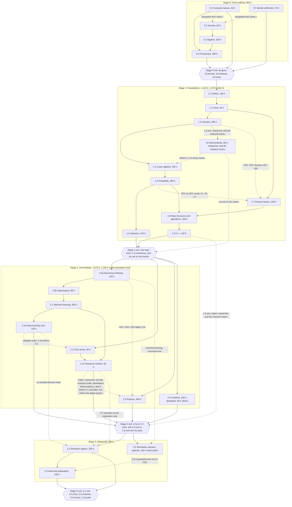

# Zero to Quant: curriculum index

Blueprint, Stage 2 Phase 1. Draft 1, 6 October 2026. Draft 2, 7 October 2026: the owner's adopted additions integrated.

**What this is.** The one index of the curriculum as the fifteen item files in `docs/curriculum/` define it: every stage, item, course and level with its lesson count (section 1); every item's hours against `docs/curriculum.md`, by track where hours differ (section 2); the prerequisite graph (section 3); where every quiz, homework set, topic paper and exit test sits (section 4); the resource canon in summary (section 5); and a record of the additions `docs/blueprint/work/canon-gap.md` proposed, which the owner adopted and which not (section 6). Sections 7 and 8 list what other papers must still settle and the small fixes each pass made to the item files.

**Sources of truth.** `docs/curriculum.md`, the owner's, for stages, items, hours and exit lines, as revised on 7 October 2026 with the adopted additions. The item files for courses, levels, lessons, homework, papers and reading: the eleven of draft 1, with `stage1-probability.md` (the P2 levels) and `stage1-dsa-cpp.md` (O1) revised on 7 October, and four new ones: `stage1-real-analysis.md` (A1), `stage2-numerics-optimisation.md` (2.0a and 2.0b), `stage2-deep-learning.md` (2.1b) and `stage2-research-method.md` (2.2c). `canon-gap.md` revision 2 for the canon. The owner's decisions at Blueprint review (`docs/PLAN.md` 12, 7 October 2026). Where two of them disagree, this index says so and names the one it follows.

**How the numbers were produced.** A script parsed every course heading, level heading and lesson row in section 2 of each item file (2,148 lesson rows in draft 1), compared them with the counts each file declares, checked every id against `CONTENT-FORMAT.md` 4.1, resolved each cross-file lesson reference written as "item lesson N" (about 470 of them) against the title of the lesson it points to, and summed every hours table. Draft 2 reran the row count, the id checks and the hours sums over the four new files and the twelve new 1.5 lessons: 321 new lesson rows and 58 new levels, every declared count equal to its rows, every lesson id unique across the fifteen files (2,469 distinct) and inside its course's namespace, and every hours table summing to its item's hours [measured]. It is a scratch check; the build's CI (`CONTENT-FORMAT.md` 6.7) replaces it, and section 7 asks CI to regenerate this index's tables from the lesson files. Results of that run are tagged [measured]; "computed here" marks a figure this index derived from the files' own numbers; every other figure is quoted from the file named beside it.

**Writing conventions.** Lesson time is 15 minutes including the quiz in every item file, so lesson hours are lessons $\times 0.25$. Course and level codes (W, P, W1, KC3) are document shorthand scoped to one item; the same letter recurs across items (Y, B and A in 0.4, 0.5 and 1.1; N, H, V and Z in 1.4 and 1.5; CP in 1.9 and 2.1). The item label A1 (real analysis) is not a level code, although 0.5 and 1.1 each have a level coded A1. The app computes display numbers from position and content refers to courses only by id (`CONTENT-FORMAT.md` 4.1).

> **Revised by the `docs/PLAN.md` review, 7 October 2026.** (1) **Skill granularity**: every item file's sample lessons list 3 or 4 skills in `introduces`; skills are now examinable methods at level grain, 3 to 8 a level and about 1,500 on the path, with at most 2 introduced per lesson and finer distinctions as step tags (`ASSESSMENT.md` 4.1). Content agents re-cut those lists when they write the lesson files. (2) **Duration**: the curriculum's "roughly 4.3 years at 15 hours a week" (draft 1: "roughly 4 years") counts mapped hours only; section 6.5 adds habits, review and holidays. (3) **Recommendation**: P1 to P4 with O1, plus a new core item 2.1b Deep learning (120 h), are recommended as core rather than as a cap option, with 60 h of real analysis on the researcher and ML tracks (sections 6.1 and 6.2; `docs/PLAN.md` 12 decision 2). (4) **Python floor**: wherever an item file names CPython 3.11 as the learner floor or the CI interpreter, read CPython 3.12 with `tools/py/uv.lock` (`docs/PLAN.md` conflict 19; SciPy 1.18.0 needs 3.12). Verification runs recorded on 3.11 stand as records and are rerun at `docs/PLAN.md` stage 26.

> **Draft 2: the owner's decisions at Blueprint review, 7 October 2026.** These lines win over anything below that reads otherwise. (1) **Adopted** (`docs/PLAN.md` 12 decision 2): P1 Research method as item 2.2c (35 h, immediately before 2.3); P2 Continuous-time processes (+15 h inside 1.5, which becomes 265 h); P3 Numerical methods, floating point and Monte Carlo as item 2.0a (120 h, first item of Stage 2); P4 Optimisation as item 2.0b (80 h, after 2.0a); O1 (2.4 at 60 h outside the developer track); 2.1b Deep learning core (120 h, after 2.1); A1 Real analysis (60 h, after 1.3, researcher and ML research tracks). All are now indexed in sections 1 to 5 as part of the curriculum; section 6 keeps the record. **Not adopted**: P5 to P16, including P8, so every file that listed P8 as a prerequisite teaches the basics itself. (2) **Totals**: 3,390 h on the trader track, 3,450 h on the researcher and ML research tracks, and 3,470 h on the developer track [computed here; the owner's decision states the first two, and the third follows from O1, as `stage1-dsa-cpp.md` 1.3 records]. (3) **Section 12 defaults** (decision 4) settle D1 to D8 of section 6.3 as each item file recommends, so the papers and exit parts this index marked "proposed" in draft 1 are part of the plan (section 4). (4) **Correction 5**: the Artifact publishes only files built from this repository and has no Python; every Python, SQL and C++ drill hands off to the web app and returns by result code. Lessons are unaffected: authored code runs at build time and every on-screen number comes from our own JavaScript models. (5) **Build order (a)**: every P0 widget batch before any content, content depth-first from 0.1; A1's six widgets are P0 (`docs/WIDGETS.md` 5.23).

---

## 0. Summary

### 0.1 Totals [measured]

"All items" counts every lesson once: A1 and all 84 lessons of 2.4 are in it, so no single learner takes all of it. The track table below gives each path.

| | Stage 0 | Stage 1 | Stage 2 | Stage 3 | All items | 3.2 (optional) |
|---|---|---|---|---|---|---|
| Hours (`curriculum.md`) | 500 | 1,415; 1,475 with A1 | 1,075; 1,155 on the developer track | 400 | see the track table | not counted; 150 when taken on `trk.derivatives` (D3) |
| Items | 5 | 10, A1 on two tracks | 8 | 2 | **25** | 1 |
| Courses | 15 | 40 | 33 | 10 | **98** | 5 |
| Levels | 67 | 178 | 136 | 50 | **431** | 20 |
| Lessons | 346 | 988 | 745 | 262 | **2,341** | 104 |
| Lesson hours | 86.5 | 247.0 | 186.25 | 65.5 | **585.25** | 26.0 |
| Homework sets | 67 | 178 | 132 and 4 milestone packs | 50 | **427 and 4 packs** | 20 |
| In-app topic papers | 3 | 11 | 7, and 3 Arena rounds | 2 | **23 and 3 rounds** | 1 |
| Exit parts | 4 stage parts, 3 topic parts | 11 | 9 (2.4 has one part per track group) | 5 | **32** | 1 |

| Track | Hours | Items | Courses | Levels | Lessons | Lesson hours | Homework sets | Exit parts |
|---|---|---|---|---|---|---|---|---|
| Trader (`trk.trader`) | **3,390** | 24 | 95 (KS in part) | 413, and 3 of 2.4 in part | 2,245 | 561.25 | 409 and 4 packs | 30 |
| Researcher (`trk.researcher`) | **3,450** | 25 | 97 (KS in part) | 422, and 3 of 2.4 in part | 2,293 | 573.25 | 418 and 4 packs | 31 |
| ML research (`trk.ml-research`) | **3,450** | 25 | 97 (KS in part) | 422, and 3 of 2.4 in part | 2,293 | 573.25 | 418 and 4 packs | 31 |
| Developer (`trk.developer`) | **3,470** | 24 | 96 | 422 | 2,293 | 573.25 | 418 and 4 packs | 30 |

Track rows are computed here from the item files: outside the developer track, 2.4 serves 36 of its 84 lessons (all of course KC, levels KM1 and KM2, and lessons 33, 38, 41 and 49), 6 of its 15 levels in full and 6 of its homework sets, and drops course KD and all of course KS but lesson 49 from the plan (`stage1-dsa-cpp.md` 1.3); A1 (2 courses, 9 levels, 48 lessons, 9 sets) is on the researcher and ML research tracks only. The trader and developer tracks show both as optional on the course map, outside their hours. Draft 1's path was 3,100 h, 20 items, 80 courses, 377 levels and 2,044 lessons; 3.2 is outside every path, as before.

Every lesson ends in a quiz and every level in a level review, so the curriculum holds 2,341 lesson quizzes and 431 level reviews (2,245 and 413 on the trader track). On the trader path, lessons take 16.6% of the hours; the rest is homework (25.6%), projects and drills (21.3%), reading and lectures (20.9%), practice and redo (11.5%) and papers (4.1%) [computed here, section 2.1].

### 0.2 What this pass found

**Draft 2** (7 October 2026, the adopted additions):

- **The four new files agree with themselves.** Every count a course heading, level heading or summary table declares equals its rows: A1 48 lessons in 9 levels, 2.0a 91 in 17, 2.0b 58 in 10, 2.1b 80 in 14, 2.2c 32 in 6, and 1.5's levels Z4b and Z4c 12 lessons; every level has 4 to 7 lessons; lesson numbers run without gaps from 1 in each item; every lesson id is unique across all fifteen files and sits in its course's namespace; every hours table sums to its item's hours, and every new file maps its blocks to estimate units (section 2.1) [measured].
- **2.2c takes 24 lessons out of 2.3.** 17 move with new ids and 7 retire as duplicates of 1.6 and 2.1 (`stage2-research-method.md` 0.6), and 2.3 keeps its 400 hours by returning about 13 to projects. This index shows 2.3 after the move; `stage1-finance-projects.md` has not yet applied it, and its lesson numbers are the current ones until it does (section 2.2, flag 4).
- **Hours now depend on the track** for A1 and 2.4, as they already did for 3.2. The schema cannot yet write them (section 2.2, flag 1; section 7, request 2).
- **Nothing in a new file assumes P8 or another unadopted proposal.** 2.0a teaches the heat equation, Fourier modes and stiff equations its PDE course needs (its decision 6); 1.5's P2 levels use 1.3 level I6 and 1.4's diagonalisation; 2.1b's one differential equation uses 1.3 level I6; A1 carries its own proof instruction in place of P7.
- **The canon grows by 95 ids** first cited by the four new files; the fifteen files cite 425 distinct source ids (section 5.3).

**Draft 1** (6 October 2026):

- **The files agree with themselves.** Every count a course heading, level heading or summary table declares equals its rows; lesson numbers run without gaps from 1 in every item; every level has 4 to 7 lessons, as `Level.lessons` requires; all 2,148 lesson ids are unique and match the `Id()` pattern; every hours table sums to its item's curriculum hours exactly; lesson hours equal lessons $\times 0.25$ everywhere [measured].
- **The files agree with each other, with seven kinds of exception, all fixed in eight changes** (section 8): a library namespace two topics shared (`alg`, used by 0.2 Algebra and 1.8 Algorithms); 93 lesson ids written in a short form outside their course namespace; 16 source ids that duplicated canon ids; one out-of-range lesson reference; two exit-table rows in the Stage 3 file that predated the 2.1 and 3.1 file; a missing topic exit part for 0.3; and stale revision 1 hours for three canon-gap proposals in two files.
- **Hours reconcile for all 20 counted items.** 3.2 is the one flag: the owner's "optional, hours not counted" against its file's 150 hours for a learner who opts in, which the schema cannot yet express (section 2.2).
- **Ten items do not yet map their hours to estimate units**, which CI's 10% rule needs (section 2.2). Section 7 lists what `CONTENT-FORMAT.md`, `ASSESSMENT.md`, the compiler and `canon-gap.md` must still settle.
- **The canon** was 267 works in `canon-gap.md` section 6 plus 131 new ids the item files cited, about 398 works for `content/sources.yaml`; draft 2 updates these figures (section 5.3).

### 0.3 Decisions made here

The item files left a few ids and counting rules open. The build needs them fixed before the first `curriculum.yaml` is written.

| # | Decision | Chosen | Rejected | Reason |
|---|---|---|---|---|
| 1 | Topic ids for the 14 topics no file named (draft 1) | **Full words**: `top.precalculus`, `top.computing`, `top.mental-arithmetic`, `top.calculus`, `top.linear-algebra`, `top.probability`, `top.statistics`, `top.finance`, `top.machine-learning`, `top.time-series`, `top.projects`, `top.research-papers`, `top.stochastic-calculus`, `top.interview` | The library namespaces as topic ids (`top.pre`, `top.ts`) | The seven ids the files already wrote are full words (`top.number`, `top.algebra`, `top.python`, `top.tools`, `top.algorithms`, `top.cpp`, `top.contests`); topic ids appear in the owner's diffs and in the app's routes, where words read better than abbreviations |
| 2 | Stage ids | **`stg.s0` to `stg.s3`** | `stg.0` to `stg.3`; `stg.stage-0` | Matches the `s0.` prefix the Stage 0 exit parts already use (`s0.gcse`) |
| 3 | Track ids | **`trk.trader`, `trk.researcher`, `trk.ml-research`, `trk.developer`**, and `trk.derivatives` for the 3.2 add-on, which `3.2.done` already names in its `track` field. Draft 1 reserved `trk.ml-research` for canon-gap P14; draft 2 defines it (decision 7) | Ids per proposal | The curriculum's four tracks plus the add-on the files already use; the `TrackName` pattern takes them as written |
| 4 | 1.8's library namespace | **`dsa`** (section 8, fix 1) | Renaming 0.2's `alg` instead | 0.2 is built first in depth-first order and `stage1-python-tools.md` cites its `prj.alg.root-finder`; no paper outside `stage1-dsa-cpp.md` cites a 1.8 library id, so the rename touches one file |
| 5 | How 3.2 is counted here | **Outside every path**: the track totals stand and 3.2's 150 hours appear as "when taken", on `trk.derivatives` only (D3, settled by default on 7 October 2026) | Adding 150 to Stage 3 | The curriculum says "hours not counted"; D3 counts them only for a learner who opts in, and P16 was not adopted |
| 6 | What this index lists | **Stages, items, courses and levels**; lessons stay in the item files | Copying every lesson row here (2,445 with 3.2) | One place per fact. A second copy of the lesson tables would drift; CI can regenerate this index's counts from the lesson files (section 7, request 5) |
| 7 | The ML research track (draft 2) | **`trk.ml-research` is a fourth track with the researcher track's items and hours** (3,450 h, A1 included). Its plan data copies the researcher track's order and project order; its track page names 2.1b and 3.3 level TR3 as its emphasis and offers 3.1's double-descent route beside a finance replication. `curriculum.md`'s track table now has its row | (a) No fourth track, reading "ML" as the researcher track; (b) courses of its own (canon-gap P14) | The owner's decision names "the researcher and ML research tracks" for A1 and gives both 3,450 h, so the track must exist; P14 was not adopted, so it has no courses of its own (A1 open item 4, 2.1b open item 8) |
| 8 | Hours that depend on the track (draft 2) | **Counted per track**: A1's 60 h on the researcher and ML research tracks only, 2.4 at 140 h on the developer track and 60 h elsewhere; stage and path totals give each figure (sections 0.1 and 2.1) | One total per stage, with A1 and 2.4 at their largest | The owner's decision states per-track totals. The schema still needs a track-scoped `hours` (section 2.2, flag 1) |
| 9 | A1's label and place (draft 2) | **Label A1**, indexed in Stage 1 between 1.3 and 1.4; topic `top.real-analysis`, library `ra`, exit part `a1.exit` (`stage1-real-analysis.md` decision 19) | `1.3b` | `1.3b` would suggest an item every track takes; display numbers come from position, so the label is never shown to a learner |
| 10 | 2.3 after 2.2c's move (draft 2) | **Indexed as adopted**: course RM with levels RM1, RM2, RM6 and RM8 (23 lessons), 2.3 at 205 lessons; each course row gives the item file's current lesson numbers and the numbers after renumbering | (a) Indexing 2.3 as its file stands, which counts 17 moved lessons twice and keeps 7 retired ones; (b) renumbering every cross-file reference to 2.3 in this pass | The owner adopted P1 with the move (`stage2-research-method.md` decision 2). Other files cite 2.3 by its current numbers, so both stay visible until `stage1-finance-projects.md` applies the move (section 7) |

---

## 1. Hierarchy

**Items at a glance** [measured]. "Library" is the topic namespace for skills, misconceptions, generators, drills and glossary terms (`skl.<ns>.*` and so on); lessons use their course as namespace.

| Item | Topic id | Library | Hours | Courses | Levels | Lessons | Lesson hours | Item file |
|---|---|---|---|---|---|---|---|---|
| 0.1 Number | `top.number` | `num` | 60 | 2 | 8 | 42 | 10.5 | `stage0-number-algebra.md` |
| 0.2 Algebra | `top.algebra` | `alg` | 180 | 4 | 19 | 111 | 27.75 | `stage0-number-algebra.md` |
| 0.3 Precalculus | `top.precalculus` | `pre` | 200 | 5 | 29 | 146 | 36.5 | `stage0-precalc-computing.md` |
| 0.4 Computer basics | `top.computing` | `comp` | 40 | 3 | 7 | 31 | 7.75 | `stage0-precalc-computing.md` |
| 0.5 Mental arithmetic | `top.mental-arithmetic` | `ment` | 20 | 1 | 4 | 16 | 4.0 | `stage0-precalc-computing.md` |
| 1.1 Python | `top.python` | `py` | 150 | 4 | 19 | 107 | 26.75 | `stage1-python-tools.md` |
| 1.2 Tools | `top.tools` | `tools` | 40 | 1 | 7 | 32 | 8.0 | `stage1-python-tools.md` |
| 1.3 Calculus | `top.calculus` | `calc` | 200 | 5 | 25 | 137 | 34.25 | `stage1-calculus.md` |
| A1 Real analysis | `top.real-analysis` | `ra` | 60, researcher and ML research tracks | 2 | 9 | 48 | 12.0 | `stage1-real-analysis.md` |
| 1.4 Linear algebra | `top.linear-algebra` | `linalg` | 150 | 5 | 18 | 98 | 24.5 | `stage1-linear-algebra.md` |
| 1.5 Probability | `top.probability` | `prob` | 265 | 5 | 29 | 168 | 42.0 | `stage1-probability.md` |
| 1.6 Statistics | `top.statistics` | `stats` | 120 | 4 | 15 | 80 | 20.0 | `stage1-statistics-ts.md` |
| 1.7 Finance basics | `top.finance` | `fin` | 100 | 5 | 14 | 80 | 20.0 | `stage1-finance-projects.md` |
| 1.8 Data structures and algorithms | `top.algorithms` | `dsa` | 250 | 5 | 26 | 150 | 37.5 | `stage1-dsa-cpp.md` |
| 1.9 C++ | `top.cpp` | `cpp` | 140 | 4 | 16 | 88 | 22.0 | `stage1-dsa-cpp.md` |
| 2.0a Numerical methods, floating point and Monte Carlo | `top.numerical-methods` | `numerics` | 120 | 4 | 17 | 91 | 22.75 | `stage2-numerics-optimisation.md` |
| 2.0b Optimisation | `top.optimisation` | `optim` | 80 | 4 | 10 | 58 | 14.5 | `stage2-numerics-optimisation.md` |
| 2.1 Machine learning | `top.machine-learning` | `ml` | 200 | 5 | 29 | 152 | 38.0 | `stage2-ml-papers.md` |
| 2.1b Deep learning core | `top.deep-learning` | `dl` | 120 | 5 | 14 | 80 | 20.0 | `stage2-deep-learning.md` |
| 2.2 Time series | `top.time-series` | `ts` | 60 | 3 | 8 | 43 | 10.75 | `stage1-statistics-ts.md` |
| 2.2c Research method and statistical honesty | `top.research-method` | `research` | 35 | 3 | 6 | 32 | 8.0 | `stage2-research-method.md` |
| 2.3 Projects | `top.projects` | `proj` | 400 | 5 | 37 | 205 | 51.25 | `stage1-finance-projects.md`, after 2.2c's move |
| 2.4 Contests | `top.contests` | `cp` | 140 developer; 60 other tracks | 4 | 15; 6 in full and 3 in part elsewhere | 84; 36 elsewhere | 21.0; 9.0 | `stage1-dsa-cpp.md` |
| 3.1 Research papers | `top.research-papers` | `papers` | 150 | 5 | 22 | 108 | 27.0 | `stage2-ml-papers.md` |
| 3.2 Stochastic calculus | `top.stochastic-calculus` | `stoch` | optional (150 when taken) | 5 | 20 | 104 | 26.0 | `stage3-stochastic-interview.md` |
| 3.3 Interview preparation | `top.interview` | `iv` | 250 | 5 | 28 | 154 | 38.5 | `stage3-stochastic-interview.md` |

**Shape** [measured]. Of the 26 topics (3.2 included), twelve have 5 courses, seven have 4, three have 3, two have 2 and two have 1. Levels hold 4 to 7 lessons everywhere. Courses run from 8 lessons (`crs.keys`) to 50 (`crs.systems`); 36 of the 103 courses fall outside design research 8.2's guide of 20 to 45 lessons: draft 1's 22 less 2.3's `crs.method` (now 23 lessons), plus 1.5's `crs.markov` (46 with the P2 levels), 2.0a's `crs.numlinalg` and `crs.pde`, all four of 2.0b's, all five of 2.1b's and all three of 2.2c's. The guide is not a schema rule; the files that set short courses say why (for example, 1.7 runs alongside 1.3 to 1.6 and unlocks course by course, and 2.1b's five courses follow Prince's chapters).

Course tables follow, in path order. Levels are listed as code, name and lesson count; "Numbers" is the course's lesson numbers within its item.

### Stage 0: From nothing (500 h)

#### 0.1 Number (60 h)

`top.number`, libraries `num`. 2 courses, 8 levels, 42 lessons (10.5 lesson hours). Source: `docs/curriculum/stage0-number-algebra.md`. Sample lesson written in full: `lsn.numwork.digit-worth`.

| Code | Course | Id | Levels (lessons) | Lessons | Numbers |
|---|---|---|---|---|---|
| W | How Numbers Work | `crs.numwork` | W1 Place value and calculation (5); W2 Negative numbers and the laws of arithmetic (5); W3 Factors, primes and counting (6); W4 Fractions (5) | 21 | 1 to 21 |
| P | Proportion, Powers and Precision | `crs.propprec` | P1 Decimals and percentages (5); P2 Ratio, rates and proportion (5); P3 Powers and roots (5); P4 Precision, estimation and the real numbers (6) | 21 | 22 to 42 |

#### 0.2 Algebra (180 h)

`top.algebra`, libraries `alg`. 4 courses, 19 levels, 111 lessons (27.75 lesson hours). Source: `docs/curriculum/stage0-number-algebra.md`.

| Code | Course | Id | Levels (lessons) | Lessons | Numbers |
|---|---|---|---|---|---|
| E | Expressions and Equations | `crs.expreq` | E1 Letters for numbers (6); E2 Brackets and factorising (5); E3 Algebraic fractions, indices, sums and proof (6); E4 Linear equations (6); E5 Formulae and changing the subject (5); E6 Inequalities (6) | 34 | 1 to 34 |
| L | Lines and Linear Systems | `crs.lines` | L1 Coordinates and straight lines (7); L2 Linear graphs in the world (6); L3 Simultaneous linear equations (7) | 20 | 35 to 54 |
| Q | Quadratics and Polynomials | `crs.quadpoly` | Q1 Factorising quadratics (6); Q2 Completing the square and the formula (6); Q3 Quadratic graphs, circles and systems (6); Q4 Optimising with quadratics (5); Q5 Polynomials (6); Q6 Complex numbers (4) | 33 | 55 to 87 |
| F | Functions and Graphs | `crs.funcs` | F1 Functions (6); F2 A gallery of graphs (7); F3 Transformations and symmetry (5); F4 Solving equations with graphs, iteration and rates (6) | 24 | 88 to 111 |

#### 0.3 Precalculus (200 h)

`top.precalculus`, libraries `pre`. 5 courses, 29 levels, 146 lessons (36.5 lesson hours). Source: `docs/curriculum/stage0-precalc-computing.md`. Sample lesson written in full: `lsn.growth.log-as-count`.

| Code | Course | Id | Levels (lessons) | Lessons | Numbers |
|---|---|---|---|---|---|
| S | Shape and Space | `crs.shape` | S1 Angles and polygons (4); S2 Area and volume (5); S3 Pythagoras, congruence and similarity (5); S4 Transformations and constructions (4); S5 Circle theorems (5); S6 Right-angled trigonometry (5); S7 Any triangle (4); S8 Vectors (6) | 38 | 1 to 38 |
| G | Growth: Sequences, Series, Exponentials and Logarithms | `crs.growth` | G1 Sequences and recurrences (5); G2 Exponential functions (5); G3 Logarithms (6); G4 Modelling with exponentials and logarithms (5); G5 Series (6) | 27 | 39 to 65 |
| T | Circles, Waves and Rotations | `crs.waves` | T1 Radians and the unit circle (5); T2 Waves (5); T3 Identities and equations (6); T4 Compound angles (5); T5 Matrices (6); T6 Complex numbers in polar form (5) | 32 | 66 to 97 |
| C | Counting, Chance and Data | `crs.chance` | C1 Counting arrangements (5); C2 Counting principles (4); C3 The binomial theorem (5); C4 Probability (6); C5 Data and statistics (6) | 26 | 98 to 123 |
| R | Proof, Limits and Curves | `crs.rigour` | R1 Logic and proof (5); R2 Proof by induction (4); R3 Rational functions and partial fractions (4); R4 Conics and parametric curves (5); R5 Limits and continuity (5) | 23 | 124 to 146 |

#### 0.4 Computer basics (40 h)

`top.computing`, libraries `comp`. 3 courses, 7 levels, 31 lessons (7.75 lesson hours). Source: `docs/curriculum/stage0-precalc-computing.md`.

| Code | Course | Id | Levels (lessons) | Lessons | Numbers |
|---|---|---|---|---|---|
| K | Keyboard Fluency | `crs.keys` | K1 The home row and technique (4); K2 Every key, and the shortcuts (4) | 8 | 1 to 8 |
| B | Workbench: Files, Terminal and Editor | `crs.bench` | B1 Files and folders (4); B2 The terminal (5); B3 Installing tools and the editor (4) | 13 | 9 to 21 |
| Y | First Programs in Python | `crs.firstpy` | Y1 Values, variables and decisions (5); Y2 Loops, functions and errors (5) | 10 | 22 to 31 |

#### 0.5 Mental arithmetic (20 h)

`top.mental-arithmetic`, libraries `ment`. 1 course, 4 levels, 16 lessons (4 lesson hours). Source: `docs/curriculum/stage0-precalc-computing.md`.

| Code | Course | Id | Levels (lessons) | Lessons | Numbers |
|---|---|---|---|---|---|
| A | Arithmetic at Speed | `crs.speed` | A1 Tables and the Zetamac format (4); A2 Adding and subtracting fast (4); A3 Multiplying beyond the tables (4); A4 Fractions, decimals, percentages and estimates (4) | 16 | 1 to 16 |

### Stage 1: Foundations (1,415 h; 1,475 h with A1 on the researcher and ML research tracks)

#### 1.1 Python (150 h)

`top.python`, libraries `py`. 4 courses, 19 levels, 107 lessons (26.75 lesson hours). Source: `docs/curriculum/stage1-python-tools.md`. Sample lesson written in full: `lsn.pythink.names-objects`.

| Code | Course | Id | Levels (lessons) | Lessons | Numbers |
|---|---|---|---|---|---|
| Y | Thinking in Python | `crs.pythink` | Y1 Objects, names and numbers (6); Y2 Text (4); Y3 Control flow (5); Y4 Functions (6); Y5 Collections (7) | 28 | 1 to 28 |
| B | Building Real Programs | `crs.pybuild` | B1 Iteration and functional tools (5); B2 Errors and debugging (5); B3 Files and the outside world (6); B4 Modules, environments and readable code (4); B5 Objects and types (7) | 27 | 29 to 55 |
| A | Arrays and Simulation | `crs.arrays` | A1 Arrays (6); A2 Computing with arrays (7); A3 Randomness and simulation (7) | 20 | 56 to 75 |
| D | Data, Time Series and Charts | `crs.dataframes` | D1 Series and DataFrames (6); D2 Loading and cleaning (4); D3 Combining and reshaping (6); D4 Time series (7); D5 Plotting and communicating (5); D6 Workflow and the exit (4) | 32 | 76 to 107 |

#### 1.2 Tools (40 h)

`top.tools`, libraries `tools`. 1 course, 7 levels, 32 lessons (8 lesson hours). Source: `docs/curriculum/stage1-python-tools.md`.

| Code | Course | Id | Levels (lessons) | Lessons | Numbers |
|---|---|---|---|---|---|
| T | Tools of the Trade | `crs.toolkit` | T1 The shell (4); T2 Working in the shell (4); T3 Git foundations (5); T4 Git collaboration (5); T5 Testing with pytest (6); T6 SQL queries (4); T7 SQL for analysis and change (4) | 32 | 1 to 32 |

#### 1.3 Calculus (200 h)

`top.calculus`, libraries `calc`. 5 courses, 25 levels, 137 lessons (34.25 lesson hours). Source: `docs/curriculum/stage1-calculus.md`. Sample lesson written in full: `lsn.deriv.instant-speed`.

| Code | Course | Id | Levels (lessons) | Lessons | Numbers |
|---|---|---|---|---|---|
| D | Limits and the Derivative | `crs.deriv` | D1 Rates and limits (7); D2 The derivative (6); D3 Rules of differentiation (7); D4 Inverses, implicit curves and related rates (5); D5 Derivatives computed and proved (4) | 29 | 1 to 29 |
| U | Using the Derivative: Approximation, Shape and Optimisation | `crs.deriv-apps` | U1 Approximation (5); U2 Extremes and the mean value theorem (4); U3 The shape of a graph (5); U4 Optimisation (6); U5 Convexity (4) | 24 | 30 to 53 |
| I | The Integral: Accumulation, Area and Probability | `crs.integral` | I1 Area and the definite integral (4); I2 The fundamental theorem (5); I3 Techniques of integration (7); I4 Improper integrals, densities and numerical integration (6); I5 Geometry and physics of integrals (6); I6 Differential equations (4) | 32 | 54 to 85 |
| X | Series and Expansions | `crs.series` | X1 Convergence (7); X2 Power series and asymptotics (6); X3 Taylor series (7) | 20 | 86 to 105 |
| M | Many Variables: Gradients, Constraints and Multiple Integrals | `crs.multivar` | M1 Functions of several variables (6); M2 The chain rule and the gradient (6); M3 Optimisation in several variables (6); M4 Lagrange multipliers (5); M5 Double integrals (5); M6 Change of variables and probability (4) | 32 | 106 to 137 |

#### A1 Real analysis (60 h, researcher and ML research tracks)

`top.real-analysis`, library `ra`. 2 courses, 9 levels, 48 lessons (12 lesson hours). Source: `docs/curriculum/stage1-real-analysis.md`. Sample lesson written in full: `lsn.real-functions.pointwise-uniform`. Taught straight after `1.3.exit` and before 1.4 on its two tracks; an elective outside the hours of the trader and developer tracks (its decision 3).

| Code | Course | Id | Levels (lessons) | Lessons | Numbers |
|---|---|---|---|---|---|
| RL | The Real Line: Completeness, Sequences and Sets | `crs.real-line` | RL1 Completeness (6); RL2 Countable and uncountable (4); RL3 Limits of sequences (5); RL4 Subsequences, Cauchy sequences and series (6); RL5 Open, closed and compact sets (5) | 26 | 1 to 26 |
| FN | Functions: Continuity, Derivatives and Uniform Limits | `crs.real-functions` | FN1 Limits and continuity of functions (7); FN2 The derivative (5); FN3 Uniform convergence (5); FN4 Power series, Taylor series and approximation (5) | 22 | 27 to 48 |

#### 1.4 Linear algebra (150 h)

`top.linear-algebra`, libraries `linalg`. 5 courses, 18 levels, 98 lessons (24.5 lesson hours). Source: `docs/curriculum/stage1-linear-algebra.md`. Sample lesson written in full: `lsn.elimination.matrix-times-vector`.

| Code | Course | Id | Levels (lessons) | Lessons | Numbers |
|---|---|---|---|---|---|
| V | Vectors, Matrices and Elimination | `crs.elimination` | V1 Combinations and the column picture (5); V2 Elimination (7); V3 Structure, cost and meaning (6) | 18 | 1 to 18 |
| N | Spaces, Rank and the Four Subspaces | `crs.subspaces` | N1 Vector spaces and the nullspace (5); N2 Rank, independence and dimension (5); N3 The four fundamental subspaces (4); N4 Bases, coordinates and linear transformations (5) | 19 | 19 to 37 |
| O | Orthogonality and Least Squares | `crs.orthogonality` | O1 Orthogonality and projections (5); O2 Least squares in practice (6); O3 Orthonormal bases and QR (5) | 16 | 38 to 53 |
| H | Hidden Directions: Determinants and Eigenvalues | `crs.eigen` | H1 Determinants (6); H2 Eigenvalues and eigenvectors (6); H3 Dynamics (6); H4 Symmetric and complex matrices (5) | 23 | 54 to 76 |
| Z | Data Matrices: Positive Definiteness, the SVD and PCA | `crs.svd` | Z1 Positive definite matrices (6); Z2 The singular value decomposition (6); Z3 Principal component analysis (6); Z4 Matrices in learning and risk (4) | 22 | 77 to 98 |

#### 1.5 Probability (265 h)

`top.probability`, libraries `prob`. 5 courses, 29 levels, 168 lessons (42 lesson hours), including canon-gap P2's levels Z4b and Z4c (12 lessons, 15 h), adopted on 7 October 2026. Source: `docs/curriculum/stage1-probability.md`. Sample lesson written in full: `lsn.count.equally-likely-outcomes`.

| Code | Course | Id | Levels (lessons) | Lessons | Numbers |
|---|---|---|---|---|---|
| N | Counting and Chance | `crs.count` | N1 Outcomes and the naive definition (6); N2 Stories and symmetry (5); N3 The axioms of probability (6); N4 First interview patterns (5) | 22 | 1 to 22 |
| H | Conditional Probability and Bayes | `crs.cond` | H1 Updating on evidence (5); H2 Bayes' rule (6); H3 Independence (5); H4 Puzzles that fool experts (6) | 22 | 23 to 44 |
| V | Random Variables and Their Distributions | `crs.rv` | V1 Random variables and distributions (6); V2 Expectation (6); V3 Waiting times and rare events (6); V4 Expectation puzzles (6); V5 Continuous random variables (7); V6 Moments and generating functions (6); V7 Gamma, Beta and their relatives (6) | 43 | 45 to 87 |
| J | Joint Distributions, Conditional Expectation and Limit Theorems | `crs.joint` | J1 Joint, marginal and conditional (6); J2 Covariance and correlation (5); J3 Transformations and the multivariate normal (7); J4 Conditional expectation (6); J5 Inequalities (4); J6 Laws of large numbers and the central limit theorem (7) | 35 | 88 to 122 |
| Z | Markov Chains, Random Walks and Interview Problems | `crs.markov` | Z1 Markov chains (6); Z2 Markov chains at work (6); Z3 Random walks (6); Z4 Fair games and stopping times (5); Z4b Continuous-time chains (5); Z4c Brownian motion (7); Z5 Geometric probability (5); Z6 Games, stopping and betting (6) | 46 | 123 to 168, taught in the order 123 to 145, 157 to 168, 146 to 156 (Z4b and Z4c keep numbers above 156 so that other files' citations of lessons 146 to 156 stay true) |

#### 1.6 Statistics (120 h)

`top.statistics`, libraries `stats`. 4 courses, 15 levels, 80 lessons (20 lesson hours). Source: `docs/curriculum/stage1-statistics-ts.md`. Sample lesson written in full: `lsn.estimators.standard-error`.

| Code | Course | Id | Levels (lessons) | Lessons | Numbers |
|---|---|---|---|---|---|
| ES | Estimators and Their Errors | `crs.estimators` | ES1 Sampling distributions (5); ES2 Judging estimators (5); ES3 Maximum likelihood (5); ES4 Large-sample theory (5) | 20 | 1 to 20 |
| IT | Intervals and Tests | `crs.testing` | IT1 Confidence intervals (5); IT2 Hypothesis tests (6); IT3 The testing toolkit (6); IT4 Many tests at once (5) | 22 | 21 to 42 |
| RG | Linear Regression | `crs.linreg` | RG1 The model (5); RG2 Inference for coefficients (6); RG3 When the assumptions fail (6); RG4 Multiple regression in practice (6); RG5 The summary table and the exit (4) | 27 | 43 to 69 |
| BY | Bayesian Inference | `crs.bayesian` | BY1 Updating (5); BY2 Priors, shrinkage and computation (6) | 11 | 70 to 80 |

#### 1.7 Finance basics (100 h)

`top.finance`, libraries `fin`. 5 courses, 14 levels, 80 lessons (20 lesson hours). Source: `docs/curriculum/stage1-finance-projects.md`. Sample lesson written in full: `lsn.rates.present-value`.

| Code | Course | Id | Levels (lessons) | Lessons | Numbers |
|---|---|---|---|---|---|
| RB | Rates and Bonds | `crs.rates` | RB1 Interest and present value (6); RB2 Bonds and yields (6); RB3 Interest-rate risk and swaps (4) | 16 | 1 to 16 |
| EQ | Shares and Portfolios | `crs.equity` | EQ1 Shares and how they pay (6); EQ2 Risk, return and the market (6) | 12 | 17 to 28 |
| MK | Exchanges and the Order Book | `crs.markets` | MK1 The limit order book (6); MK2 Auctions, venues and the trade cycle (4); MK3 Why spreads exist, and what trading costs (7) | 17 | 29 to 45 |
| DV | Forwards, Futures and Options | `crs.derivatives` | DV1 Forwards and futures (7); DV2 Option payoffs and strategies (5); DV3 No-arbitrage bounds and put-call parity (6) | 18 | 46 to 63 |
| OP | Pricing Options | `crs.pricing` | OP1 Binomial trees (7); OP2 Black-Scholes (4); OP3 Greeks, hedging and implied volatility (6) | 17 | 64 to 80 |

#### 1.8 Data structures and algorithms (250 h)

`top.algorithms`, libraries `dsa`. 5 courses, 26 levels, 150 lessons (37.5 lesson hours). Source: `docs/curriculum/stage1-dsa-cpp.md`. Sample lesson written in full: `lsn.algcost.doubling`.

| Code | Course | Id | Levels (lessons) | Lessons | Numbers |
|---|---|---|---|---|---|
| AC | Algorithmic Cost | `crs.algcost` | AC1 How Cost Grows (7); AC2 Recursion and Proof (6); AC3 Sorting (6); AC4 Selection and Order in Practice (4) | 23 | 1 to 23 |
| AH | Arrays, Hashing and Pointers | `crs.arrayhash` | AH1 Arrays and Hash Tables (6); AH2 Two Pointers (5); AH3 Sliding Windows (6); AH4 Prefix Sums (5); AH5 Binary Search (6); AH6 Intervals (5) | 33 | 24 to 56 |
| SQ | Stacks, Lists and Heaps | `crs.linear` | SQ1 Stacks (5); SQ2 Queues and Linked Lists (7); SQ3 Heaps (6); SQ4 Randomised Structures and Streams (4) | 22 | 57 to 78 |
| TG | Trees and Graphs | `crs.treesgraphs` | TG1 Binary Trees (6); TG2 Search Trees and Tries (6); TG3 Graphs and Traversal (7); TG4 Weighted Graphs (6); TG5 Graph Techniques (6) | 31 | 79 to 109 |
| DP | Recursion, Dynamic Programming and Greedy | `crs.dynprog` | DP1 Backtracking (6); DP2 From Recursion to Dynamic Programming (6); DP3 Two-Dimensional DP (6); DP4 Designing Dynamic Programmes (5); DP5 Greedy Algorithms (5); DP6 Bits and Integer Maths (6); DP7 Hard Problems and the Method (7) | 41 | 110 to 150 |

#### 1.9 C++ (140 h)

`top.cpp`, libraries `cpp`. 4 courses, 16 levels, 88 lessons (22 lesson hours). Source: `docs/curriculum/stage1-dsa-cpp.md`.

| Code | Course | Id | Levels (lessons) | Lessons | Numbers |
|---|---|---|---|---|---|
| CB | C++ Foundations | `crs.cppcore` | CB1 From Source to Program (5); CB2 Types and Arithmetic (6); CB3 Functions and Files (6); CB4 First Containers, Algorithms and Tests (5) | 22 | 1 to 22 |
| CM | Memory and Ownership | `crs.cppmemory` | CM1 The Memory Model (6); CM2 Classes and Invariants (6); CM3 Copying and Moving (6); CM4 Polymorphism and Design (6) | 24 | 23 to 46 |
| CL | Generic Code and the Standard Library | `crs.cppstl` | CL1 Templates (5); CL2 Containers (6); CL3 Algorithms (5); CL4 Randomness and Numerics (5) | 21 | 47 to 67 |
| CP | Performance and the Pricer | `crs.cpppricing` | CP1 Tools of a C++ Engineer (5); CP2 Performance (6); CP3 The Binomial Pricer in C++ (6); CP4 First Contact with Concurrency (4) | 21 | 68 to 88 |

### Stage 2: Intermediate (1,075 h; 1,155 h on the developer track)

#### 2.0a Numerical methods, floating point and Monte Carlo (120 h)

`top.numerical-methods`, library `numerics`. 4 courses, 17 levels, 91 lessons (22.75 lesson hours). Source: `docs/curriculum/stage2-numerics-optimisation.md`. Sample lesson written in full: `lsn.approx.cancellation`. The first item of Stage 2 on every track.

| Code | Course | Id | Levels (lessons) | Lessons | Numbers |
|---|---|---|---|---|---|
| EA | Error, Equations and Integrals | `crs.approx` | EA1 Floating point as a number system (6); EA2 Conditioning and stability (7); EA3 Solving equations (6); EA4 Interpolation (5); EA5 Numerical integration (6) | 30 | 1 to 30 |
| NL | Numerical Linear Algebra | `crs.numlinalg` | NL1 Solving $A\mathbf x = \mathbf b$ well (5); NL2 Structure: symmetric, banded and sparse (4); NL3 Eigenvalues and the SVD in floating point (4); NL4 Iterative methods (5) | 18 | 31 to 48 |
| PD | Finite Differences and the Pricing Equation | `crs.pde` | PD1 From trees to the heat equation (5); PD2 Time stepping and stability (6); PD3 Pricing on a grid (6) | 17 | 49 to 65 |
| MO | Monte Carlo Methods | `crs.montecarlo` | MO1 Random numbers (5); MO2 Estimators, error and bias (5); MO3 Variance reduction (6); MO4 Quasi-Monte Carlo (4); MO5 Sensitivities, early exercise and the exit (6) | 26 | 66 to 91 |

#### 2.0b Optimisation (80 h)

`top.optimisation`, library `optim`. 4 courses, 10 levels, 58 lessons (14.5 lesson hours). Source: `docs/curriculum/stage2-numerics-optimisation.md` (lessons numbered 1 to 58, separately from 2.0a). No sample lesson yet; lesson 12, "The dual as the best bound", is the next to write in full.

| Code | Course | Id | Levels (lessons) | Lessons | Numbers |
|---|---|---|---|---|---|
| LP | Linear Programming and Duality | `crs.linprog` | LP1 Linear programmes and their geometry (6); LP2 The simplex method (5); LP3 Duality (6) | 17 | 1 to 17 |
| CX | Convexity and Optimality | `crs.convex` | CX1 Convex sets (5); CX2 Convex functions (6); CX3 Duality and the KKT conditions (7) | 18 | 18 to 35 |
| DA | Descent Algorithms | `crs.descent` | DA1 Unconstrained methods and their rates (6); DA2 Constraints, momentum and noise (6) | 12 | 36 to 47 |
| AP | Optimisation at Work: Portfolios and Learning | `crs.opt-apps` | AP1 Portfolio construction (6); AP2 Learning as optimisation (5) | 11 | 48 to 58 |

#### 2.1 Machine learning (200 h)

`top.machine-learning`, libraries `ml`. 5 courses, 29 levels, 152 lessons (38 lesson hours). Source: `docs/curriculum/stage2-ml-papers.md`. Sample lesson written in full: `lsn.learning.unseen-data`.

| Code | Course | Id | Levels (lessons) | Lessons | Numbers |
|---|---|---|---|---|---|
| LD | Learning from Data | `crs.learning` | LD1 The learning problem (5); LD2 Bias and variance (5); LD3 Loss, likelihood and information (6); LD4 Fitting by optimisation (6); LD5 Validation and cross-validation (6); LD6 Model selection and the bootstrap (5) | 33 | 1 to 33 |
| LS | Linear Models and Shrinkage | `crs.shrinkage` | LS1 Linear regression as a predictor (6); LS2 Beyond linearity (5); LS3 Ridge (5); LS4 The lasso and the elastic net (6); LS5 High dimensions (4) | 26 | 34 to 59 |
| CP | Classification and Probabilities | `crs.classify` | CP1 Logistic regression (6); CP2 Generative classifiers (5); CP3 Evaluating classifiers (6); CP4 Probabilities you can bet on (5); CP5 Margins and kernels (4) | 26 | 60 to 85 |
| TN | Trees, Ensembles and Networks | `crs.ensembles` | TN1 Decision trees (6); TN2 Bagging and random forests (4); TN3 Boosting (6); TN4 Interpreting models (5); TN5 Neural networks: representation (4); TN6 Neural networks: training (6) | 31 | 86 to 116 |
| FD | Machine Learning on Financial Data | `crs.finml` | FD1 Validation through time (6); FD2 Leakage (6); FD3 Labels and sample weights (5); FD4 Features from market data (5); FD5 Unsupervised learning: structure in returns (5); FD6 Overfitting by search (4); FD7 Capstone and exit (5) | 36 | 117 to 152 |

#### 2.1b Deep learning core (120 h)

`top.deep-learning`, library `dl`. 5 courses, 14 levels, 80 lessons (20 lesson hours). Source: `docs/curriculum/stage2-deep-learning.md`. Sample lesson written in full: `lsn.autodiff.tape`. After 2.1 on every track; the Deep Learning Lab `prj.dl.lab` (26.5 h) carries the exit drills.

| Code | Course | Id | Levels (lessons) | Lessons | Numbers |
|---|---|---|---|---|---|
| DN | Deep Networks: Functions, Losses and Fitting | `crs.deepnets` | DN1 What a deep network computes (6); DN2 Losses from likelihood (5); DN3 Fitting deep networks (5) | 16 | 1 to 16 |
| AD | Automatic Differentiation from Scratch | `crs.autodiff` | AD1 Reverse mode (6); AD2 The gradients of a network, by hand (6); AD3 Building the engine (5) | 17 | 17 to 33 |
| TD | Training Deep Networks | `crs.dltrain` | TD1 A language model, from counts to a network (6); TD2 Activations, gradients and normalisation (6); TD3 Generalisation in deep networks (5) | 17 | 34 to 50 |
| CR | Convolution and Residual Networks | `crs.convres` | CR1 Convolution (7); CR2 Residual networks (6) | 13 | 51 to 63 |
| TF | Attention and Transformers | `crs.transformers` | TF1 Attention (6); TF2 The transformer (6); TF3 Transformers at work (5) | 17 | 64 to 80 |

#### 2.2 Time series (60 h)

`top.time-series`, libraries `ts`. 3 courses, 8 levels, 43 lessons (10.75 lesson hours). Source: `docs/curriculum/stage1-statistics-ts.md`.

| Code | Course | Id | Levels (lessons) | Lessons | Numbers |
|---|---|---|---|---|---|
| SM | Stationary Models | `crs.arma` | SM1 Prices, returns and stationarity (5); SM2 Autocorrelation (5); SM3 ARMA models (6); SM4 Forecasting and evaluation (5) | 21 | 1 to 21 |
| VL | Volatility | `crs.volatility` | VL1 Volatility clustering and its models (5); VL2 Fitting, forecasting and risk (5) | 10 | 22 to 31 |
| CO | Unit Roots and Cointegration | `crs.cointegration` | CO1 Unit roots and spurious regression (5); CO2 Cointegration and pairs (7) | 12 | 32 to 43 |

#### 2.2c Research method and statistical honesty (35 h)

`top.research-method`, library `research`. 3 courses, 6 levels, 32 lessons (8 lesson hours). Source: `docs/curriculum/stage2-research-method.md`. Sample lesson written in full: `lsn.audit.look-ahead-disguised`. Immediately before 2.3 on the trader, researcher and ML research tracks; on the developer track after 2.2 and before the alpha project. 17 of its lessons moved from 2.3's course RM with new ids, and 15 are new (its section 0.6).

| Code | Course | Id | Levels (lessons) | Lessons | Numbers |
|---|---|---|---|---|---|
| IS | Is It Real? Inference and Selection | `crs.inference` | IS1 How sure is one result? (5); IS2 Many trials, one winner (6) | 11 | 1 to 11 |
| AU | Auditing Other People's Results | `crs.audit` | AU1 The backtest audit (7); AU2 What survives: the published record (5) | 12 | 12 to 23 |
| RP | Reporting and Pre-registration | `crs.reporting` | RP1 Writing and defending results (5); RP2 Pre-registration (4) | 9 | 24 to 32 |

#### 2.3 Projects (400 h)

`top.projects`, libraries `proj`. 5 courses, 37 levels, 205 lessons (51.25 lesson hours), after 2.2c's move: levels RM3, RM4, RM5 and RM7 and lesson 2 leave course RM (17 lessons move to 2.2c, 7 retire), and their 13 hours return to the projects. Source: `docs/curriculum/stage1-finance-projects.md`, which has not yet applied the move (decision 10): the Numbers column gives its current lesson numbers, then the numbers after renumbering.

| Code | Course | Id | Levels (lessons) | Lessons | Numbers |
|---|---|---|---|---|---|
| RM | Research Method | `crs.method` | RM1 Questions and data (5); RM2 Measuring performance (6); RM6 Reproducible research engineering (6); RM8 The empirical finance toolkit (6) | 23 | 1, 3 to 12, 31 to 36 and 42 to 47; after renumbering 1 to 23 |
| BT | The Backtesting Engine | `crs.backtest` | BT1 What a backtest is (6); BT2 Portfolio accounting (6); BT3 Fills, costs and constraints (6); BT4 Biases you can switch on (6); BT5 Sizing and risk control (6); BT6 Strategies to test the engine on (5); BT7 Architecture, tests and speed (5); BT8 Project 1, the backtesting engine (4) | 44 | 48 to 91; after renumbering 24 to 67 |
| AR | Alpha Research and Portfolio Construction | `crs.alpha` | AR1 Universes and signals (6); AR2 Cleaning and neutralising signals (6); AR3 Measuring predictive power (7); AR4 Factor models and risk models (6); AR5 From signal to portfolio (6); AR6 Honest alpha research (5); AR7 Signals beyond price, and machine learning (5); AR8 Project 2, alpha signal research (4) | 45 | 92 to 136; after renumbering 68 to 112 |
| OA | Options Analytics | `crs.options-analytics` | OA1 Option data (5); OA2 Implied volatility numerics (5); OA3 Smiles and surfaces (6); OA4 No arbitrage on the surface, and fitting (6); OA5 Three pricers compared, and a fourth (7); OA6 Greeks and risk in practice (5); OA7 Volatility as a traded quantity (5); OA8 Project 3, the options analytics dashboard (4) | 43 | 137 to 179; after renumbering 113 to 155 |
| MS | Market Data and Trading Systems | `crs.systems` | MS1 Feeds and messages (6); MS2 Rebuilding the book (6); MS3 Time and candles (6); MS4 Latency and throughput (6); MS5 Storage and replay (6); MS6 Performance engineering (5); MS7 Orders and the trading system (6); MS8 Running a system safely (5); MS9 Projects 4 and 5 (4) | 50 | 180 to 229; after renumbering 156 to 205 |

#### 2.4 Contests (140 h on the developer track; 60 h on the others)

`top.contests`, libraries `cp`. 4 courses, 15 levels, 84 lessons (21 lesson hours) on the developer track. Under canon-gap O1 (adopted 7 October 2026) the trader, researcher and ML research tracks take the 36-lesson core the file marks ◆ (9 lesson hours): all 21 lessons of KC, levels KM1 and KM2, and lessons 33, 38, 41 and 49; the rest stays on their course maps as optional and outside their hours. Source: `docs/curriculum/stage1-dsa-cpp.md` (section 1.3).

| Code | Course | Id | Levels (lessons) | Lessons | Numbers |
|---|---|---|---|---|---|
| KC | Contest Craft | `crs.contestcraft` | KC1 How Contests Work (5); KC2 Ad Hoc Thinking (6); KC3 Searching under Contest Limits (4); KC4 Practice Discipline and Other Competitions (6) | 21 | 1 to 21 |
| KM | Contest Mathematics | `crs.contestmath` | KM1 Primes and Divisibility (6); KM2 Modular Arithmetic (5); KM3 Counting (5); KM4 Probability and Games (6); KM5 Integer Geometry (4) | 26 | 22 to 47 |
| KS | Contest Data Structures and Graphs | `crs.contestds` | KS1 Range Queries (6); KS2 Trees at Scale (6); KS3 Graphs at Scale (7) | 19 | 48 to 66 |
| KD | Contest Techniques: DP and Strings | `crs.contestdp` | KD1 DP Techniques (6); KD2 Strings (6); KD3 Techniques for Hard Constraints (6) | 18 | 67 to 84 |

### Stage 3: Advanced (400 h)

#### 3.1 Research papers (150 h)

`top.research-papers`, libraries `papers`. 5 courses, 22 levels, 108 lessons (27 lesson hours). Source: `docs/curriculum/stage2-ml-papers.md`.

| Code | Course | Id | Levels (lessons) | Lessons | Numbers |
|---|---|---|---|---|---|
| MP | Reading Papers and Replicating Momentum | `crs.momentum` | MP1 How to read an empirical paper (5); MP2 The replication method (5); MP3 Momentum: the strategy (6); MP4 What explains momentum (5); MP5 Replicating Jegadeesh and Titman (4) | 25 | 1 to 25 |
| FF | Factor Models: Fama and French | `crs.factors` | FF1 The CAPM and its failure (5); FF2 Building the factors (5); FF3 Time-series regressions and the GRS test (5); FF4 Beyond three factors (5); FF5 Replicating Fama and French (4) | 24 | 26 to 49 |
| PS | Pairs Trading and Statistical Arbitrage | `crs.pairs` | PS1 The distance method (6); PS2 What the paper found, and why (5); PS3 Statistical arbitrage models (4); PS4 Replicating Gatev, Goetzmann and Rouwenhorst (4) | 19 | 50 to 68 |
| MM | Market Making: Avellaneda and Stoikov | `crs.making` | MM1 The market maker's problem (5); MM2 The Avellaneda-Stoikov solution (6); MM3 Simulating the paper (5); MM4 Beyond the paper (4) | 20 | 69 to 88 |
| WS | What Survives: Multiple Testing and Replication | `crs.survival` | WS1 The factor zoo (6); WS2 The replication evidence (5); WS3 Machine learning meets the cross-section (4); WS4 The exit: your replication (5) | 20 | 89 to 108 |

#### 3.2 Stochastic calculus (optional: hours not counted in any track's path; 150 h when taken)

`top.stochastic-calculus`, libraries `stoch`. 5 courses, 20 levels, 104 lessons (26 lesson hours). Source: `docs/curriculum/stage3-stochastic-interview.md`. Sample lesson written in full: `lsn.brownian.quadratic-variation`.

| Code | Course | Id | Levels (lessons) | Lessons | Numbers |
|---|---|---|---|---|---|
| AT | Arbitrage on a Tree | `crs.tree-pricing` | AT1 Replication on many periods (4); AT2 Probability on coin-toss space (5); AT3 State prices and changing measure (4); AT4 American claims and stopping times (5); AT5 Random walks and random interest rates (6) | 24 | 1 to 24 |
| BR | Measure, Information and Brownian Motion | `crs.brownian` | BR1 Probability on infinite spaces (6); BR2 Information and conditioning (5); BR3 Building Brownian motion (5); BR4 Roughness: variation and martingales (5); BR5 Hitting times and the maximum (6) | 27 | 25 to 51 |
| IC | Itô Calculus | `crs.ito` | IC1 The Itô integral (5); IC2 Itô's formula (6); IC3 Black-Scholes-Merton by replication (5); IC4 Many dimensions and simulation (4) | 20 | 52 to 71 |
| RN | Risk-Neutral Pricing and the PDE | `crs.risk-neutral` | RN1 Girsanov and the risk-neutral measure (6); RN2 Completeness, the fundamental theorems and replication (6); RN3 SDEs, Feynman-Kac and numerical pricing (6) | 18 | 72 to 89 |
| EX | Exotics, Rates and Volatility Models | `crs.exotics-rates` | EX1 Exotic and American options (5); EX2 Numéraires and interest-rate models (5); EX3 Beyond constant volatility (5) | 15 | 90 to 104 |

#### 3.3 Interview preparation (250 h)

`top.interview`, libraries `iv`. 5 courses, 28 levels, 154 lessons (38.5 lesson hours). Source: `docs/curriculum/stage3-stochastic-interview.md`.

| Code | Course | Id | Levels (lessons) | Lessons | Numbers |
|---|---|---|---|---|---|
| PZ | Probability Under the Clock | `crs.puzzles` | PZ1 Method under the clock (6); PZ2 Expectation at speed (6); PZ3 Conditional probability under pressure (6); PZ4 States, chains and games (6); PZ5 Continuous and geometric problems (6); PZ6 Stochastic processes at interview depth (6); PZ7 Solving cold (5) | 41 | 1 to 41 |
| QM | Mental Maths and Brainteasers Under Pressure | `crs.mental-pressure` | QM1 Speed formats (5); QM2 Estimation and quick quant numbers (5); QM3 Test strategy (4); QM4 Logic, invariants and constructions (6); QM5 Number puzzles (5); QM6 Calculus and linear algebra at interview speed (6) | 31 | 42 to 72 |
| MG | Bets, Markets and Market-Making Games | `crs.mm-games` | MG1 Pricing a bet (6); MG2 Sizing (5); MG3 Making markets (6); MG4 Trading games (5); MG5 Options at interview speed (6) | 28 | 73 to 100 |
| TR | Technical Rounds: Statistics, Machine Learning and Code | `crs.technical` | TR1 Statistics questions (6); TR2 Machine-learning questions (6); TR3 ML-lab depth (5); TR4 Coding rounds (6); TR5 C++ and systems questions (5); TR6 The data take-home (5) | 33 | 101 to 133 |
| IV | The Interview Itself | `crs.interview` | IV1 How interviews are marked (5); IV2 You and your work (5); IV3 The process (5); IV4 Mock interviews (6) | 21 | 134 to 154 |

---

## 2. Hours reconciliation

### 2.1 Every item against `curriculum.md` [measured]

Blocks are the item files' own hours tables. Rows for A1 and 2.4 give each track's figure where hours depend on the track (decision 8). "Estimates" is what the file says the content schema carries as estimates (lesson minutes, set and paper estimates, companion hours, exit `estHours`, project milestones); CI fails a topic whose estimates miss its curriculum hours by more than 10% (`CONTENT-FORMAT.md` 6.7). "Solving" is the file's stated share of time spent solving rather than reading, against the curriculum's 60% floor (rule 2).

| Item | `curriculum.md` | File | Match | Lessons | Practice and redo | Homework | Papers and exits | Reading and lectures | Projects and drills | Estimates declared | Solving |
|---|---|---|---|---|---|---|---|---|---|---|---|
| 0.1 | 60 | 60.0 | yes | 10.5 | 12.0 | 16.0 | 3.0 | 15.0 | 3.5 | 56.75 (94.6%) | 92% |
| 0.2 | 180 | 180.0 | yes | 27.75 | 36.0 | 47.5 | 6.0 | 46.75 | 16.0 | 169.5 (94.2%) | 91% |
| 0.3 | 200 | 200.0 | yes | 36.5 | 39.75 | 50.75 | 11.5 | 47.5 | 14.0 | **not stated** | 91% |
| 0.4 | 40 | 40.0 | yes | 7.75 | 13.75 | 5.25 | 1.25 | 6.5 | 5.5 | **not stated** | 84% |
| 0.5 | 20 | 20.0 | yes | 4.0 | 11.0 | 2.0 | 0.5 | 1.5 | 1.0 | **not stated** | 92.5% (computed here: all but the reading row) |
| **Stage 0** | **500** | **500.0** | **yes** | 86.5 | 112.5 | 121.5 | 22.25 | 117.25 | 40.0 | | |
| 1.1 | 150 | 150.0 | yes | 26.75 | 24.25 | 38.0 | 4.0 | 30.0 | 27.0 | 142.25 (94.8%) | 89% |
| 1.2 | 40 | 40.0 | yes | 8.0 | 6.25 | 10.5 | 2.5 | 8.25 | 4.5 | 37.5 (93.75%) | 88% |
| 1.3 | 200 | 200.0 | yes | 34.25 | 20.25 | 50.25 | 15.0 | 61.5 | 18.75 | 186.0 (93%) | 84% |
| A1 | 60, two tracks | 60.0 | yes | 12.0 | 4.0 | 23.0 | 5.5 | 9.5 | 6.0 | 55.25 (92.1%) | 83% |
| 1.4 | 150 | 150.0 | yes | 24.5 | 22.0 | 36.0 | 12.0 | 35.5 | 20.0 | 140.5 (93.7%) | 83.5% |
| 1.5 | 265 | 265.0 | yes | 42.0 | 28.75 | 97.0 | 22.0 | 55.75 | 19.5 | **not stated** | 88% |
| 1.6 | 120 | 120.0 | yes | 20.0 | 18.0 | 30.0 | 4.0 | 28.0 | 20.0 | **not stated** | 83% |
| 1.7 | 100 | 100.0 | yes | 20.0 | 12.0 | 26.0 | 4.0 | 26.0 | 12.0 | 94.0 (94.0%) | 72% |
| 1.8 | 250 | 250.0 | yes | 37.5 | 24.5 | 65.0 | 4.0 | 36.0 | 83.0 | 242.5 (97.0%) | 91% |
| 1.9 | 140 | 140.0 | yes | 22.0 | 15.0 | 40.0 | 4.0 | 23.0 | 36.0 | 134.5 (96.1%) | 84% |
| **Stage 1** | **1,415** | **1,415.0** | **yes** | 235.0 | 171.0 | 392.75 | 71.5 | 304.0 | 240.75 | | |
| **Stage 1 with A1** | **1,475** | **1,475.0** | **yes** | 247.0 | 175.0 | 415.75 | 77.0 | 313.5 | 246.75 | | |
| 2.0a | 120 | 120.0 | yes | 22.75 | 9.75 | 55.0 | 4.0 | 18.0 | 10.5 | 113.0 (94.2%) | 84% |
| 2.0b | 80 | 80.0 | yes | 14.5 | 5.5 | 33.5 | 4.0 | 15.0 | 7.5 | 75.5 (94.4%) | 81% |
| 2.1 | 200 | 200.0 | yes | 38.0 | 14.0 | 58.0 | 4.0 | 46.0 | 40.0 | **not stated** | 84% |
| 2.1b | 120 | 120.0 | yes | 20.0 | 7.0 | 32.5 | 4.0 | 30.0 | 26.5 | 116.0 (96.7%) | 78% |
| 2.2 | 60 | 60.0 | yes | 10.75 | 7.75 | 16.0 | 3.5 | 11.0 | 11.0 | **not stated** | 87% |
| 2.2c | 35 | 35.0 | yes | 8.0 | 2.25 | 13.0 | 3.0 | 4.25 | 4.5 | 32.5 (92.9%) | 82% |
| 2.3 | 400 | 400.0 | yes, after 2.2c's move (computed here) | 51.25 | 23.75 | 49.5 | 5.0 | 47.5 | 223.0 | 389.5 (97.4%) | 84% (before the move) |
| 2.4, developer track | 140 | 140.0 | yes | 21.0 | 6.25 | 22.5 | 7.5 | 7.75 | 75.0 | 137.5 (98.2%) | 94.5% (computed here) |
| 2.4, other tracks | 60 | 60.0 | yes | 9.0 | 4.0 | 9.0 | 5.0 | 3.0 | 30.0 | 57.5 (95.8%) | 95.0% (computed here) |
| **Stage 2, trader, researcher and ML research** | **1,075** | **1,075.0** | **yes** | 174.25 | 74.0 | 266.5 | 32.5 | 174.75 | 353.0 | | |
| **Stage 2, developer** | **1,155** | **1,155.0** | **yes** | 186.25 | 76.25 | 280.0 | 35.0 | 179.5 | 398.0 | | |
| 3.1 | 150 | 150.0 | yes | 27.0 | 10.0 | 38.5 | 4.0 | 22.0 | 48.5 | **not stated** | 85% |
| 3.3 | 250 | 250.0 | yes | 38.5 | 23.5 | 49.5 | 7.5 | 89.5 | 41.5 | **not stated** | 96% |
| **Stage 3** | **400** | **400.0** | **yes** | 65.5 | 33.5 | 88.0 | 11.5 | 111.5 | 90.0 | | |
| **Path, trader** | **3,390** | **3,390.0** | **yes** | 561.25 (16.6%) | 391.0 (11.5%) | 868.75 (25.6%) | 137.75 (4.1%) | 707.5 (20.9%) | 723.75 (21.3%) | | |
| **Path, researcher and ML research** | **3,450** | **3,450.0** | **yes** | 573.25 (16.6%) | 395.0 (11.4%) | 891.75 (25.8%) | 143.25 (4.2%) | 717.0 (20.8%) | 729.75 (21.2%) | | |
| **Path, developer** | **3,470** | **3,470.0** | **yes** | 573.25 (16.5%) | 393.25 (11.3%) | 882.25 (25.4%) | 140.25 (4.0%) | 712.25 (20.5%) | 768.75 (22.2%) | | |
| 3.2 | optional, not counted | 150.0 | **flag** | 26.0 | 16.0 | 43.5 | 11.0 | 42.0 | 11.5 | **not stated** | 79% |

Within every item the blocks sum to the total exactly, and lesson hours equal lessons $\times 0.25$ [measured]. Stage and path rows are computed here from the item rows. 1.5's row is its file's current table, the P2 levels with the review's recalibration of homework times; draft 1 quoted 39.0, 33.75, 63.5, 20.0, 74.25 and 19.5 from the file before both. 2.3's row moves the 24 lessons (6.0 h), 4 level reviews (1.0 h) and 4 homework sets of 90 minutes (6.0 h) that leave for 2.2c into projects (13.0 h), as `stage2-research-method.md` request 3 asks; the item file still shows the old split. 2.4's hours are spread across Stage 2, as the curriculum says; 1.7's 100 run beside 1.3 to 1.6. Neither changes the totals. Draft 1's path was 3,100 h: 511.0 lesson hours (16.5%), 374.75 practice (12.1%), 720.75 homework (23.2%), 123.25 papers (4.0%), 663.5 reading (21.4%) and 706.75 projects (22.8%).

### 2.2 Flags

| # | Flag | Items | What it means | Who settles it |
|---|---|---|---|---|
| 1 | **Track-scoped hours** | A1, 2.4, 3.2 | A1 counts 60 h on two tracks and none on the others; 2.4 counts 140 h on the developer track and 60 h elsewhere; 3.2 counts 150 h only on `trk.derivatives` (D3, settled by default). The schema's `Topic.hours` is one positive integer, `Track` holds no hours of its own and no per-level or per-lesson overrides, and CI's "curriculum drift" check compares `curriculum.yaml` with one figure per item in `curriculum.md`. As written, none of the three can pass | `CONTENT-FORMAT.md` 3.2: a track-scoped `hours` on `Track.topics` with course, level and lesson overrides, the shape `stage1-dsa-cpp.md` 1.3 writes out (section 7, request 2) |
| 2 | **No estimate mapping** | 0.3, 0.4, 0.5, 1.5, 1.6, 2.1, 2.2, 3.1, 3.2, 3.3 | These hours tables do not say which schema unit carries each block, so nobody can yet tell whether the item passes CI's 10% rule. The other sixteen items did this mapping, the five new ones included (0.1 and 1.4 show the pattern: an "Estimate unit" column and an "Estimates: N h" total) | Each item file, before its first lesson file is written |
| 3 | **Lower solving share** | 1.7 (72%), 2.1b (78%) | Above the 60% floor. 1.7 reads Khan, Varsity, Hull and Harris; 2.1b counts Karpathy's videos as watching, although the learner codes along, because the coding is counted in its Lab | None needed; noted for the weekly plan |
| 4 | **2.3 not yet re-cut** | 2.3, 2.2c, 3.1 | `stage1-finance-projects.md` still lists the 24 lessons, 4 levels, 4 sets and drills that 2.2c's section 0.6 moves or retires, its hours table still gives them 13 h, and its `exm.proj.methods` Q2 and Q3 still examine them. Until it is re-cut, 17 lessons are written twice and lesson numbers in other files that cite 2.3 (for example 2.0a's "OA2, lessons 142 to 146") are the current ones | `stage1-finance-projects.md`, applying `stage2-research-method.md` request 3 (section 7, request 9) |
| 5 | **Order on the developer track** | 2.2c, 2.3 | The developer plan builds projects 1 and 4 before 2.1 (`ASSESSMENT.md` 8.9), so 2.2c sits after 2.2 and before the alpha project there, and those two projects keep 2.3's original note predicates | `ASSESSMENT.md` 8.9 owner (`content/plan.yaml`) |

---

## 3. Prerequisite graph

### 3.1 Diagram

Solid arrows are prerequisites the item files state, reduced so that no arrow repeats what a longer path already implies. Hexagons are stage exits: the curriculum's rule 3 ("no exit test, no next stage") makes every item of a stage depend on the previous stage's exit, so arrows across stages go through them. Dashed arrows are "alongside" items, course-level skill gates and track ordering, which are not hard prerequisites.

### 3.2 Table

"Needs" is what the item file's prerequisites section names at item level. "Anchors" are the lessons and levels it names; every anchor was checked against the target file and resolves to a lesson or level that teaches what the claim says [measured], after the one fix in section 8 (fix 4). Draft 2's rows for A1, 2.0a, 2.0b, 2.1b and 2.2c quote their files; their anchors were read against the lesson tables they cite, and 2.3 anchors keep that file's current numbers (section 2.2, flag 4).

| Item | Needs | Anchors named by the item file | Alongside, gates and order |
|---|---|---|---|
| 0.1 | Nothing beyond reading, a browser and a calculator | | 0.4 and 0.5 from the first week; code drills assume only what 0.4 has reached |
| 0.2 | 0.1 | 0.1 levels W2, W4, P3 | 0.4 alongside: course E's drills need variables and `print`; from course L, `def`, `if` and `for` |
| 0.3 | 0.1, 0.2, 0.4 | 0.1 P3; 0.2 courses F and Q, lesson 16 (sigma notation) | 0.5 alongside |
| 0.4 | Nothing | Course Y assumes 0.1 level W2 | Alongside 0.1 from the first week |
| 0.5 | Nothing at item level | 0.1 W1 by lesson 3; 0.2 lesson 10 before A3 lessons 11 and 12; 0.1 W4 and P1 before A4 | Released in step with 0.1 and 0.2; the Daily 10 continues to the end of the path |
| 1.1 | Stage 0 exit | 0.4 lessons 13 to 17 and 19 to 31; 0.1 lessons 37, 42; 0.2 lessons 16, 47, 75, 76, 105, 107, 108; 0.3 lessons 55 to 59, 98 to 102, 112 to 123 | Daily 10 |
| 1.2 | 1.1 | 1.1 courses Y and B, lessons 39, 44, 46, 47, course D; 0.4 lessons 13 to 17 and 19 | |
| 1.3 | 0.2, 0.3, 1.1, 1.2 | 0.3 R5 (142 to 146), R3 (133 to 136), R4, G1 to G5, T1 to T6, S8, C3, R1, R2; 0.2 lessons 43, 72, 73 to 77, 107 to 110 | 1.7 alongside |
| A1 | `1.3.exit`; 0.3 levels R1 and R2; 0.1 lesson 41; 1.1 for the drills | 1.3 lessons 4 to 7, 9, 26, 29, 34 to 37, 50 to 53, 55, 56, 86 to 96, 99 to 101; 0.3 R1 (124 to 128), R2 (129 to 132), R5 | Researcher and ML research tracks only, straight after 1.3 and before 1.4; an elective outside the hours elsewhere. 1.7 and the Daily 10 continue alongside. Feeds 1.4, 1.5 (countable additivity, swapping sums and expectations), 2.0a, 2.0b, 2.1b and 3.1 |
| 1.4 | 1.3 (and A1 on the researcher and ML research tracks, by order, not by content), and 0.2, 0.3, 1.1, 1.2 | 0.2 lessons 49 to 54; 0.3 S8 (33 to 38), T5 (87 to 92), T6 (93 to 97), R1, R2, C1, G5; 1.1 lessons 66, 67 and A3; 1.3 lessons 82 to 85, 99 to 104, 109 to 122, 124 to 128, 134 | |
| 1.5 | 1.4, and 0.3, 1.1 to 1.3 | 0.3 C1 to C4, G5, R1, R2; 1.1 A3; 1.3 I4 (72, 73), X1, X2, M5, M6 (129 to 135); 1.4 products, inverses, eigenvalues, positive definite matrices; for the P2 levels Z4b and Z4c, 1.3 level I6 and 1.4's diagonalisation, which stand in for the unadopted P8 | The three weekly probability problems start here. A1's graduates get back pointers from lessons 12, 64, 65, 78 to 80 and 118 (A1 request) |
| 1.6 | 1.5, and 0.3, 1.1 to 1.4 | 0.3 C4, C5 (112 to 123); 1.1 lessons 63, 69, 93, 94, 101; 1.3 lessons 30 to 32, 35, 40, 47, 72, 73, 99, 100, 118 to 123, 133; 1.4 lessons 13, 39 to 47, 51, 88; all of 1.5 | 1.7 alongside |
| 1.7 | Stage 0 exit; 1.1, 1.2 | By course (decision 4 of its file): RB, EQ, MK need Stage 0 only; DV needs RB1; OP1 needs 1.5 V2; OP2 and OP3 need 1.3 lessons 103, 105 and 1.5 V5, V7 | Beside 1.3 to 1.6; the planner unlocks each course when its skills are learned |
| 1.8 | 1.1 to 1.7 | 1.1 lessons 1, 12 to 28, A3; 0.3 lessons 42, 98 to 102, 132; 1.5 lessons 52 to 54; 1.4 lessons 9, 76; 1.7's binomial tree and order book | |
| 1.9 | 1.8 | 1.1, 1.2; 1.7's binomial pricer; 1.1 A3 and 1.5 for Monte Carlo errors; 0.1 lesson 42, 1.1 lesson 4 | Trader and researcher tracks may let C++ slip into Stage 2: `1.9.exit` moves to the Stage 2 checklist |
| 2.0a | Stage 1 exit (rule 3) | 0.1 lesson 42; 1.1 lessons 4, 5, 66, 67 and A3 (69 to 75); 1.2 lesson 21; 1.3 lessons 27, 33, 75, 84, 86, 99, 100, 111 and level X3; 1.4 lessons 12, 16, 48, 50 to 52, 67, 72, 77 to 84, 88, 96, 98; 1.5 V5 to V7, J3, J4, J6, Z3, lesson 140 and the P2 levels; 1.7 OP1 to OP3 | First item of Stage 2 on every track; on the developer track 1.9 level CL4 precedes it. Teaches its own differential-equation basics (P8 not adopted) |
| 2.0b | Stage 1 exit and 2.0a | 2.0a level NL1, lessons 15, 16, 19, 37, 46; 1.3 U4, U5, M3, M4 (124 to 128); 1.4 Z1 (77 to 82), lesson 96; 1.5; 1.6 ES3; 1.7 EQ2, MK3 | Feeds 2.1 levels LD4, LS4, CP5 and TN6, which recap it (its decision 7) |
| 2.1 | Stage 1 exit; 2.0a and 2.0b, whose lessons 2.1's descent, soft-thresholding, margin and momentum lessons now recap (2.0b request 3) | 1.1 A2, A3, lessons 93, 94; 1.3 lessons 33, 50, 116, 117, 125 to 128; 1.4 lessons 39 to 51, 79, 82 to 96; 1.5 lessons 112 to 114, 154; 1.6 lessons 6, 11 to 15, 25, 38 to 42, 46, 52, 58, 63 to 65, 77, 78; 1.7 | 2.3 not required |
| 2.1b | 2.1 complete; 2.0a and 2.0b | 2.1 TN5, TN6 (107 to 116), LD3 (13 to 15), lessons 17 to 21, 57, 58, 92, FD1, ML Lab drill 13; 1.1 A1, A2; 1.2; 1.3 lessons 112, 116; 1.4 V1, Z2, lesson 87; 1.5 courses J and Z; 1.6 ES3 | After 2.1 and before 2.2 on every track; 2.4 alongside in the Build block |
| 2.2 | Stage 1 exit | 1.6 ES3, ES4, IT2, IT3, RG2, RG3, lessons 25, 46, 64; 1.5; 1.4 lessons 64, 70; 1.3 lessons 85, 87, 104; 1.1 D4; 1.7 | After 2.1 on every track |
| 2.2c | 2.1 and 2.2, with 1.6, 1.7 and 2.0a course MO | 2.1 FD1 (117 to 122), FD2 (123 to 128), FD6 (144 to 147), lesson 151; 2.2 SM1, SM2, lessons 21, 42; 1.6 lessons 19, 38 to 42, 55, 56; 1.7 lesson 19, MK3; 1.1 lesson 94, D3; 1.2 | Immediately before 2.3 on the trader, researcher and ML research tracks; on the developer track after 2.2 and before the alpha project (section 2.2, flag 5) |
| 2.3 | Stage 1 exit | 1.6 lessons 19, 38 to 69; all of 1.7; 1.8; 1.9 on the developer track | Trader, researcher and ML research: after 2.2c, with project 2's pre-registration locked before its data milestone. Developer: projects 1 and 4 first, with the two-lesson bridge of 2.2 lessons 21 and 31 (draft 1's "before RM5"; RM5 leaves for 2.2c). OA2, OA5 and OA6 become applications of 2.0a (2.0a request 2) |
| 2.4 | Stage 1 exit | All of 1.8; 1.9 through lesson 62 for C++ submissions; 1.5; 1.4 | Spread across Stage 2: one contest a week once 100 problems are solved |
| 3.1 | Stage 2 exit | 2.2c (3.1 lesson 9 recaps 2.2c lessons 29 and 30, lesson 95 recaps lesson 21; 2.2c request 4); 2.1b for the toy double-descent route (2.1b section 3.3); 2.3 RM6 and RM8, AR1 to AR4, BT3; 2.2 lessons 11, 37 to 42; 2.1 lessons 15, 45 to 49, 117 to 128, 144 to 147; 1.6 lessons 19, 38 to 42, 50, 51, 55, 56; 1.7 MK1, MK3, EQ2; 1.5 lessons 74, 140; 1.3; 1.4 | |
| 3.2 | Stage 2 exit (rule 3); content from 1.3, 1.4, 1.5, 1.7 | 1.5 V5 to V7, J4, J6, Z3, Z4; 1.7 OP and RB; 1.3 lessons 82 to 85, 99 to 105, 109 to 111, 133; 1.4 Cholesky factors | Recommended, not required: 2.3 course OA. Its BR3 and PZ6 openings recap 1.5 level Z4c (P2); 2.0a course PD precedes its numerical pricing (RN3) |
| 3.3 | Stage 2 exit; 3.1 for IV2 | All of 1.5; 1.6, 2.1, 2.1b, 2.2 for TR1 to TR3 and TR6; 2.2c for TR1, TR3 and IV4's project round; 1.7 for MG5; 1.8, 1.9 for TR4, TR5; 2.3 and 3.1 for IV2; 0.5 for QM1, QM3 | 3.2 optional; its graduates test out of PZ6 |

---

## 4. Assessment map

### 4.1 The ladder

The layers are `ASSESSMENT.md` 2.1's. Every item file follows them.

| Layer | Where it sits | Count in all items (trader path) | Gate |
|---|---|---|---|
| Lesson quiz | End of every lesson: 3 to 5 items (4 in almost every lesson), 1 mark each, one attempt, "Why?" after each | 2,341 (2,245) | Never; 75% marks the lesson Mastered |
| Level review | After a level's lessons: 6 to 10 items, up to 30% from earlier levels of the course | 431 (413) | Never |
| Homework | Issued at the end of each level, due in 7 days: at least one long-form item, one code drill and one item at difficulty 5 | 427 sets (409) and 4 project milestone packs | Never; feeds readiness and remediation |
| Practice and fluency sets | On demand everywhere; some items also issue one generated set per level (fluency sets in 0.1 and 0.2; practice sets in 1.1, 1.4 and 1.8, for example) | On demand | Never |
| Level check | Before "Jump here" on the course map: 5 items from the skipped levels | On demand | 4 of 5 credits the skipped lessons |
| Topic paper | After the item's levels, or first, to test out | 23 (22), and 3 Arena rounds (2 outside the developer track); `ASSESSMENT.md` 2.8 lists 14 and must add 9 (section 7) | 70% (curriculum bars where named) |
| Exit parts | After the topic paper: real papers, capstone drills, projects, counters | 32 (30) | The curriculum's line |
| Stage exit | When every part is met | 4 | All parts |

Two habits run beside the ladder: the Daily 10 (10 minutes of mental arithmetic a day from the first week, `ASSESSMENT.md` 9) and three weekly probability problems from item 1.5 onwards (`ASSESSMENT.md` 10).

### 4.2 Per item

"Exit parts" give the part id, its gate in short, and its `estHours` where the files fix one. Draft 1 marked "(proposed)" the papers and parts that item files proposed and nobody had accepted. The owner's section 12 defaults (7 October 2026) settled D3 to D6 as recommended, and the adopted items bring their own papers and parts, so every row below is part of the plan; a bracketed D or P number names the decision that adopted a paper or part. `ASSESSMENT.md` still has to write their data (section 7, request 4).

| Item | Quizzes | Level reviews | Homework | Topic paper | Exit parts | Projects, labs and other |
|---|---|---|---|---|---|---|
| 0.1 | 42 | 8 | 8, plus 8 fluency sets | `exm.number`: 75 min, 22 items, 60 marks, non-calculator, 70% | `0.1.exit`: `exm.number` at 70% (0.5 h) | Number Lab: 7 drills |
| 0.2 | 111 | 19 | 19, plus 19 fluency sets | `exm.algebra`: 90 min, 25 items, 80 marks, non-calculator, 70% | `0.2.exit`: `exm.algebra` at 70% (1.5 h) | `prj.alg.root-finder` (10 h); Algebra Lab: 12 drills |
| 0.3 | 146 | 29 | 29 | `exm.pre.topic`: 90 min in two sections (A non-calculator 40 min, B calculator 50 min), 24 items, 80 marks, 70% | `0.3.exit`: `exm.pre.topic` at 70% (1.0 h; added in this pass) | Precalc Lab in three parts (10 h); 8 drills |
| 0.4 | 31 | 7 | 7 | None (`ASSESSMENT.md` 2.8); ungated practical rehearsal `exm.comp.practical`, 30 min, 10 tasks, 20 marks | Closed by `s0.script` | Three mini-projects on the learner's machine (5.5 h); typing benchmark, ungated |
| 0.5 | 16 | 4 | 4 | None; ungated 30-minute benchmark sitting every four weeks | Closed by `s0.zetamac` | A personal drill script; the Daily 10 |
| 1.1 | 107 | 19 | 19 | `exm.python`: 90 min, 24 items, 80 marks, 70% | `1.1.exit`: capstone `drl.py.exit-capstone` on a seeded messy CSV, then the same script run locally and pasted (10 h) | `prj.py.trade-ledger` (6 h); Python Lab: 22 drills |
| 1.2 | 32 | 7 | 7 | `exm.tools`: 60 min, 18 items, 50 marks, 70% | `1.2.exit`: paste-verify of `git log`, `git status`, `pytest -q` (3 h), then policed weekly by the Build block | `prj.tools.repo` (3 h); Tools Lab: 3 drills |
| 1.3 | 137 | 25 | 25 | `exm.calc.finals`: finals kind, 180 min, 11 multi-part questions, 100 marks; 70% overall and 70% on Section A | `1.3.exit`: the paper, and sets M1 to M4 submitted and redone; confirm a real MIT 18.01 final at 70% and the 18.02SC Unit 2 sets (15 h) | Calculus Lab in four parts (14.75 h); 8 drills |
| A1 | 48 | 9 | 9 | `exm.analysis`: `topic` kind, 90 min, 16 items, 80 marks, 32 long-form, 70% | `a1.exit`: the paper; twelve portfolio proofs written cold, two or more from each of Abbott's chapters 1 to 6, each at 7 of 10; confirm the MIT 18.100A Fall 2020 Final Assignment sat timed (180 min) at 70%, and one `human-mark` sitting of the paper (11.5 h). Researcher and ML research tracks | Proof portfolio pool of 18 theorems; 9 homework drills, web app only |
| 1.4 | 98 | 18 | 18 | `exm.linalg`: finals kind, 180 min, 10 multi-part questions, 100 marks, 70% | `1.4.exit`: the paper, `drl.linalg.exit-lstsq` and `drl.linalg.exit-pca`; confirm a real MIT 18.06 final at 70% (11 h) | `prj.linalg.factor-risk` (8 h); Linear Algebra Lab: 12 drills |
| 1.5 | 168 | 29 | 29 | `exm.prob.finals`: finals kind, 180 min, 10 multi-part questions, 100 marks, 70%; and (P2) `exm.prob.continuous`: `topic` kind, 90 min, 8 questions, 50 marks, 70% | `1.5.exit`: the paper; confirm two real Stat 110 finals at 70%, at least 3 days apart (20 h). `1.5.continuous` (P2): `exm.prob.continuous` at 70%, with Q1 (a chain's stationary distribution and hitting time), Q2 (exit with drift) and Q3 (the running maximum) each at 70% (2 h) | Probability Lab in four parts (16 h); 7 drills |
| 1.6 | 80 | 15 | 15 | `exm.stats`: 90 min, 20 items, 80 marks, 70%, `slotMin` 0.7 on Q19 ("explain the table") | `1.6.exit`: the paper and `drl.stats.exit-ols`, every summary field matched to statsmodels (9.5 h) | `prj.stats.skill-or-luck` (9 h); Statistics Lab: 14 drills |
| 1.7 | 80 | 14 | 14 | `exm.fin`: 90 min, 12 questions, 100 marks, 70% with 70% on Q4, Q5 and Q7 | `1.7.exit`: the paper and `drl.fin.exit-binomial` (2 h) | `prj.fin.pricing-lab` (10 h); 3 drills |
| 1.8 | 150 | 26 | 26 | `exm.algorithms`: 90 min, 22 items, 80 marks, 70% | `1.8.exit`: problem ledger at 150, and 5 of the last 9 timed held-out mediums solved within 30 minutes (9 h) | Problem Gym, 90 problems (60 h); `prj.dsa.order-book` (14 h) |
| 1.9 | 88 | 16 | 16 | `exm.cpp`: 90 min, 22 items, 80 marks, compiler-free, 70% | `1.9.exit`: paste-verify of the C++ pricer's doctest summary and timings against Python (12 h); Stage 2 on the trader and researcher tracks | `prj.cpp.mc-pricer` (12 h); C++ Lab: 12 Gym problems re-solved |
| 2.0a | 91 | 17 | 17 | `exm.numerics`: `topic` kind, 90 min, 16 items, 80 marks, 32 long-form, 70% | `2.0a.exit`: the paper with Q3 (cancellation, written out) at 70%; `drl.numerics.exit-four-pricers` (a call priced four ways, error against work, orders read off) and `drl.numerics.exit-iv-grid` (no failures on a hidden strike grid), every hidden test passing (8 h) | Numerics Lab `set.montecarlo.lab`: 7 drills (3.5 h) |
| 2.0b | 58 | 10 | 10 | `exm.optim`: `topic` kind, 90 min, 16 items, 80 marks, 32 long-form, 70% | `2.0b.exit`: the paper with Q3 (duality) and Q7 (convexity) at 70%; three convexity proofs at 7 of 10; `drl.optim.exit-duality`, `drl.optim.exit-convergence` and `drl.optim.exit-portfolio` passing, with the portfolio's dual-value note at 7 of 10 (8.5 h) | The portfolio drill needs the web app's new `optimisation` Python group (cvxpy with Clarabel, highspy) [unverified in a browser] |
| 2.1 | 152 | 29 | 29 | `exm.ml`: 90 min, 20 items, 80 marks, 70%, `slotMin` 0.7 on Q18 to Q20 (leakage, regularisation, bias and variance) | `2.1.exit`: the paper, capstone `prj.ml.exit` with the `ml-workbench` audits, `drl.ml.exit-pipeline` (36 h) | ML Lab: 16 drills |
| 2.1b | 80 | 14 | 14 | `exm.dl`: `topic` kind, 90 min, 20 items, 80 marks, 70%, `slotMin` 0.7 on Q18 to Q20 (derive a backward pass; initialisation and normalisation; attention) | `2.1b.exit`: the paper; `drl.dl.exit-engine-mlp`, `drl.dl.exit-cnn` and `drl.dl.exit-transformer` (validation loss within 0.05 nats of the reference); `prj.dl.lab` finished with the `reference-match` note predicate (28 h) | Deep Learning Lab `prj.dl.lab` in five parts (26.5 h), which holds the three drills; five practice sets |
| 2.2 | 43 | 8 | 8 | `exm.ts`: 75 min, 15 items, 60 marks, 70%, `slotMin` 0.7 on Q15 ("why returns, not prices") | `2.2.exit`: the paper and `drl.ts.exit-coint` (5 h) | `prj.ts.vol-forecast` (4.5 h); Time Series Lab: 8 drills |
| 2.2c | 32 | 6 | 6 | `exm.research`: `topic` kind, 75 min, 14 items, 60 marks, 24 long-form, 70%, `slotMin` 0.7 on Q14 (writing) | `2.2c.exit`: the paper; the audit `itm.audit.exit-findings` at 8 of 10 (four of five planted defects placed, no false finding); the pre-registration `itm.reporting.exit-prereg` at 7 of 10, locked before project 2's data; `drl.research.exit-honest-sharpe` (a deflated Sharpe ratio and a block-bootstrap interval) passing (5.75 h) | Sets the P1 checklist: four `results-note` predicates (`prereg-before-data`, `bias-audit-section`, `deflated-sharpe`, `bootstrap-interval`) on every later note that reports a Sharpe ratio |
| 2.3 | 205 | 37 | 33 sets, and 4 milestone packs on the project levels BT8, AR8, OA8, MS9 | `exm.proj.methods` (D5): 90 min, 11 questions, 100 marks of which 30 defend the learner's own projects, 70%; its Q2 and Q3 become BT and AR items, since `exm.research` now examines their topics (2.2c request 3) | `2.3.exit`: three finished projects of three kinds, each with passing tests, a README and a results note that says what failed, its predicates passing, and on `backtest`, `alpha` and `bot` notes the four P1 predicates (210 h in the item file; 223 h after 2.2c's move, computed here) | Five projects specified (`prj.proj.backtester`, `prj.proj.alpha`, `prj.proj.options`, `prj.proj.market-data`, `prj.proj.bot`); three built |
| 2.4 | 84; 36 outside the developer track | 15; 6 | 15; 6 | None (`ASSESSMENT.md` 2.8); Arena rounds `exm.contests.arena-1` to `-3` (kind `contest`, 120 min, 6 problems; D5); `arena-3` on the developer track only | Developer track, `2.4.exit` (D4): 30 contests logged and upsolved, and `arena-3` with at least 3 of 6 solved (2.5 h). Other tracks, `2.4.exit-core` (O1): 12 contests logged and upsolved, and `arena-2` with at least 3 of 6 solved (2.5 h) | 30 rated contests with upsolving (75 h); 12 outside the developer track (30 h) |
| 3.1 | 108 | 22 | 22 | `exm.papers` (D5): 90 min, 18 items, 72 marks, 70% | `3.1.exit`: `prj.papers.replication` finished, with the `oos-section` and `survival-ratio` note predicates and, where the note reports a Sharpe ratio, the four P1 predicates (41 h) | Replication Lab: 5 rehearsal replications; the toy double-descent route on every track (2.1b section 3.3; a change request to `stage2-ml-papers.md`) |
| 3.2 | 104 | 20 | 20 | `exm.stoch.finals`: finals kind, 180 min, 8 multi-part questions, 100 marks, 40 long-form, 70% | `3.2.done` (D3): the paper and `drl.stoch.exit-three-pricers` (6 h); shown only on the derivatives add-on | `prj.stoch.lab` in four parts (11.5 h) |
| 3.3 | 154 | 28 | 28 | `exm.iv.paper` (D5): 120 min, 15 questions, 100 marks, 70%. Exit gate `exm.iv.zhou-cold`: kind `cold-set`, 20 problems in two 60-minute sittings, 80% | `3.3.zhou` (14 h), `3.3.zetamac` (6 h), `3.3.mocks` (15 h); `3.3.books` (D6, 61.5 h) | Ten human mocks; a 6-hour take-home rehearsal; speed blocks; market-making sessions aloud |

### 4.3 Stage exits

Every part can be sat first ("sit each stage's exit test first"); passing all of a stage's parts skips it.

| Stage | Parts | Gate in the app | Confirm, logged | Defined in |
|---|---|---|---|---|
| 0 | `s0.gcse` | GCSE-style Higher Paper 1 (kind `gcse`): 90 min, 26 questions, 80 marks, non-calculator, 80% | One real Higher Paper 1, timed, self-marked against the board's mark scheme, at 80% | `stage0-precalc-computing.md` 4.4 |
| 0 | `s0.precalc` | Precalculus challenge (kind `challenge`): 30 items, 60 min, 85% | The Khan Academy course challenge at 85% | Same |
| 0 | `s0.zetamac` | Median of the last 7 days' cold Zetamac-format scores, physical keyboard, at least 5 runs, 25 or more | None | Same |
| 0 | `s0.script` | `setup-checklist` paste-verify: folder, ten-line script, its run from the terminal | None | Same |
| 1 | `1.1.exit` to `1.9.exit` and `1.5.continuous`; `a1.exit` on the researcher and ML research tracks | Each topic closed by its paper and exit parts (section 4.2). Headline bars: the three finals at 70%; 150 problems; on two tracks, the analysis portfolio and the 18.100A final | As section 4.2 | `stage1-dsa-cpp.md` 4.5 (a diagnostic route of about 25 hours in nine sittings), which must add `1.5.continuous` and `a1.exit` (section 7); `stage1-probability.md` 4.3; `stage1-real-analysis.md` 4.4 |
| 2 | `2.0a.exit`, `2.0b.exit`, `2.1.exit`, `2.1b.exit`, `2.2.exit`, `2.2c.exit`, `2.3.exit`; `2.4.exit` (D4) on the developer track or `2.4.exit-core` (O1) on the others; `1.9.exit` on the trader, researcher and ML research tracks | As section 4.2. Headline bars: a call priced four ways with its errors measured; a portfolio's dual values explained; your own transformer within 0.05 nats of a reference; three finished projects, each with tests and a written results note that passes the P1 checklist where it reports a Sharpe ratio | The repositories | `stage3-stochastic-interview.md` 4.5, which must add the four new parts and `2.4.exit-core` (section 7) |
| 3 | `3.1.exit`, `3.3.zhou`, `3.3.zetamac`, `3.3.mocks`, `3.3.books` (D6) | As section 4.2. Headline: one paper replicated out of sample; the interview books solved cold | Zhou chapter 4 logged cold at 80%; the mock log | `stage3-stochastic-interview.md` 4.6 |
| 3.2 add-on | `3.2.done` (D3) | Closes separately, for learners on `trk.derivatives` | Optional: 30 Chin, Nel and Ólafsson problems | `stage3-stochastic-interview.md` 4.2 |

### 4.4 Where the assessment design needs another paper's decision

| # | Point | Detail | Paper |
|---|---|---|---|
| 1 | `Topic.exam` is required, but two topics have no paper | The schema (`CONTENT-FORMAT.md` 3.2) makes `exam` mandatory. D5 (settled by default) gives 2.3, 3.1 and 3.3 their papers and 2.4 its Arena rounds, and every adopted item brings its own paper (`exm.analysis`, `exm.numerics`, `exm.optim`, `exm.dl`, `exm.research`, and 1.5's second paper `exm.prob.continuous`). 0.4 has an ungated rehearsal; 0.5 has none | `CONTENT-FORMAT.md` (make `exam` optional, and allow two papers on one topic for 1.5) and `ASSESSMENT.md` 2.8 (write the nine papers' data) |
| 2 | New exit instrument values | Draft 1's: kind `contest` for Arena rounds; `contest-upsolved` in `log-count`; `book-log` books beyond `zhou`; `projectKind` as a list with `count` and `distinct`; a track-selected gate list (for `2.4.exit-core` and `3.3.books`); the note predicates `time-ordered-validation`, `oos-section`, `survival-ratio`. Draft 2 adds: `real-paper` value `mit-18100a-final` with `timedMinutes` (A1); a `rubric` instrument over a pool reference with `count` (2.0b's convexity proofs); an auto-marked `rubric` mark accepted as confirmed, or an `item-mark` instrument (2.2c's audit); project kind `dl-lab` and the note predicate `reference-match` (2.1b); the four P1 predicates `prereg-before-data`, `bias-audit-section`, `deflated-sharpe` and `bootstrap-interval` on `backtest`, `alpha`, `bot` and `replication` notes (2.2c); `tracks` on `ExitPart` so that `a1.exit` and `2.4.exit-core` apply only where their item is planned | `ASSESSMENT.md` 2.10 |
| 3 | `1.4.exit` `estHours` | 11 in `stage1-linear-algebra.md` and `stage1-dsa-cpp.md` 4.5; 13 in `ASSESSMENT.md` 2.9, which counted the paper's 3 hours twice | `ASSESSMENT.md` 2.9 |
| 4 | Trader track projects | The curriculum's track table gives traders "one project" as their weight; the Stage 2 exit asks for three. D7, settled by default, keeps three, with the options dashboard first on the trader track | Settled (section 6.3); the track table's phrase reads as weight, not count |
| 5 | `human-mark` on A1 | Decision 10 of `docs/PLAN.md` 12 gives a person one sitting per Stage 1 maths topic (1.3 to 1.6); A1's exit asks for one human-marked sitting of `exm.analysis` too | `ASSESSMENT.md` 2.9 (name A1 among the human-marked topics) |

---

## 5. Resource canon

### 5.1 Rules

From `canon-gap.md` 0.4, which the item files follow:

- **One spine per item plus up to three resources in fixed roles**: lectures (`parallel-reading`), problems (`problem-inspired`), stretch (`further`). The owner's pick is the spine wherever `curriculum.md` names one; where it offers two, the item file chose (CS50P for 1.1; OpenStax Calculus for 1.3, with Stewart as the alternative).
- **Editions pinned** in `content/sources.yaml`, chapters cited by that edition, `checked: false` until a person with the book confirms.
- **Homework mirrors problem types, never wording.** Only CC BY works may be adapted: OpenStax Prealgebra, Elementary, Intermediate and College Algebra, and Precalculus 2e. OpenStax Calculus and MIT OpenCourseWare (CC BY-NC-SA), Prince's *Understanding Deep Learning* and Hammack's *Book of Proof* (CC BY-NC-ND) are cited and mirrored, never adapted.
- **Every item names a problem source with public solutions**, or says none exists and the app writes and verifies its own.
- **Level by level**, each item file's section 5 gives every level a companion list of readings, lectures and outside problem sets, with hours and source ids. Those lists carry the trader path's 707.5 hours of reading, lectures and outside problems (717.0 on the researcher and ML research path, 712.25 on the developer path; section 2.1).

### 5.2 Per item

Condensed from `canon-gap.md` section 6, which holds chapter numbers, editions and evidence tags; the draft 2 rows (A1, 2.0a, 2.0b, 2.1b, 2.2c and 1.5's P2 levels) are condensed from their item files' section 5, which `canon-gap.md` must absorb (section 7). "Solutions" says where worked solutions to the problem source are public.

| Item | Spine | Lectures | Problems | Stretch | Solutions |
|---|---|---|---|---|---|
| 0.1 | Khan Academy Arithmetic, then Pre-algebra; OpenStax Prealgebra 2e | | GCSE Higher papers; Corbettmaths 5-a-day | UKMT Junior and Intermediate challenges | Public: mark schemes, answers |
| 0.2 | Khan Academy Algebra 1 and 2; Corbettmaths (UK route); OpenStax algebra books | | GCSE Higher papers; Corbettmaths | Gelfand and Shen, *Algebra*; Rusczyk, *Introduction to Algebra*; Oxford MAT papers | Public |
| 0.3 | Khan Academy Precalculus; TLMaths A-level Pure (UK route); Lang, *Basic Mathematics* (one-book option) | | A-level Pure papers; OpenStax Precalculus 2e; Stat 110 Strategic Practice 1 | Gelfand's *Trigonometry* and *Functions and Graphs*; STEP Support Programme; Underground Mathematics; Isaac Maths | Public |
| 0.4 | Sweigart, *Automate the Boring Stuff*, 3rd ed, introduction and early chapters; Shotts, *The Linux Command Line* ch. 1 to 4 as reading | Missing Semester (2026) lecture 1; CS50x weeks 0 and 1 | keybr.com for typing | | Partial |
| 0.5 | Zetamac, 10 minutes a day | | App-generated 80-in-8 sets | Benjamin and Shermer, *Secrets of Mental Math* | Generated in the app |
| 1.1 | Harvard CS50P; McKinney, *Python for Data Analysis*, 3rd ed, for NumPy and pandas | MIT 6.100L (Fall 2022) with Guttag | CS50P problem sets (auto-checked); VanderPlas, *Python Data Science Handbook* | Ramalho, *Fluent Python* (Stage 2) | CS50P checker; no model solutions |
| 1.2 | The Missing Semester (2026, with 2020 for dropped lectures); *Pro Git* ch. 1 to 3; SQLBolt | CMU 15-445 lectures 1 and 2 | | Okken, *Python Testing with pytest*; MIT Software Construction readings | None public for Missing Semester |
| 1.3 | OpenStax *Calculus* vols 1 to 3 (Stewart, 9th ed, as alternative) | MIT 18.01SC, 18.02SC; 3Blue1Brown, *Essence of Calculus* | 18.01SC problem sets, exams and final; 18.02SC sets | STEP papers 2 and 3; Spivak; Apostol; Boyd and Vandenberghe §5.1 | Public (MIT) |
| A1 | Abbott, *Understanding Analysis*, 2nd ed, ch. 1 to 6; Lebl, *Basic Analysis I*, as the second explanation | MIT 18.100A (Fall 2020, Rodriguez), pull-based | Abbott's exercises by section; 18.100A problem sets where solutions are posted [check]; Hammack, *Book of Proof*, ch. 14 | Rudin, *Principles of Mathematical Analysis*; Tao, *Analysis I*; Pugh; Körner; Cambridge IA Analysis I sheets; Vapnik and Chervonenkis (1971), Bernstein (1912), Cybenko (1989), Hornik, Stinchcombe and White (1989) | None for Abbott; Hammack's odd exercises; 18.100A [check] |
| 1.4 | Strang, *Introduction to Linear Algebra*, 6th ed, ch. 1 to 7 | MIT 18.06 (Spring 2010), 18.06SC; 3Blue1Brown, *Essence of Linear Algebra* | 18.06 exams and final; 18.06SC sets | Hefferon; *Mathematics for Machine Learning*; Boyd and Vandenberghe, *VMLS*; Strang, *Linear Algebra and Learning from Data*; Axler, after canon-gap P7; eight papers (four subspaces, PageRank, matrix exponential, spectral clustering, yield-curve PCA, random-matrix noise, shrinkage, PCA residual trading) | Public (MIT) |
| 1.5 | Blitzstein and Hwang, *Introduction to Probability*, 2nd ed, with Harvard Stat 110; for P2's levels Z4b and Z4c, Durrett, *Essentials of Stochastic Processes*, 3rd ed, ch. 4 and 5, and Grimmett and Stirzaker, *Probability and Random Processes*, 4th ed, ch. 13 | Stat 110; alternatives MIT RES.6-012 and 6.041 with Bertsekas and Tsitsiklis, MIT 18.600; MIT 6.262 and 18.S096 for Z4b and Z4c, pull-based | Stat 110 strategic practice, homework and practice finals | Evans and Rosenthal (the curriculum's alternative); Ross, *A First Course in Probability*; Norris, *Markov Chains*; Mosteller | Public (Stat 110, about 250 problems with solutions) |
| 1.6 | DeGroot and Schervish, 4th ed, ch. 7 to 11 and §12.6; OpenIntro Statistics as the bridge | MIT 18.650, 18.05; Stanford STATS 200 notes | 18.05 sets and exams; ISLP ch. 3 for regression | Casella and Berger; Efron and Hastie, *CASI*; papers on FDR, HC errors, Anscombe, Wilson intervals, Stein's paradox, the ASA statement, Sharpe-ratio statistics, the deflated Sharpe ratio, multiple testing in factors | Public (18.05); paid (DeGroot student manual) |
| 1.7 | Khan Finance and Capital Markets; Zerodha Varsity; Hull, 11th ed (ch. 1, 2, 4, 5, 7, 10, 11, 13, 15, 19); Harris, *Trading and Exchanges* | MIT 15.401 (Lo); Yale ECON 252 (Shiller) | Hull's practice questions | Shreve I ch. 1; Joshi, *Concepts and Practice* | Paid (Hull student manual) |
| 1.8 | Bhargava, *Grokking Algorithms*, 2nd ed, then NeetCode 150 | MIT 6.006 (Spring 2020), 6.046J; Stanford CS106B for the developer track | 6.006 problem sets; NeetCode 150; a held-out bank for the exit | CLRS 4th ed (reference); Skiena; *Elements of Programming Interviews* | Public (6.006, NeetCode videos) |
| 1.9 | learncpp.com, or Stroustrup, *Programming: Principles and Practice*, 3rd ed | Stanford CS106L | Joshi, *C++ Design Patterns and Derivatives Pricing* | Stroustrup, *A Tour of C++*; Meyers, *Effective Modern C++*; Baruch and QuantNet C++ course | Public (learncpp quizzes) |
| 2.0a | Süli and Mayers, *An Introduction to Numerical Analysis* (EA, and PD's stability); Trefethen and Bau, *Numerical Linear Algebra* (NL, and EA2); Wilmott, Howison and Dewynne, *The Mathematics of Financial Derivatives* (PD); Glasserman, *Monte Carlo Methods in Financial Engineering* (MO); Goldberg (1991) read in EA1 | MIT 18.335J (Spring 2019) | 18.335J problem sets; the spines' exercises | Higham, *Accuracy and Stability of Numerical Algorithms*, 2nd ed; Trefethen, *Approximation Theory and Approximation Practice*; Owen, *Monte Carlo Theory, Methods and Examples*; short papers by level (Kahan 1965, Welford 1962, Longstaff and Schwartz 2001 and others) | Public (18.335J's four problem sets with solutions) |
| 2.0b | Boyd and Vandenberghe, *Convex Optimization* (CX, DA, AP); Vanderbei, *Linear Programming: Foundations and Extensions*, 5th ed (LP, its canon role changed to `basis`) | Stanford EE364A, pull-based | Boyd and Vandenberghe's *Additional Exercises*; Vanderbei's exercises | Nocedal and Wright, 2nd ed; Cornuéjols, Peña and Tütüncü, 2nd ed; Bottou, Curtis and Nocedal (2018); Markowitz (1952), Michaud (1989) | None public [unverified]: the app writes and verifies its own |
| 2.1 | James, Witten, Hastie, Tibshirani and Taylor, *ISLP* (2023) | Stanford CS229; MIT 6.036 (Fall 2020) | ISLP exercises; CS229 problem sets | Géron (PyTorch edition, 2025) for code; ESL 2nd ed; López de Prado, *AFML*, ch. 3, 4, 7, 8 | Auto-checked (6.036); community only (ISLP) |
| 2.1b | Prince, *Understanding Deep Learning* (2023), ch. 1 to 12; Karpathy, *Neural Networks: Zero to Hero*, rebuilt in NumPy | MIT 6.7960 Deep Learning (Fall 2024), pull-based | Prince's end-of-chapter problems; the UDL notebooks; 6.7960 homework parts | Stanford CS231n; Goodfellow, Bengio and Courville; Bishop and Bishop; Griewank and Walther; the Transformer Circuits thread | Partial: 6.7960 homework 5 solutions posted [searched]; the others [check] |
| 2.2 | Hyndman and co-authors, *FPP, the Pythonic Way*; Tsay, *Analysis of Financial Time Series*, 3rd ed, ch. 1 to 3, 8 | MIT 14.384 (Mikusheva) | Tsay's exercises | Hamilton; Durbin and Koopman; ten papers (GARCH 101, stylised facts, Roll, Kupiec, Andersen and Bollerslev, spurious regression, Engle and Granger, Gatev and co-authors, forecast accuracy, Newey and West) | None public |
| 2.2c | López de Prado, *AFML*, ch. 11 to 14; Arnott, Harvey and Markowitz (2019) as the checklist | None: no programme teaches research method as a named course; a reading pack of method papers by level replaces lectures (Lo 2002; Bailey and López de Prado 2012, 2014; White 2000; Harvey, Liu and Zhu 2016; Ioannidis 2005; McLean and Pontiff 2016; Kapoor and Narayanan 2023; Nosek and others 2018) | AFML's exercises for ch. 11 and 14 (`problem-inspired`) | Reinhart, *Statistics Done Wrong*; Simmons, Nelson and Simonsohn (2011); Gelman and Loken (2014) | None: the app writes and verifies every exercise it grades |
| 2.3 | Per project: *AFML* ch. 11 to 14 and Chan (backtester); Grinold and Kahn, Isichenko, Jegadeesh and Titman, *101 Formulaic Alphas*, French library, Open Source Asset Pricing (alpha); Hull ch. 20, 21, Gatheral, Glasserman, Sinclair (options); Kleppmann and Riccomini, ITCH 5.0, CS:APP ch. 11, 12 (market data) | | | | None: the projects are the learner's own |
| 2.4 | Codeforces and its EDU section | | CSES Problem Set with Laaksonen's *Competitive Programmer's Handbook* | USACO Guide; *Competitive Programming 4*; Project Euler; Kaggle; IMC Prosperity | Public (editorials) |
| 3.1 | The curriculum's five papers: Jegadeesh and Titman (1993), Fama and French (1993), Gatev, Goetzmann and Rouwenhorst (2006), Avellaneda and Stoikov (2008), Harvey, Liu and Zhu (2016) | | | Bali, Engle and Murray for method; Gu, Kelly and Xiu (2020); French library and Open Source Asset Pricing for data | The papers' own tables |
| 3.2 | Shreve, *Stochastic Calculus for Finance* I (ch. 1 to 6) and II (ch. 1 to 6, 9, 10); Baxter and Rennie first | MIT 18.S096 (Fall 2013); MIT 15.070J | Chin, Nel and Ólafsson, vol. 1; Cambridge Stochastic Financial Models sheets | Björk; Øksendal | Paid (Chin and co-authors, full solutions) |
| 3.3 | Mosteller; Zhou, *A Practical Guide to Quantitative Finance Interviews*; Crack, *Heard on the Street*, 24th ed; Joshi, Denson and Downes (developer and desk-quant roles) | | Blitzstein and Hwang exercises; *One Thousand Exercises in Probability* | Stefanica and co-authors, *150 Most Frequently Asked Questions*; Winkler, *Mathematical Puzzles*; Jane Street, *Probability and Markets* | Public: every book prints its solutions |

### 5.3 The registry and the ids this pass mapped [measured]

`canon-gap.md` section 6 holds 267 source ids. After draft 2 the fifteen item files cite 425 distinct ids: 186 of them are canon ids and 239 are not, 144 cited by the eleven earlier files (draft 1 counted 131; the 7 October revisions of those files, the P2 levels among them, account for the difference [inferred]) and 95 first cited by the four new files (A1 10, 2.0a and 2.0b 38, 2.1b 38, 2.2c 11, with overlaps between them removed) [measured: every backticked `src.` id in the files, against section 6 of `canon-gap.md`]. Each file lists its new ids in its request table to `canon-gap.md`. The other 81 canon ids serve proposals that were not adopted or are not yet cited. `content/sources.yaml` therefore starts at about 506 works, each with an edition, a licence and `checked: false`.

Draft 1's figures, for the record: 281 distinct ids, 150 canon and 131 new, 117 canon ids uncited, about 398 works.

Sixteen ids in the item files named works the canon already held under another id, or named one work twice across files. Draft 1 replaced them with one id each (section 8, fix 3):

| Written in | As | Now | Work |
|---|---|---|---|
| `stage0-number-algebra.md` | `src.blitzstein-hwang-2e` | `src.blitzstein-hwang-2019` | Blitzstein and Hwang, *Introduction to Probability*, 2nd ed |
| `stage0-number-algebra.md` | `src.hammack-book-of-proof` | `src.hammack-proof-3e` | Hammack, *Book of Proof*, 3rd ed |
| `stage0-number-algebra.md` | `src.openintro-stats-4e` | `src.openintro-4e` | *OpenIntro Statistics*, 4th ed |
| `stage0-number-algebra.md` | `src.openstax-elem-algebra-2e` | `src.openstax-elementary-algebra-2e` | OpenStax, *Elementary Algebra 2e* |
| `stage0-number-algebra.md` | `src.openstax-int-algebra-2e` | `src.openstax-intermediate-algebra-2e` | OpenStax, *Intermediate Algebra 2e* |
| `stage0-number-algebra.md` | `src.openstax-calculus-1` | `src.openstax-calculus` | OpenStax, *Calculus*, cited by volume in `loc` |
| `stage0-number-algebra.md` | `src.python-floating-point` | `src.python-docs-float` | Python tutorial, "Floating-Point Arithmetic" |
| `stage0-number-algebra.md` | `src.3b1b-essence-calculus` | `src.3b1b-calculus` | 3Blue1Brown, *Essence of Calculus* |
| `stage0-number-algebra.md` | `src.huff-how-to-lie` | `src.huff-lie` | Huff, *How to Lie with Statistics*; `stage1-python-tools.md`'s id kept (2 uses against 1) |
| `stage0-precalc-computing.md` | `src.3b1b-linear-algebra` | `src.3b1b-linalg` | 3Blue1Brown, *Essence of Linear Algebra*; `stage1-linear-algebra.md`'s id kept (12 uses against 1) |
| `stage1-finance-projects.md` | `src.gu-kelly-xiu-2020` | `src.gkx-2020` | Gu, Kelly and Xiu (RFS 2020) |
| `stage1-finance-projects.md` | `src.mit-18s096` | `src.mit-18s096-2013` | MIT 18.S096, Fall 2013 |
| `stage1-finance-projects.md` | `src.moskowitz-ooi-pedersen-2012` | `src.mop-2012` | Moskowitz, Ooi and Pedersen (2012); `stage2-ml-papers.md`'s acronym id kept, as canon decision 6 prefers |
| `stage1-statistics-ts.md` | `src.lopezdeprado-afml` | `src.afml-2018` | López de Prado, *Advances in Financial Machine Learning* |
| `stage1-statistics-ts.md` | `src.bbldz-2014` | `src.bailey-2014-charlatanism` | Bailey, Borwein, López de Prado and Zhu (Notices of the AMS 2014) |
| `stage2-ml-papers.md` | `src.cartea-jaimungal-penalva` | `src.cartea-ahft` | Cartea, Jaimungal and Penalva, *Algorithmic and High-Frequency Trading* |

The seven duplicates `canon-gap.md` 8.1 already mapped (`src.esl`, `src.lo-2002-sharpe`, `src.bailey-lopezdeprado-2014`, `src.harvey-liu-zhu-2016`, `src.gatev-2006`, `src.casi`, `src.islr-2e`) now appear in the item files only in notes that record the mapping. Request tables that asked the canon to add an id it already holds were corrected in the same pass.

---

## 6. Additions: what the owner adopted, and what was not adopted

The owner decided `canon-gap.md` revision 2's proposals, with the review's two additions (2.1b and A1), at Blueprint review on 7 October 2026 (`docs/PLAN.md` 12 decision 2). **The adopted additions are part of the curriculum** and are indexed in sections 0 to 5 like every other item; this section keeps the record of what was proposed, what was decided and where each adopted line now sits. **The proposals not adopted** stay listed so that a later review can find them; nothing in sections 0 to 5 depends on them. Placement uses working labels (2.0a, 2.2c, A1); display numbers come from position, so inserting an item renumbers nothing a learner has stored.

### 6.1 The proposals and the owner's decisions

Hours are revision 2's, which already subtract what the item files teach inside their existing hours (canon-gap 8.2).

**Adopted (7 October 2026).**

| # | Addition | Hours | Where it sits now | Tracks | Item file | What moved in other items |
|---|---|---|---|---|---|---|
| P1 | Research method and statistical honesty | 35 | Item 2.2c, Stage 2, immediately before 2.3 (on the developer track, after 2.2 and before the alpha project) | All | `stage2-research-method.md` | 2.3 levels RM3, RM4, RM5 and RM7 and lesson 2 leave 2.3: 17 lessons move with new ids, 7 retire, 13 h return to projects; every later results note that reports a Sharpe ratio passes the four P1 predicates |
| P2 | Stochastic processes in continuous time | +15 | Inside 1.5 (250 to 265 h): levels Z4b and Z4c, lessons 157 to 168, taught between Z4 and Z5; paper `exm.prob.continuous`, part `1.5.continuous` | All | `stage1-probability.md` | 3.2 BR3 and 3.3 PZ6 each turn their first two lessons into recaps of Z4c (their files' follow-up) |
| P3 | Numerical methods, floating point and Monte Carlo | 120 | Item 2.0a, the first item of Stage 2 | All | `stage2-numerics-optimisation.md` | 2.3 levels OA2, OA5 and OA6 become applications of 2.0a; 1.3 lesson 27 and 2.3 OA5 are its previews |
| P4 | Optimisation | 80 | Item 2.0b, after 2.0a and before 2.1 | All | `stage2-numerics-optimisation.md` | 2.1 lessons 17 to 19, 51, 52, 82 to 85 and 112 recap 2.0b instead of introducing it; 1.3 level M4 is its first pass |
| 2.1b | Deep learning core | 120 | Item 2.1b, after 2.1 and before 2.2 | All | `stage2-deep-learning.md` | 2.1 levels TN5 and TN6 are its first pass; 3.1 gains a toy double-descent route |
| A1 | Real analysis (Abbott, chapters 1 to 6) | 60 | Between 1.3 and 1.4 | Researcher, ML research (an elective outside the hours elsewhere) | `stage1-real-analysis.md` | 1.3 gains forward pointers and 1.5 back pointers for its graduates; carries its own proof instruction, since P7 was not adopted |
| O1 | Offset: 2.4 Contests from 140 to 60 h outside the developer track | -80 | 2.4, track-dependent hours | Trader, researcher, ML research | `stage1-dsa-cpp.md` | The 36-lesson core, 12 contests, `arena-2` and `2.4.exit-core` |

**Not adopted.** P8's absence is the one that reached other files: every file that listed it as a prerequisite now teaches the basics itself (section 0.2).

| # | Proposal | Hours | Tracks | What the curriculum does instead |
|---|---|---|---|---|
| P5 | Statistical inference, second pass | +25 | All | 1.6 keeps Fisher information, the delta method, the bootstrap, permutation tests, FDR and logistic regression; 2.2c lessons 2 and 3 teach the Newey-West and block-bootstrap tools it needs |
| P6 | Portfolio theory, risk and fixed income | 75 | Trader, researcher | 2.0b course AP (constrained portfolios, turnover, execution) with `frontier-lab`; 1.7 EQ2 and 2.3 AR4, AR5 as before |
| P7 | Proof and discrete mathematics | 70 | All | 0.3 levels R1 and R2 as before; on two tracks, A1's own proof instruction and portfolio |
| P8 | Differential equations, second order and systems | 45 | All | 1.3 level I6; 2.0a level PD1 and lesson 54 (heat equation, Fourier modes, stiff equations); 1.5's P2 levels use 1.3 I6 and 1.4's diagonalisation |
| P9 | Information theory essentials | +20 | All | 2.1 level LD3 (entropy, cross-entropy, KL divergence, mutual information); 2.1b lesson 10 (bits and perplexity) |
| P10 | Matrix calculus for learning | +10 | All | 2.1 lessons 20 to 22 and 111; 2.1b course AD |
| P11 | Financial econometrics and empirical asset pricing, with a time-series extension | 80 + 15 | Researcher | 1.6 lessons 55 and 56, 2.2 lesson 41, 3.1's Newey-West, GRS and Kalman previews, and 2.3 RM8 |
| P12 | Market microstructure and execution | 50 | Trader | 1.7 level MK3; 2.0b lesson 53 (Almgren and Chriss as a quadratic programme); 3.1 lessons 85 and 86 |
| P13 | Computer systems, concurrency and performance | 150 | Developer | 1.9 level CP4 and 2.3 course MS. The curriculum's "at least double these hours" for C++ on the developer track stays a note in `curriculum.md`, not hours |
| P14 | ML research track courses: deep learning 150, language models 120, learning theory 60, reinforcement learning 50 | 380 | ML research | 2.1b (every track) and A1; `trk.ml-research` exists with the researcher track's items (decision 7) |
| P15 | Bayesian computation | 40 | Researcher, ML research | 1.5 lesson 134 (Metropolis) and 1.6 course BY |
| P16 | Derivatives add-on: real analysis 120, measure-theoretic probability 100, stochastic calculus 150 | 370 | Desk quant | 3.2 as written (104 lessons), counted at 150 h when taken on `trk.derivatives` (D3); its levels BR1 and BR2 teach Shreve II ch. 1 and 2 themselves |

### 6.2 Hours: adopted against proposed

Years count mapped hours at 15 hours a week over 52 weeks; section 6.5 gives the full duration.

| Track | Draft 1 | Adopted | Change | Years at 15 h a week | All proposals, for the record |
|---|---|---|---|---|---|
| Trader | 3,100 | **3,390** | +290 | 4.3 | 3,565 |
| Researcher | 3,100 | **3,450** | +350 | 4.4 | 3,610 (3,650 with P15) |
| ML research | (not a track) | **3,450** | | 4.4 | 3,820 (3,860 with P15) |
| Developer | 3,100 | **3,470** | +370 | 4.4 | 3,670 |
| Derivatives add-on | 3.2 uncounted | +150 when taken (D3) | | +0.2 | +370 (P16) |

The changes are P2 +15, 2.0a +120, 2.0b +80, 2.1b +120 and 2.2c +35 on every track, A1 +60 on the researcher and ML research tracks, and O1 -80 outside the developer track [computed here]. The owner's decision states 3,390 h and 3,450 h; the developer figure follows from O1.

**Exit-test changes that follow**, each within `ASSESSMENT.md` 2.10 once the values of section 4.4 point 2 exist: 1.5 adds `1.5.continuous`; Stage 1 adds `a1.exit` on two tracks; Stage 2 adds `2.0a.exit`, `2.0b.exit`, `2.1b.exit`, `2.2c.exit` and `2.4.exit-core`; every Stage 2 and 3.1 results note that reports a Sharpe ratio passes the P1 checklist (pre-registration, bias audit, deflated Sharpe ratio, bootstrap interval). **Not adopted with them**: canon-gap 4.4's proof portfolio for every track (P7) and differential-equations unit exam (P8), and the P5 tasks. **Not yet decided**: canon-gap 4.4's Stage 3 Zhou line, 80% of chapter 4 and 70% of chapter 5 with P2; the exit stays at chapter 4 until the owner confirms (section 6.4; `docs/PLAN.md` 12 decision 14).

**Not proposed** (canon-gap 4.5): abstract algebra, geometry and topology; complex analysis and Fourier methods as a course; corporate finance and accounting; macroeconomics; credit, XVA and term-structure models; kdb+/q; distributed systems; graduate probability outside P16; stochastic control as a course; quantum and blockchain topics; contest ratings above 1,400.

### 6.3 Other decisions the item files raised, settled by default

These change what sections 1 to 4 show. The item files built the recommended option and said so. **All eight were settled on 7 October 2026 as each item file recommends**: the owner's decision 4 gives every section 12 decision not otherwise decided its stated default, and `docs/PLAN.md` 12 decision 3's default is "as each item file recommends". The "If accepted" column is what now holds, and sections 1 to 4 show it.

| # | Decision | Recommended in | If accepted | If declined |
|---|---|---|---|---|
| D1 | GCSE geometry and statistics inside 0.3 (courses S1 to S5 and level C5, 29 lessons, about 40 of 0.3's 200 h) | `stage0-precalc-computing.md` decision 2 | As indexed | They move out and Stage 0 grows to 540 h, or the GCSE exit's 80% bar becomes close to unreachable |
| D2 | Khan Precalculus units taught in 0.3 (T5, T6, R3, R4, R5) | Same, decision 3 | As indexed | They move to the openings of 1.3 and 1.4, and `s0.precalc` loses those slots |
| D3 | 3.2 counted at 150 h for learners who opt in, with completion part `3.2.done` | `stage3-stochastic-interview.md` decisions 2, 3 and 4.2 | `trk.derivatives` gains 150 h; 3.2 closes on `3.2.done` | 3.2 stays uncounted and closes on its paper alone |
| D4 | An exit for 2.4: `2.4.exit` (30 contests upsolved and `arena-3` at 3 of 6) | `stage1-dsa-cpp.md` 4.3 | 2.4 gains a completion state and the Stage 2 exit lists it | 2.4 has no completion state; its targets stay goals |
| D5 | Topic papers where `ASSESSMENT.md` 2.8 has none: `exm.proj.methods` (2.3), `exm.papers` (3.1), `exm.iv.paper` (3.3), Arena rounds (2.4) | The four item files | They gate their topics with the exits | Each runs as an ungated practice paper |
| D6 | `3.3.books` for the map line's "the interview books solved cold" | `stage3-stochastic-interview.md` decision 14 | A fourth 3.3 exit part (61.5 h, already inside 3.3's 250) | The three checkboxes stand alone |
| D7 | Trader track: three finished projects (the Stage 2 exit line) rather than the track table's "one project" | `ASSESSMENT.md` 2.11; `stage3-stochastic-interview.md` 4.5 | As indexed, with the options dashboard first on the Trader track | The Trader track's `2.3.exit` takes a count of 1 |
| D8 | Mocks with Bertie do not count towards the ten | `ASSESSMENT.md` 2.9 | As indexed | One line of exit data changes |

### 6.4 The owner's decisions in one list

From `canon-gap.md` section 7, with D1 to D8 above, and how 7 October 2026 answered each: (1) which proposals to accept: P1 to P4 with O1, 2.1b and A1; P5 to P16 not adopted (section 6.1); (2) whether the item files' first passes count: yes, every adopted figure is revision 2's net hours; (3) whether to add the ML research track: yes as a track, with the researcher track's items and A1 (decision 7), but without P14's courses; (4) whether to count 3.2: 150 h when taken, on `trk.derivatives` only (D3), without P16; (5) the exit-test changes: those of the adopted items (section 6.2); (6) which paid spines the learner is told to buy: **still open**, tracked as `STATE.md` open question 23 and due before the first paid-book citation check at stage 84 (the adopted items add Abbott, Süli and Mayers, Trefethen and Bau, Wilmott, Howison and Dewynne, Glasserman, Vanderbei and AFML, which 2.1 already uses); (7) the hours ceiling: 3,390 to 3,470 h by track. Also **still open**: the Stage 3 Zhou line with P2 (section 6.2), now `docs/PLAN.md` 12 decision 14, due before the 3.3 wave is briefed.

### 6.5 Duration with habits, review and holidays

Added by the `docs/PLAN.md` review [simulated: `ASSESSMENT.md` 6.5's FSRS rerun for maintenance and the planner's block rules for habits; 60 h of retention sittings our estimate]. Total hours are the mapped hours plus the Daily 10 after 0.5, the weekly probability problems from 1.5, maintenance review and retention sittings; years at 52 study weeks, with 46 study weeks a year in brackets. Earned hours scale by each item's estimate share, so an item reads complete when it is (`ASSESSMENT.md` 8.7).

| Scope (mapped hours) | 10 h a week | 15 h a week | 25 h a week |
|---|---|---|---|
| Draft 1 (3,100) | 4,170 h: 8.0 years (9.1) | 3,820 h: 4.9 years (5.5) | 3,550 h: 2.7 years (3.1) |
| P1 to P4 with O1 (3,270) | 4,410 h: 8.5 (9.6) | 4,030 h: 5.2 (5.8) | 3,750 h: 2.9 (3.3) |
| **Adopted, trader track: P1 to P4, O1 and 2.1b (3,390)** | 4,570 h: 8.8 (9.9) | 4,180 h: 5.4 (6.1) | 3,880 h: 3.0 (3.4) |
| **Adopted, researcher or ML research track, with A1 (3,450)** | 4,650 h: 8.9 (10.1) | 4,260 h: 5.5 (6.2) | 3,950 h: 3.0 (3.4) |

The developer track's 3,470 mapped hours were not simulated; they are 20 h more than the researcher row, about a week and a half at 15 h a week [inferred]. At 15 h a week, draft 1's scope added about 360 h of habits and 360 h of maintenance and retention sittings to the 3,100 mapped hours; at the learner's pace the forecast (`ASSESSMENT.md` 8.7) replaces these figures within months.

---

## 7. Requests to other papers

| # | Paper | Request |
|---|---|---|
| 1 | `CONTENT-FORMAT.md` 3.1 | The hierarchy comment says "1 to 4 courses per topic"; twelve topics have five, and `Topic.courses` has no maximum. Update the comment to "1 to 5", as `stage0-precalc-computing.md` decision 4 already reads it |
| 2 | `CONTENT-FORMAT.md` 3.2 | `Topic.exam` optional, or a rule for 0.4 and 0.5 (section 4.4, point 1), and a way for one topic to carry two papers (1.5's `exm.prob.finals` and `exm.prob.continuous`); **track-scoped hours**: `hours` on `Track.topics` with course, level and lesson overrides, for A1 (60 h on two tracks, an elective elsewhere), 2.4 (140 h or 60 h) and 3.2 (150 h on `trk.derivatives`), in the shape `stage1-dsa-cpp.md` 1.3 writes out (section 2.2, flag 1) |
| 3 | `CONTENT-FORMAT.md` 6.7 | The "curriculum drift" check must read per-track hours from `curriculum.md` for A1, 1.5, 2.4 and 3.2 and compare each track's path total (3,390, 3,450, 3,450, 3,470) |
| 4 | `ASSESSMENT.md` 2.8 to 2.10, 8.9 | Data for the nine papers 2.8 does not list (`exm.prob.continuous`, `exm.analysis`, `exm.numerics`, `exm.optim`, `exm.dl`, `exm.research`, and D5's `exm.proj.methods`, `exm.papers`, `exm.iv.paper`) and for the Arena rounds; rows in 2.9 for `1.5.continuous` (2 h), `a1.exit` (11.5 h), `2.0a.exit` (8 h), `2.0b.exit` (8.5 h), `2.1b.exit` (28 h), `2.2c.exit` (5.75 h), `2.4.exit-core` (2.5 h), and D4 to D6's `2.4.exit`, `3.3.books` and `3.2.done`; the instrument values of section 4.4 point 2; A1 among the `human-mark` topics; plan data in 8.9 for `trk.ml-research` (decision 7) and the Stage 2 order 2.0a, 2.0b, 2.1, 2.1b, 2.2, 2.2c, 2.3, with the developer order of section 2.2 flag 5 |
| 5 | The compiler (`CONTENT-FORMAT.md` 8) | Emit this index's tables (section 1's course and level rows, section 2.1's lesson hours by track, section 4.2's counts) from the lesson files, and fail the build when the published `docs/CURRICULUM.md` disagrees |
| 6 | `canon-gap.md` | Add the 239 source ids the canon lacks (section 5.3); change `src.vanderbei-lp-5e`'s role to `basis` for 2.0b course LP; record P1 to P4, O1, 2.1b and A1 as adopted and P5 to P16 as not adopted |
| 7 | Ten item files | Map each hours block to its estimate unit (section 2.2, flag 2): 0.3, 0.4, 0.5, 1.5, 1.6, 2.1, 2.2, 3.1, 3.2, 3.3 |
| 8 | `stage1-dsa-cpp.md` 4.5 and `stage3-stochastic-interview.md` 4.5 | The Stage 1 exit table adds `1.5.continuous` and, on two tracks, `a1.exit`; the Stage 2 exit table adds `2.0a.exit`, `2.0b.exit`, `2.1b.exit`, `2.2c.exit` and `2.4.exit-core`, and names the ML research track beside the researcher track for `1.9.exit` |
| 9 | `stage1-finance-projects.md` | Apply `stage2-research-method.md` 0.6 and request 3 (remove 2.3 lessons 2, 13 to 30 and 37 to 41 and levels RM3, RM4, RM5 and RM7; renumber 2.3; return 13 h to projects; re-cut `exm.proj.methods` Q2 and Q3; add the P1 predicates), and `stage2-numerics-optimisation.md` request 2 (OA2, OA5 and OA6 as applications of 2.0a) |
| 10 | `stage2-ml-papers.md` | 2.0b request 3 (2.1's descent, soft-thresholding, margin and momentum lessons recap 2.0b); 2.1b's forward pointers and the double-descent route of 3.1 (its open item 5); 2.2c request 4 (3.1 recaps 2.2c; the P1 predicates on `prj.papers.replication`) |
| 11 | `stage1-calculus.md`, `stage1-probability.md`, `stage1-statistics-ts.md`, `stage3-stochastic-interview.md` | A1's forward pointers from 1.3 and back pointers in 1.5; 2.2c request 5 (1.6 pointers); 1.5's P2 follow-ups (3.2 BR3 and 3.3 PZ6 recap level Z4c) |
| 12 | `docs/PLAN.md` | Section 1 still states draft 1's scope (3,100 mapped hours, 20 counted items, 85 courses, 2,148 lessons); it should cite section 0.1's figures. Section 12's build table for the adopted items should cite `docs/WIDGETS.md`'s new entries (24 widgets, A1's six at P0) |
| 13 | `docs/AI-TUTOR.md` | `top.real-analysis` among the `proof-heavy` topics; the Bertie rules of A1 decision 16, 2.0a and 2.0b decision 18, 2.1b decision 12 and 2.2c decision 12 (never naming a planted defect; away during the exit audit) |

---

## 8. Changes made to the item files

**Second review round of `docs/PLAN.md`** (7 October 2026): a binding revision 2 header row for the Artifact publishing rule was added to the eleven item files that predate it (every file but the four new ones), with their Artifact-build open items closed by the rule; `stage1-finance-projects.md`'s row also marks the 24 lessons 2.2c moved or retired as not to be authored from that file. `STATE.md` tracks requests 1 to 13 of section 7 under Pending document edits.

**Draft 2** changed no item file. The changes the adopted additions need in the item files are requests 8 to 11 of section 7, and the owner's 7 October revisions of `stage1-probability.md` (P2) and `stage1-dsa-cpp.md` (O1) were made by those files' own passes.

**Draft 1**: small cross-file fixes only; no course, level or lesson was added, removed, renamed or renumbered, and no hours changed.

| # | File | Change | Why |
|---|---|---|---|
| 1 | `stage1-dsa-cpp.md` | 1.8's library namespace `alg` became `dsa`: 174 distinct ids (240 occurrences) across `skl`, `mc`, `gen`, `drl`, `gls`, `crd`, `pool` and `prj`, for example `gen.dsa.dp-fill-1d` and `prj.dsa.order-book`; the conventions paragraph records the change | 0.2 Algebra already uses `alg` (`gen.alg.*`, `drl.alg.*`, `prj.alg.root-finder`), and `CONTENT-FORMAT.md` 4.1 gives each topic its own namespace. No id had collided yet, but 1.8's glossary terms `gls.alg.linear` and `gls.alg.quadratic` (growth laws) took names 0.2's glossary would need for lines and quadratics |
| 2 | `stage1-finance-projects.md` | The 93 lesson ids of courses OA and MS are written in full (`lsn.options-analytics.optdata-chain-anatomy`, `lsn.systems.feeds-ticks`) instead of short forms (`lsn.optdata.*`, `lsn.feeds.*`) that the compiler was to expand; open item 5 is closed | `CONTENT-FORMAT.md` 4.1 makes the course the lesson namespace; the short forms were 16 namespaces no course owns, and an id must be the id the build uses before any lesson file is written |
| 3 | `stage0-number-algebra.md`, `stage0-precalc-computing.md`, `stage1-finance-projects.md`, `stage1-statistics-ts.md`, `stage2-ml-papers.md` | 16 source ids replaced by the canonical ids in section 5.3; three request rows no longer ask the canon to add ids it already holds | One work, one id (`canon-gap.md` decision 6) |
| 4 | `stage3-stochastic-interview.md` | "1.3 lessons 72 to 140" became "1.3 lessons 82 to 85 (first-order ODEs), 99 to 105 (Taylor), 109 to 111 (partial derivatives) and 133 (the Gaussian integral)" | 1.3 has 137 lessons; the row names those four topics |
| 5 | `stage3-stochastic-interview.md` | The Stage 2 exit table names `exm.ml` and `stage2-ml-papers.md` 4.3; the Stage 3 exit table names `exm.papers` (proposed) and `3.1.exit`'s 41 `estHours` | The rows predated the 2.1 and 3.1 file and said "the 2.1 topic exam", "None" and "as in the 3.1 curriculum file" |
| 6 | `stage0-precalc-computing.md` | Added topic exit part `0.3.exit` (`exm.pre.topic` at 70%, 1.0 h taken from the existing 2 h of marking and review) after section 4.1 | `Topic.exit` needs at least one part; the sibling file gives 0.1 and 0.2 theirs on the same pattern |
| 7 | `stage1-probability.md` | Open item 6 reads P2 as +15 h (revision 2), with Z4 kept inside 1.5 | It quoted revision 1's +40 h and described Z4 as moving into a P2 course |
| 8 | `stage1-statistics-ts.md` | Decision S5 and open item 5 read P5 as +25 h and P11's 2.2 extension as +15 h | They quoted revision 1's +40 h and +20 h |

**Checked and found consistent in draft 2, with no change** [measured]: all 2,469 lesson ids and 455 level ids across the fifteen files unique; the 321 new lesson rows each inside its course's namespace; the four new files' declared counts against their rows; the hours tables of A1, 2.0a, 2.0b, 2.1b, 2.2c and 1.5 against their totals; every widget id in the new rows against `docs/WIDGETS.md` (section 8 there).

**Checked and found consistent in draft 1, with no change** [measured]: every declared count against its rows; lesson numbering per item; levels of 4 to 7 lessons; uniqueness and format of all 2,148 lesson, 397 level and 85 course ids; every prerequisite anchor in section 3.2; about 470 cross-file "item lesson N" references, each read against the target lesson's title (one was out of range, fix 4); sample-lesson ids against the tables; exit-part `estHours` across files (1.1 10, 1.2 3, 1.3 15, 1.4 11, 1.5 20, 1.6 9.5, 1.7 2, 1.8 9, 1.9 12, 2.1 36, 2.2 5, 3.1 41), except `ASSESSMENT.md`'s 13 for 1.4 (section 4.4, point 3); every hours table against its total.
